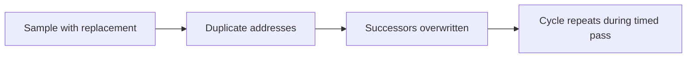

# Third review of plan-2026-11-02.md

**Short version:** The parser fix, process-group guard, and original-footprint per-thread rerun address major comments from the second review. Remaining problems include duplicate addresses in the new mixed chain, four incorrect fitted core positions, and a counter checker that accepts missing evidence. The saved counters support substantial memory traffic from streaming writes, but do not establish every claimed request count or exclude the home nodes as a bottleneck.

This review treats **“State at 04:45 UTC”** as authoritative. Earlier sections are history. It checks the current sources, the full run in [sudo-20261102T040631Z](results/sudo-20261102T040631Z/), and the corrected self-test in [sudo-20261102T043312Z](results/sudo-20261102T043312Z/). These comments replace the second review. All verification was local; no CRB workload was launched.

Terms: **L2** is a core's private cache. **SLC** is the mesh cache. A **home node** owns an address; a **proxy** can cache a remote-owned address locally. A **crosspoint** is a position on the mesh. **P1** means fix before relying on the affected measurement method. **P2** means fix before accepting the affected analysis or conclusion.

**1. P1 — The new mixed sampler breaks the single-walk requirement.**

The mixed sampler chooses addresses independently with replacement. `build_chain()` assumes distinct addresses and writes one successor at each address. A duplicate overwrites an earlier successor, so the chase can revisit a short cycle before completing its nominal 2,048 loads. This undermines the method's protection against learning a repeated chain. [homelat.c:1039](/home/jhan/workspace/titan/cache-perf/bench/homelat.c:1039), [chain construction:594](/home/jhan/workspace/titan/cache-perf/bench/homelat.c:594)



A local simulation reproduced the current no-perf path's random-number sequence, including eviction-buffer initialization. With a 32 MiB buffer, 2,048 selected entries contained **2,042 distinct addresses**. The seven chains first revisited an address after **1,113, 684, 451, 523, 828, 911, and 385 loads**. These are simulated chain properties, not hardware latency measurements.

**Correction:** sample without replacement within each node. Check that the selected addresses are unique and that a chain visits every selected address before returning to its start. This is a defect in the current mixed baseline; the saved 04:06 matrix predates this sampler change. It does not invalidate that matrix's per-node chains.

**2. P2 — The fitted core position is not necessarily the nearest slice position.**

The plan puts cores 34–35 and 98–99 at `(4,4)`, alongside the preceding pair. It acknowledges a core port at `(4,5)` without a populated slice. That position must still be a candidate for the requesting core. [plan:121](/home/jhan/workspace/titan/cache-perf/crb/plan-2026-11-02.md:121), [mesh map](results/cmn-map.txt)

I reproduced all 120 residuals in [core-positions.json](results/sudo-20261102T040631Z/core-positions.json) from the [latency matrix](results/sudo-20261102T040631Z/full/latency.csv). The saved fit uses the smaller of the two slice medians at each crosspoint, then fits `latency = intercept + slope × Manhattan distance`. Searching all 35 core-port positions with a positive slope changes exactly these four cores:

| Core | Saved position | Error at saved position, ns | Better position, inferred | Error there, ns |
|---|---|---:|---|---:|
| 34 | (4,4) | 1.436 | (4,5) | 0.715 |
| 35 | (4,4) | 1.447 | (4,5) | 0.735 |
| 98 | (4,4) | 1.446 | (4,5) | 0.729 |
| 99 | (4,4) | 1.445 | (4,5) | 0.743 |

Error is the root mean square difference between predicted and recorded latency. Across these cores, including `(4,5)` roughly halves the error:

```text
Fit error, ns; each block represents approximately 0.1 ns
Saved (4,4)   ██████████████  1.436–1.447 ns
Other (4,5)   ███████         0.715–0.743 ns
```

**Correction:** fit against core-port positions independently of slice positions. Save the fitting script and candidate list with the JSON. Label the result as an inferred core position. The absence of a slice at `(4,5)` does not justify placing its cores at `(4,4)`.

**3. P2 — “0 checks failed” does not establish complete counter data or measured background.**

`subtract.py` ignores nonnumeric counter rows, loops only over counters successfully parsed from the long run, and substitutes zero for an absent idle measurement. It also exits successfully after reporting failures. [subtract.py:23](/home/jhan/workspace/titan/cache-perf/bench/subtract.py:23), [checks:33](/home/jhan/workspace/titan/cache-perf/bench/subtract.py:33)

Local fault injection demonstrated two failures:

- Replacing a counter in both runs with `<not counted>` produced **“checks failed: 0”** and exit status **0**.
- Supplying counters that ran for 50% of the interval produced **“checks failed: 1”** but still exit status **0**.

The actual files contain the expected measurement-counter rows: 360 in `writebw.csv` and 96 in `crossmesh.csv`. However, the saved [crossmesh.csv](results/sudo-20261102T040631Z/crossmesh.csv) contains **no background block**. Its printed `bg/line = 0.0000` values are defaults, not measurements. The new Part 4 idle collection fixes future runs; it cannot validate the earlier file. [run_sudo.sh:104](/home/jhan/workspace/titan/cache-perf/bench/run_sudo.sh:104), [plan:114](/home/jhan/workspace/titan/cache-perf/crb/plan-2026-11-02.md:114)

**Correction:** derive required counters from each declared event set; require every expected counter in both runs and a valid matching idle control. Reject unsupported or uncounted rows and invalid intervals. Return a nonzero status on failure. Mark the saved cross-mesh rates as lacking measured background until a suitable control exists.

The blanket “background under 0.001 per line” also needs correction. The largest calculated correction in `writebw.csv` is **0.001152 events per line**, for the one-thread 1 GiB write case's SLC accesses. This is small, but the stated bound is false. **Insufficient data:** background rates for the saved cross-mesh event sets. [plan:124](/home/jhan/workspace/titan/cache-perf/crb/plan-2026-11-02.md:124), [writebw.csv](results/sudo-20261102T040631Z/writebw.csv)

**4. P2 — Request totals and bottleneck conclusions exceed the counter evidence.**

The cross-mesh result does not show “one write request and one memory request per line.” Running the supplied analysis gives these sums across both meshes:

| Writers | Write-request events per application line | Local plus remote memory-request events per application line |
|---|---:|---:|
| 64 on mesh 0 | 1.554 | 1.657 |
| 32 on each mesh | 1.522 | 1.974 |

These sums use separate event-set runs and are not counts of unique application writes. The distinction needs an explicit accounting of which transaction stages and request classes each event counts. The values above reproduce the script's current output before any missing cross-mesh background correction. [plan:129](/home/jhan/workspace/titan/cache-perf/crb/plan-2026-11-02.md:129), [crossmesh.csv](results/sudo-20261102T040631Z/crossmesh.csv)

The low fill counts and substantial memory-request counts support the narrower finding that these streaming writes largely bypass cache allocation and generate memory traffic. They do not establish the universal statement “every streamed write goes to memory.” Preserve the useful observation while qualifying that statement. [plan:128](/home/jhan/workspace/titan/cache-perf/crb/plan-2026-11-02.md:128), [writebw.csv](results/sudo-20261102T040631Z/writebw.csv)

Likewise, lower retry and throttle event rates show that those particular indicators fell. They do not exclude every home-node service limit. The Arm manual describes the retry event as reflecting inability to queue a request class; it is not a complete measurement of home-node utilization. [Arm CMN S3 manual, section 7.3.2, page 388](refs/arm-cmn-s3-r2p3-trm-107858.pdf)

**Correction:** replace “the home nodes are not where the collapse happens” with the measured statement about retry and throttle rates. Keep the bottleneck location unresolved. **Insufficient data:** event accounting that relates these counts to unique writes, and measurements that distinguish home-node, chip-link, and memory-controller limits.

**5. P2 — The empty control does not reproduce the timed measurement's cache state.**

The baseline takes consecutive counter snapshots before chain construction, filling, and eviction. The real interval takes its snapshots after reading an 8 MiB eviction buffer. Counter-read code and data can therefore encounter different cache states. The current subtraction does not establish that all remaining activity was triggered by the chase. [baseline:783](/home/jhan/workspace/titan/cache-perf/bench/homelat.c:783), [measurement:725](/home/jhan/workspace/titan/cache-perf/bench/homelat.c:725), [unsupported attribution:857](/home/jhan/workspace/titan/cache-perf/bench/homelat.c:857)

The corrected self-test is useful evidence: the two local homes report **1.061/0.030** and **1.079/0.005 accesses/misses per timed load**. It removes the earlier parser ambiguity. However, the recorded **1.38–1.86 L2 refills per timed load** still contain unexplained excess. The test uses 256-line sets; the full matrix uses 2,048-line sets. [corrected verify.csv](results/sudo-20261102T043312Z/selftest/verify.csv)

**Correction:** prepare the empty control with the same fill-and-evict sequence and timing calls. Retain raw deltas and each counter's baseline, then validate at the full matrix's 2,048-line size. Keep unexplained excess unassigned until this comparison exists. **Insufficient data:** the contribution of measurement overhead under the actual post-eviction cache state.

The latest 0.2 whole-mesh miss threshold accepts all four saved rows when evaluated locally. The recorded hardware run failed three of four under the earlier 0.1 threshold. The plan correctly says the new threshold was not rerun; retain that distinction. [run.log:31](/home/jhan/workspace/titan/cache-perf/crb/results/sudo-20261102T043312Z/run.log:31), [current predicate:861](/home/jhan/workspace/titan/cache-perf/bench/homelat.c:861)

**Corrections to the current record**

- **Node and chunk counts:** 127 nodes have 4,096 classified lines. Mesh 1 node `0xa0` has 4,095. Chunk 7 has 16,384 mesh-0 lines, 16,383 mesh-1 lines, and one unknown. Amend the “every node” and “each chunk” statements. [plan:116](/home/jhan/workspace/titan/cache-perf/crb/plan-2026-11-02.md:116), [nodes.csv](results/sudo-20261102T040631Z/full/nodes.csv), [chunks.csv](results/sudo-20261102T040631Z/full/chunks.csv)
- **Baseline units:** 78–97 means mesh-cache access events per empty window, not counter-read calls. Pass B performs six counter-read system calls per empty window. Rename the field and prose accordingly. [plan:134](/home/jhan/workspace/titan/cache-perf/crb/plan-2026-11-02.md:134), [calculation:848](/home/jhan/workspace/titan/cache-perf/bench/homelat.c:848)
- **Threshold wording:** the response to review item 2 still says 0.1 whole-mesh misses; the latest predicate uses 0.2. Make that response agree with the current threshold and its untested status. [plan:136](/home/jhan/workspace/titan/cache-perf/crb/plan-2026-11-02.md:136)

**Resolved comments and verification limits**

| Earlier concern | Current evidence and status |
|---|---|
| Grouped miss-counter parsing | Fixed: each leader is read once and members use separate positions. Closed-group bookkeeping is cleared. The new self-test reports unequal access and miss counts. |
| Missing run artifacts | Addressed: the full run and corrected self-test logs and CSVs are now present. |
| Guard leaves descendants or returns the wrong status | Fixed in the local wrapper-and-descendant test: exit status 3, descendant absent after shutdown. |
| Wrong footprint and independent per-thread best values | Addressed: the 3 MiB run retains per-repetition rows. Recalculation supports the reported group ranges and simultaneous totals. |
| Remote home confused with serving slice | Addressed in the current plan's proposed label, “latency by home group.” A particular proxy position remains an inference. |
| Contiguity and control-hit implementation | Current code checks every page frame and the control node's own delta. Record the source version with future runs so each saved result identifies the checks actually executed. |

Evidence: [group parsing:680](/home/jhan/workspace/titan/cache-perf/bench/homelat.c:680), [guard:25](/home/jhan/workspace/titan/cache-perf/bench/run_sudo.sh:25), [3 MiB per-thread results](results/followup3-20261102T031936Z/perthread-asmread-3M-40.csv), [control delta:542](/home/jhan/workspace/titan/cache-perf/bench/homelat.c:542), [page checks:1012](/home/jhan/workspace/titan/cache-perf/bench/homelat.c:1012).

Local calculations also confirm 15,360 per-node latency rows, median repeat spread **2.995%**, and 90th-percentile spread about **5.164%**. Those support the plan's rounded 3% and 5%. They establish repeatability of the recorded latency, not independent validation of its serving-cache interpretation. The capacity partition settings and specific proxy mapping remain unmeasured.
