# Asimov Firmware and OS Boot Specification

**Version:** 0.2 - Bringup-Sequence Alignment Draft

**Status:** Working Draft

**Date:** 2026-07-09

**Authors:** Positron AI - Accelerator Platform Software

**Related Architecture Decisions:** AD-011 (Boot Sequence), AD-023 (Security Model), AD-003 (M7 SCP Firmware)

---

## 1. Introduction

### 1.1 Purpose

This specification defines the firmware and operating system boot architecture for the ARM Compute Sub-System (CSS)
within the Asimov ML inference ASIC. It covers the complete boot chain from power-on through inference-ready state,
spanning the Cortex-M7 System Control Processor (SCP), C1-Nano Application Processor (AP) cores, and the Phoenix
host system.

### 1.2 Scope

This document covers:
- SCP firmware architecture, boot process, update mechanism, and runtime services
- AP initialization, OS loading, and bootloader architecture
- Security model for firmware and OS integrity
- Debugging and release management

This document does **not** cover:
- The runtime LLM inference workload on C1-Nano APs
  (see [Asimov CSS Software Spec](../css_software/css_software_spec.md))
- ASIC hardware architecture
  (see [Asimov System Architecture Specification](https://github.com/positron-ai/asimov_spec/blob/main/00_system_overview/asimov_system_spec.md))
- Detailed register-level programming (deferred to the Programmer's Model — PeakRDL-generated
  register guides and C/C++ headers published by the ASIC team from the RTL; see
  [Section 1.4](#14-outstanding-dependencies))

### 1.3 Audience

- Firmware engineers developing SCP and AP firmware
- Software engineers developing host-side tooling
- ASIC design engineers defining the SCP subsystem and memory map
- Security architects evaluating the boot trust chain

### 1.4 Outstanding Dependencies

The generated system address map defines addresses and node ownership. Firmware must use that map
for programming; address examples elsewhere in this document do not replace it.
[Section 7.1.5](#715-ocm-cold-boot-policy) defines the OCM boot policy.

The following items are required to complete this specification but are not yet available:

- [ ] **Interrupt map** — GIC SPI routing is now defined in RTL: the GIC-600 SPI collator takes a fully
  populated 128-line bundle (`gic_spi_in[127:0]` in `cmn.sv` — per-DSU 17-lane slots, MHU doorbell /
  TX-complete lines, AP UART, DMA-350, and design-block IRQs; see [Section 3.6](#36-nvic-and-interrupt-configuration)
  and [Section 11.5](#115-tf-a-platform-port)). Remaining: ASIC sign-off of the map and a consolidated
  interrupt-map table in the Programmer's Model.
- [ ] **Programmer's Model** — Register-level reference for the SoC. Delivery form: **PeakRDL
  register guides plus C/C++ headers generated from PeakRDL templates, published by the ASIC team
  directly from the RTL's SystemRDL sources** (e.g. `cmn_cfg_mgmt.rdl`, `cmn_dsu_mgmt.rdl`,
  `cmn_m7_reset_ctrl.rdl`), so the collateral cannot drift from the hardware. The
  `cmn_cfg_mgmt` / `cmn_dsu_mgmt` layout and addresses are summarized in
  [Section 7.3.1](#731-cmn-configuration-and-dsu-management-registers); once the generated
  headers are published, firmware should migrate its hand-maintained register macros
  (`scp_mmap.h`) to them.
- [ ] **ASIC team input on Credo memory-module integration** — The SCP-side access mechanism is
  now defined in RTL (Goldcrest APB tunnels over the HRA configuration plane —
  see [Section 7.1.4](#714-hra-configuration-plane) and [Section 3.5](#35-planned-modules));
  remaining inputs are the Goldcrest programming recipe against the real Credo vendor IP (the
  in-tree synthesis drop is an empty stub) and the per-block HRA config-mastership decision.
- [ ] **BMC-to-Asimov communication interface** — The mechanism by which the BMC
  on Galaxia accesses SPI flash and communicates with the Phoenix host for firmware updates.

### 1.5 Document Conventions

- **Investigation items** are marked with unchecked checkboxes: `- [ ]`
- Diagrams use embedded Mermaid for GitHub rendering
- Cross-references link to related sections within this document and to other specs
- References to Notion architecture decisions use the format AD-NNN

### 1.6 Related Documents

| Document | Link | Description |
|----------|------|-------------|
| Asimov System Architecture Spec | [positron-ai/asimov_spec — System Overview](https://github.com/positron-ai/asimov_spec/blob/main/00_system_overview/asimov_system_spec.md) | ASIC hardware architecture |
| CMN/CSS Spec | [positron-ai/asimov_spec — CMN/CSS](https://github.com/positron-ai/asimov_spec/blob/main/08_cmn_css/cmn_css_spec.md) | ARM CSS RTL-grounded spec |
| Asimov SCP Firmware | [positron-ai/asimov-scp-firmware](https://github.com/positron-ai/asimov-scp-firmware) | Wrapper repo with ARM SCP submodule |
| ARM SCP Firmware | [gitlab.arm.com/firmware/SCP-firmware](https://gitlab.arm.com/firmware/SCP-firmware) | Upstream SCP firmware framework |
| ARM Trusted Firmware-A | [trustedfirmware-a.readthedocs.io](https://trustedfirmware-a.readthedocs.io/) | AP-side boot firmware and PSCI |
| ARM SCMI Specification | ARM DEN0056 | System Control and Management Interface |
| ARM TBBR Specification | ARM DEN0006 | Trusted Board Boot Requirements |
| Asimov CSS Software Spec | [css_software_spec.md](../css_software/css_software_spec.md) | Runtime inference workload (placeholder) |

---

## 2. System Context

### 2.1 Asimov in the Titan Platform

Asimov is an ML inference ASIC designed by Positron AI, deployed as a PCIe endpoint device within the **Titan**
server platform. Each Titan server contains up to 4 Asimov ASICs mounted on **Galaxia** carrier cards, controlled
by an ARM-based **Phoenix** host CPU.

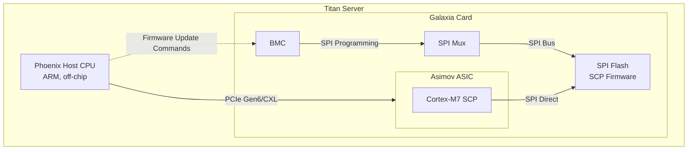

The Asimov ASIC features a dual-hemisphere architecture, each hemisphere containing:
- **Cortex-M7 SCP** — Boot core and system management processor
- **5x C1-DSU clusters** with 10 C1-Nano cores — Application processors for control plane
- **CMN-S3 mesh interconnect** — On-chip coherent fabric
- **GIC-600** — Interrupt controller
- **Inference engines** — See ASIC architecture spec

### 2.2 Execution Domains

The Asimov software architecture spans three CPU execution domains:

| Domain | Processor | Role |
|--------|-----------|------|
| **Phoenix Host** | ARM (off-chip) | API gateway, tokenization, batch scheduling, model loading, firmware updates |
| **Cortex-M7 SCP** | On-chip boot core | Power/thermal management, LPDDR init, PCIe endpoint init |
| **C1-Nano ARM AP** | 10 cores/hemi, CMN mesh | Recipe interpretation, CW generation, progress monitoring, KV cache, MoE routing |

> **Note:** A BMC on the Galaxia card is also a CPU execution domain. BMC firmware is TBD.

### 2.3 Boot Sequence Overview

The complete boot sequence from power-on to inference-ready state:

```mermaid
sequenceDiagram
    participant HW as Hardware Reset
    participant BL1 as SCP BL1<br/>(Mask ROM)
    participant BL2 as SCP BL2<br/>(RAM Firmware)
    participant PHX as Phoenix Host
    participant BMC as BMC (Galaxia)
    participant AP as C1-Nano APs

    HW->>HW: Preloader FSM: scrub all TCM ECC, CRC-check Boot ROM,<br/>copy Boot ROM → ITCM @ 0x30000
    HW->>BL1: CPUWAIT release, M7 fetches from ITCM @ 0x30000
    BL1->>BL1: Init UART (no SID/system-info — no Asimov RTL)
    BL1->>BL1: Copy BL2 from SPI flash to ITCM (size from image header)
    BL1->>BL2: Jump to RAM firmware

    BL2->>BL2: Init MPU, clocks, timers
    BL2->>BL2: Init CMN-S3 mesh; provision and read back OCM0–4
    BL2->>BL2: Init system DRAM (SMS Goldcrest link → off-chip LPDDR5X)
    BL2->>BL2: Init PCIe endpoint (controller + Cadence SD2002 PHY)

    Note over BL2,PHX: PCIe link established

    PHX->>PHX: Enumerate Asimov as PCIe device
    PHX->>BL2: Write OS+bootloader image to System DRAM via PCIe BAR
    BL2->>BL2: Set RVBAR for primary AP core
    BL2->>AP: Deassert AP reset (PPU power-on)

    AP->>AP: Boot TF-A BL31, then Linux
    AP->>BL2: SCMI handshake via MHU
    Note over BL2,AP: Runtime: SCMI services active
```

> **Note:** The exact boot ordering after SCP initialization — specifically when PCIe link training occurs relative
> to DRAM init — is formally an open question (AD-011). The standing rationale for the DRAM-before-PCIe ordering
> shown above: the OS-image load needs DRAM regardless of ordering, and clocking forces no ordering in either
> direction — the PCIe controller runs from its own reference clock and SerDes PLL, independent of the 2 GHz
> system PLL ([Section 3.5](#35-planned-modules)). The sequence above represents the expected flow but may be revised.

Regardless of the relative SMS-link and PCIe initialization order, the OCM cold-boot gate in
[Section 7.1.5](#715-ocm-cold-boot-policy) must complete before any SMS-backed access or PCIe link bring-up.

---

## 3. Cortex-M7 SCP Firmware

### 3.1 Role of the SCP

The System Control Processor (SCP) is a standard component in ARM Compute Sub-System (CSS) designs. It is the
first processor to execute after power-on and is responsible for:

1. **Platform initialization** — Clocks, power domains, CMN mesh interconnect, DRAM controller, PCIe endpoint
2. **AP core management** — Setting reset vectors (RVBAR), powering on/off cores and clusters via PPU
3. **Runtime system management** — Thermal monitoring (throttle/MPMM actuation), watchdog, power domain management
4. **Communication with AP** — SCMI protocol over MHU (Message Handling Unit) for AP ↔ SCP interaction

ARM provides an open-source SCP firmware framework on GitLab
([SCP-firmware](https://gitlab.arm.com/firmware/SCP-firmware)) that implements a modular, event-driven architecture
used by all ARM CSS reference platforms (RD-N2, RD-V1, RD-V3, Morello, Juno, etc.). Asimov uses this upstream
framework as its SCP firmware base.

### 3.2 ARM SCP Firmware Framework

The SCP firmware framework provides:

- **Event-driven runtime** — An infinite event loop that dispatches events to registered module handlers
- **Module system** — Pluggable modules with defined lifecycle phases (init → bind → start → runtime)
- **Inter-module APIs** — Typed API bindings between modules for service discovery
- **Hardware abstraction** — CMSIS-based HAL for ARM Cortex-M processors
- **Build system** — CMake-based, supports out-of-tree products via `PRODUCT_PATH`

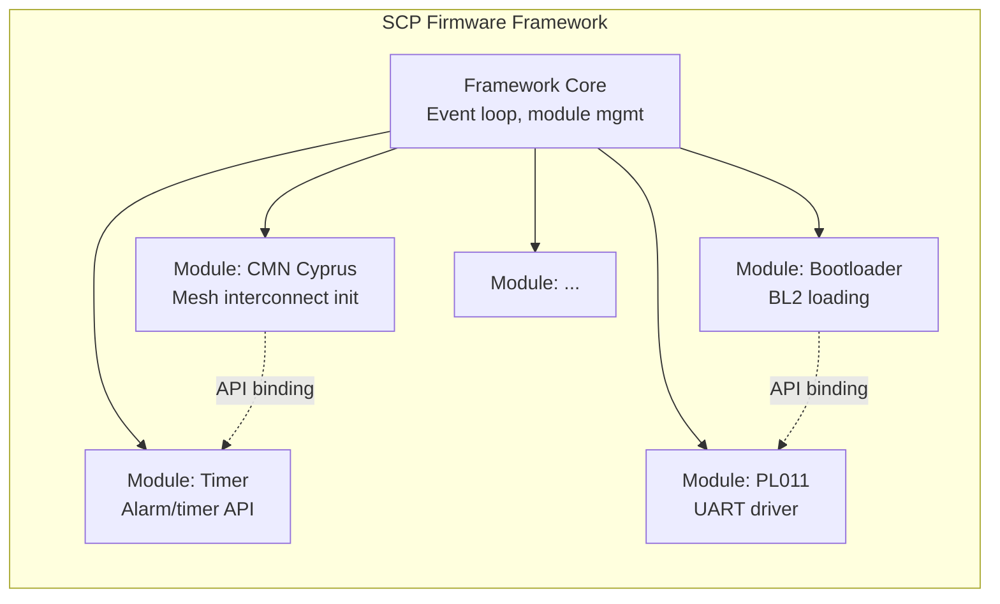

**Firmware lifecycle phases:**

```
1. Module init    — Each module initializes its internal state
2. Module bind    — Modules bind to APIs provided by other modules
3. Module start   — Modules register for events, start timers, enable interrupts
4. Runtime loop   — Event-driven: process events, handle SCMI, thermal, etc.
```

### 3.3 Modular Architecture

Each SCP firmware image is composed of a set of modules selected at build time via `Firmware.cmake`. Modules fall
into three categories:

| Category | Description | Examples |
|----------|-------------|---------|
| **Upstream (ARM)** | Standard modules from the SCP-firmware repository | `bootloader`, `pl011`, `cmn_cyprus`, `scmi`, `mhu3` |
| **Product-specific** | Configuration modules that bind upstream modules to Asimov hardware | `config_bootloader.c`, `config_cmn_cyprus.c`, `config_pl011.c` |
| **Custom (Positron)** | Modules written by Positron for Asimov-specific hardware | `asimov-system`, `asimov-gtimer`, `asimov-sysinfo`, `xspi`; planned: `asimov-pll`, `asimov-pcie`, `asimov-sensor`, `asimov-credo-dmc` |

### 3.4 Module Inventory

The full current module list for each firmware image; planned additions are covered in
[Section 3.5](#35-planned-modules). The authoritative build list is each image's `Firmware.cmake`
in the wrapper repository — the tables below annotate it with purpose and provenance.

**BL1 (ROM firmware — `scp_romfw`):**

| Module | Source | Purpose |
|--------|--------|---------|
| `pl011` | Upstream | UART driver for boot console output |
| `clock` | Upstream | Empty clock-framework stub — no clock elements (Asimov system clocks are externally fixed); kept only to satisfy compile-time references from upstream modules |
| `xspi` | **Custom** | Cadence xSPI boot-flash driver (`mod_cdns_xspi`; IP6522 controller + IP6184 PHY; DIRECT/XIP read through the 0x48000000 window) |
| `bootloader` | Upstream | BL2 image loading from flash to ITCM (product C trampoline `mod_bootloader_boot.c`) |
| `isys-rom` | Upstream | ROM trigger — initiates the bootloader copy sequence |

**BL2 (RAM firmware — `scp_ramfw`):**

Grouped by role. Initialization order is set by `Firmware.cmake`.

*HAL, identity, and timing:*

| Module | Source | Purpose |
|--------|--------|---------|
| `armv7m-mpu` | Upstream | ARMv7-M Memory Protection Unit configuration |
| `pl011` | Upstream | UART driver |
| `clock` | Upstream | Empty clock-framework stub — no clock elements (Asimov system clocks are externally fixed); kept only to satisfy compile-time references from upstream modules (e.g. `mod_cmn_cyprus`) |
| `asimov-gtimer` | **Custom** | Folded-frame Generic Timer driver — drives the single folded CNTBase0 frame at `0x44005100` (replaces the stock `gtimer`, which expects separate CNTControl/CNTCTL/CNTBase register windows that do not exist in the silicon) |
| `timer` | Upstream | Timer framework (alarm API) |
| `system-info` | Upstream | System information framework (fed by the shim below) |
| `asimov-sysinfo` | **Custom** | Compile-time identity shim — `sid`/`pcid` were dropped (no Asimov SID/System-PIK RTL); feeds `mod_system_info` a fixed `chip_id=0` and loudly WARNs that the SoC identity is SPOOFED |

*Interconnect:*

| Module | Source | Purpose |
|--------|--------|---------|
| `cmn-cyprus` | Upstream | CMN-S3 (Cyprus) mesh discovery and RNSAM programming |

*AP communication:*

| Module | Source | Purpose |
|--------|--------|---------|
| `mhu3` | Upstream | MHUv3 hardware driver (doorbell channels) |
| `transport` | Upstream | SCMI shared-memory transport (SMT) HAL |
| `scmi` | Upstream | SCMI protocol dispatcher |
| `sds` | Upstream | Shared Data Structures — platform info published to TF-A |

*Power and AP core release:*

| Module | Source | Purpose |
|--------|--------|---------|
| `apcontext` | Upstream | Zero-initializes the AP context area in shared SRAM before AP release |
| `power-domain` | Upstream | Hierarchical power state machine (system / cluster / core) |
| `ppu-v1` | Upstream | PPU register driver — drives DSU-internal cluster and core PPUs |
| `mock-ppu` | Upstream | Stub PPU element for SYSTOP — unblocks composite-state cascade (see [Section 7.3.1](#731-cmn-configuration-and-dsu-management-registers)) |
| `system-power` | Upstream | SYSTOP-level power domain management |
| `asimov-system` | **Custom** | Boot orchestrator — programs RVBAR, drives composite power-on for the primary core |

*SCMI protocol handlers (consumed by TF-A BL31 at AP boot, then by Linux at runtime):*

| Module | Source | Purpose |
|--------|--------|---------|
| `scmi-power-domain` | Upstream | PSCI cpu_on/cpu_off via SCMI Power Domain protocol (0x11) |
| `scmi-system-power` | Upstream | System reboot/shutdown via SCMI System Power protocol (0x12) |
| `scmi-apcore` | Upstream | SCMI AP-Core protocol (0x90) — BL31 sends RESET_ADDRESS_SET to publish the AP entry point; module writes the per-DSU RVBAR slots in `cmn_cfg_mgmt` (one 64-bit LO/HI slot per DSU — RVBAR is shared by both PEs in a DSU) |

*Watchdog:*

| Module | Source | Purpose |
|--------|--------|---------|
| `sp805` | Upstream | SCP self-watchdog (CMSDK APB WDT, register-compatible with SP805) |

### 3.5 Planned Modules

Most modules are upstream ARM code. Four custom Positron modules exist today (`xspi`,
`asimov-gtimer`, `asimov-sysinfo`, `asimov-system` — [§3.4](#34-module-inventory)) and four more are
planned: `asimov-pll`, `asimov-sensor` (plus the upstream thermal stack: `thermal_mgmt`,
`pid_controller`, `sensor`, `scmi_sensor`), `asimov-credo-dmc`, and `asimov-pcie`.

**`asimov-pll`** — boot-time PLL driver for both product clocking modes. PLL ownership is a
**board-dependent source election**. The CAR `BMC_Use_W/E` straps select a configuration source;
they are not a BMC data path. With both straps low and no M7/JTAG override, CAR selects its
autonomous **Fixed** recipe. The FSM starts the PLL and waits for LOCK or timeout, but **does not
switch `clk_core` to the PLL output**: Fixed holds `BYPASS2=1`, `SEL1=1`, and `DSEL0=0`, selecting
the 100 MHz reference clock. Even after LOCK asserts, M7/JTAG programming is required to select
the fast clock. With exactly one strap high, the selected M7 owns configuration from POR and must
program the PLL before downstream reset release can complete. Both straps high select Fixed
ahead of M7 VLD, so that combination cannot use ordinary M7 takeover. JTAG direct control has
higher priority than the straps; the board's supported source policy must account for this.

Firmware reads the CAR serial status word (word 0: `{LOCK, pll_cfg_sel, BMC_Use_W/E}`) through
`cmn_m7_pll_agent` at `0x44080000`; responses land in its RXDATA registers. The driver must:

1. Identify the selected source and current clock configuration. On a cold boot the reference
   supplies `clk_core`; the CMN dividers then give M7 `hclk` = 50 MHz and peripheral
   `pclk` = 5 MHz. The nominal 1 GHz / 100 MHz rates apply only at a 2 GHz root. Early UART
   divisors and timeouts must use the rate in effect, including across a later clock switch.
2. For takeover of a running Fixed PLL, preload the compatible running recipe and mux settings
   with PLL `RESET=0` and `BYPASS=0` **before asserting M7 VLD**. Selecting the agent's reset
   defaults would reset the PLL, drop LOCK, and reassert downstream resets. Intentional PLL
   reset/reprogramming requires a corresponding subsystem reinitialization policy.
3. Configure the per-chip target (e-fuse binning field or flash parameter block),
   confirm lock, satisfy the repair-before-fast-clock dependency in [§4.5](#45-redundancy-configuration-tws-and-spm),
   and explicitly sequence the clock switch, including any required in-rush ramp.
4. Establish the **selected output rate** from source, mux and divider configuration before
   publishing the AP boot-info struct. LOCK alone is insufficient: Fixed normally has LOCK=1
   while `clk_core` remains at 100 MHz. CAR's frequency monitor samples `clk_div_fnl`, which is
   the unselected branch when `BYPASS2=0`; its count alone is not a measurement of `clk_core`.

`RESET_STATUS.pll_locked` and the downstream reset-release interlock use the CAR LOCK
signal ([§8.6](#86-reset-arbitration)). M7 is separate from those 17 managed resets and can run
from the reference clock while the PLL is unlocked. An SCP warm reset does not reset CAR's
configuration: the driver must inspect retained clock/source state rather than assume cold entry.
The source-selection, ramp and repair policies are described in the
[open items](#731-cmn-configuration-and-dsu-management-registers).

RTL references: [CAR clock selection and measurement](https://github.com/Positron-AI-TSMC/asimov/blob/main/design/top/car/rtl/car_top.sv),
[CMN clock division](https://github.com/Positron-AI-TSMC/asimov/blob/main/design/css/cmn/rtl/cmn_outer_rib2.sv),
and [reset control](https://github.com/Positron-AI-TSMC/asimov/blob/main/design/css/cmn/rtl/cmn_m7_reset_ctrl.sv).

There is deliberately no DVFS module set: Asimov runs at a single Operating Point with no runtime
DVFS per the PTCR Plan of Record — see [§8.4](#84-power-management-strategy) for the full rationale.

- [ ] **Investigation: Goldcrest / system-DRAM bring-up module** — System DRAM sits at the far end of the
  Credo Goldcrest SerDes link: the SMS slice of XMS (Goldcrest pairs 16–17) carries the boot-critical
  system-DRAM lanes, and the LPDDR5X memory controller is off-chip on the memory module — there is no on-die
  DRAM controller, PHY, or training engine (`ip/goldcrest/Goldcrest_ip.sv`). The access mechanism is defined
  in RTL: per-pair Goldcrest APB tunnels reached over the HRA configuration plane
  ([§7.1.4](#714-hra-configuration-plane)) via the two SMS taps, populated-channel discovery via stuffing
  IDs, per-pair completion status in `gc_init_complete_sts` (`xms_csr.rdl`), and deeper link state behind
  the PHY APB. **Division of labor:** the SCP programs only the SoC-side (Asimov) Goldcrest SerDes;
  the memory-module far end — the module-side Goldcrest SerDes and the LPDDR5X memory controller —
  is programmed by the **BMC** and is out of SoC-firmware scope. A custom SCP module
  (`asimov-credo-dmc`) drives the SoC side at boot for the SMS slice
  ([§4.3](#43-bl2--ram-firmware) step 6) — still a critical-path item for AP boot (system DRAM must be up
  before the host can load the OS image). Remaining open: the SoC-side programming recipe against the
  real Credo vendor IP (the in-tree synthesis drop is an empty port-list stub), per-block HRA config
  mastership ([§7.1.4](#714-hra-configuration-plane)), and the BMC far-end-ready handoff
  ([§5.4](#54-boot-failure-detection)) — without a signal, link-training retries cannot distinguish a
  far end the BMC has not yet programmed from a dead module, which shapes the timeout and
  error-reporting policy.

- [ ] **Investigation: Goldcrest firmware ownership and recovery contract (SMS/XMS/C2C)** — The
  boot-critical SMS path assigns its SoC-side initialization to the SCP, while ownership of the
  XMS weight-memory and C2C instances is unresolved. C2C exposes software-driven Goldcrest MCU
  reset, indirect APB access, and multicast writes for bulk firmware download, but the architecture
  does not yet assign the M7 SCP, AP software, or Phoenix host as its owner. Define image custody
  and version compatibility, the per-instance cold-boot sequence, and the retention/reload matrix
  for warm reset, subsystem reset, MCU reset, link loss, and retraining. Cold power-up requires a
  firmware download and an MCU-SRAM uncorrectable ECC error requires reload; a link-down/link-up
  event alone is not currently specified to erase MCU SRAM or require another download. XMS and
  C2C initialization are not AP-boot prerequisites for a single-chip system and must not be
  conflated with the boot-critical SMS system-DRAM path.

- [ ] **Investigation: PCIe endpoint module** — A custom SCP module (`asimov-pcie`) is
  needed to configure the Cadence SD2002 PHY and endpoint controller. This dedicated PCIe SerDes
  tree runs from its own reference clock and PLL and is not part of the Goldcrest links used by
  XMS, SMS, and C2C. The configuration surface is the PCIe AXI-Lite fan-out
  (`design/pcie/registers/pcie.rdl`) reached through the HRA plane. Cold boot loads firmware into
  the PHY's top- and lane-level microcontrollers before PHY reset release. The wrapper reset
  sequencer does **not complete unattended**: firmware-load-done and link-training-enable are
  software CSR bits that reset to zero, the sequencer waits at firmware load with no timeout, and
  link training is hard-gated by its enable bit. Firmware must perform both explicit writes or the
  host never enumerates the device. Open: whether silicon needs the delivered PHY firmware, its
  image source and custody, and the M7 load procedure. No upstream PCIe module exists; every Arm
  SCP platform implements its own.

### 3.6 NVIC and Interrupt Configuration

The Cortex-M7 NVIC is configured at silicon time via Socrates parameters that determine how many external interrupt
lines, priority levels, and ancillary capabilities are implemented in hardware. These cannot be changed
post-tapeout (ARM DIT0034H, IIM Table 2-1). The values below reflect the current RTL: the 2026-05-04 Cortex-M7
regen (`asimov` `b93ea788b`, "FPU=1, ETM=1, WIC=0, MPU=16, IRQNUM=64, RAR=2") as subsequently amended by a
Socrates Catalog update (`asimov` `704368824`) that **reverted FPU to 0**. The interrupt table below also
reflects the removal of the per-core wake lanes (`asimov` `316e71e2d`).

| Parameter | Value | Description |
|-----------|:-----:|-------------|
| **IRQNUM** | **64** | Number of external interrupt lines (IRQ[0]…IRQ[63]). Ten lines are physically driven today (IRQ[0],[2],[3],[4],[5],[16],[17],[18],[29],[30] — see the assignment table); the rest are reserved for future expansion (PCIe MSI-X, PPU state, thermal). |
| **IRQLVL** | **3** | Bits of interrupt priority. 3 bits = 8 priority levels. |
| **WICLINES** | n/a | WIC disabled (`WIC=0`) — no power-gating-aware wake path is planned for the M7 in this design. |
| **MPU** | **16** | MPU regions. Firmware uses ≲3 today; remaining regions are headroom. |
| **FPU** | **0** (Socrates Catalog) | No FPU in the silicon configuration: the Socrates Catalog update following the interim FPU=1 regen (`b93ea788b`) removed the FPU (`asimov` `704368824`). The in-tree Cortex-M7 delivery still carries FPU=1 pending the next IP regen sync, with the FPU exception outputs left unconnected; the former `IRQ[6]` exception OR is gone, freeing that lane. SCP firmware builds soft-float (`__FPU_PRESENT=0`). |
| **CTI** | **1** | Cross Trigger Interface present for CoreSight integration. |
| **ETM** | **1** | ETM-MI trace path retained; ETM-MD path retired. |
| **RAR** | **2** | `CORTEXM7+CSETMM7` async-reset configuration (synthesis-only; no firmware impact). |

**IRQ assignments — current RTL** (2026-06-16; authoritative source:
`asimov/design/css/cmn/rtl/cmn_m7_subsys.sv` IRQ-assignment block):

| IRQ | Source | Notes |
|-----|--------|-------|
| `NMI` | CMSDK Watchdog *bark* (`WDOGINT`) | 2-flop CDC sync from `clk_ref` (100 MHz) → `hclk` (1 GHz). Routed to NMI rather than a maskable IRQ so SCP firmware cannot lose it under interrupt-disable critical sections. Bite path is separate — see [§8.6](#86-reset-arbitration) |
| `IRQ[0]` | PL011 UART (combined `UARTINTR`) | |
| `IRQ[1]` | tied 0 | Freed — the PL022 `spi_intr` lane was removed when the boot flash controller moved to Cadence xSPI; reserved for future use |
| `IRQ[2]` | Cadence xSPI (`xspi_int`) | Boot-flash controller completion/error IRQ. Replaced the WDOG bark (moved to NMI) on this lane |
| `IRQ[3]` | SCP `CNTBase0` generic-timer frame compare (`scp_timer_irq`, frame folded into `cmn_m7_reset_ctrl`) | Drives the SCP firmware tick / event loop |
| `IRQ[4]` | MHU-320AE inst 1 `MBX` combined IRQ (AP→SCP RX doorbell) | `MHU_INST1_MBX_IRQ` in `fmw_cmsis.h`; hi-priority RPC critical path. Routed from the MHU's MBX combined-IRQ output (SCP-side window `0x4404_0000`, 128 KB) |
| `IRQ[5]` | MHU-320AE inst 2 `PBX` combined IRQ (SCP→AP TX-complete) | `MHU_INST2_PBX_IRQ` in `fmw_cmsis.h`. RTL-wired but unused by the SCP firmware: the bidirectional `mod_mhu3` element completes its postbox writes synchronously over M7 AHB, so a TX-complete IRQ adds no information. Retained in the NVIC enum so the line number stays reserved against future use |
| `IRQ[15:6]` | tied 0 | Reserved. `IRQ[6]` carried the FPU exception OR before FPU removal; now free. |
| `IRQ[16]` | GIC-600 `fault_int` (RAS) | Firmware-first RAS per GIC-600 TRM §3.16.5; 2-flop CDC from 2 GHz GIC clock. RAS path goes through the M7 (not GIC SPI[6:4]) because the SCP does not receive normal GIC interrupts |
| `IRQ[17]` | GIC-600 `err_int` (RAS) | Same path |
| `IRQ[18]` | GIC-600 `pmu_int` (RAS) | Same path |
| `IRQ[28:19]` | tied 0 (removed) | Formerly `gic_wake_request[9:0]` (per-core wake). Removed by `asimov` `316e71e2d`: wake now drives `DSU.COREWAKEREQUEST` directly (C1-DSU CIM §9.5), so the SCP NVIC no longer observes per-core wake. SCP firmware installs no wake-sync handlers. |
| `IRQ[30:29]` | M7 CTI `CTIIRQ[1:0]` | Cross-trigger interrupt requests from the M7's built-in CTI (level-asserted until CTI INTACK; ETR/ETF trace-buffer servicing). Firmware handling is bounded by the missing M7→debug-APB INTACK path — see [§10.2](#102-jtag-and-coresight-debug). |
| `IRQ[31]` | tied 0 | Reserved |
| `IRQ[63:32]` | tied 0 | Reserved (post-2026-05-04 IP regen headroom) |

**Per-DSU peripheral interrupts go to the AP-side GIC, not the M7 NVIC.** The 5×17 per-DSU SPI map
(the `gic_spi_in[127:0]` concatenation in `cmn.sv`, `NUM_SPIS=128`) carries cluster `CRIT/ERR/FAULT`,
core `ERR/FAULT`, CME `ERR/FAULT`, complex `ERR/FAULT`, `MPAM_NS/S`, cluster `PMU`, `COMM`, and CTI lanes for
the Cortex-A AP cores via the GIC-600 distributor. The full SPI numbering is enumerated in
[§11.6 AP Interrupt Sources — GIC SPI Map](#116-ap-interrupt-sources--gic-spi-map).

**IRQLVL = 3** (8 priority levels) is sufficient for the SCP's interrupt priority tiers:

| Priority Tier | NVIC Priority | Sources |
|--------------|:------------:|---------|
| Critical | 0 (highest) | NMI (watchdog bark), thermal emergency |
| High | 1–2 | MHU INST1 RX doorbell (`IRQ[4]`), RAS `fault_int` / `err_int` (`IRQ[16]` / `IRQ[17]`) |
| Medium | 3–4 | Timers, PPU state changes |
| Low | 5–7 | PMU events, diagnostics |

> **Note:** The GIC-600 handles interrupts for the C1-Nano AP cores and is a completely separate interrupt
> controller. This section covers only the M7 SCP's NVIC — the interrupts wired directly to the M7
> `INTISR[0..N]` lines by the ASIC.

- [ ] **Open: ASIC sign-off on the M7 interrupt map.** The current map is inferred from RTL + commit
  messages; there is no separate ASIC architecture document publishing it (or the AP-side per-DSU
  128-lane GIC SPI map) as an authoritative interface contract.

---

## 4. SCP Boot Process

### 4.1 Two-Stage Boot Architecture

Asimov uses a two-stage boot following the standard ARM CSS pattern for platforms without an RSS (Runtime Security
Subsystem).

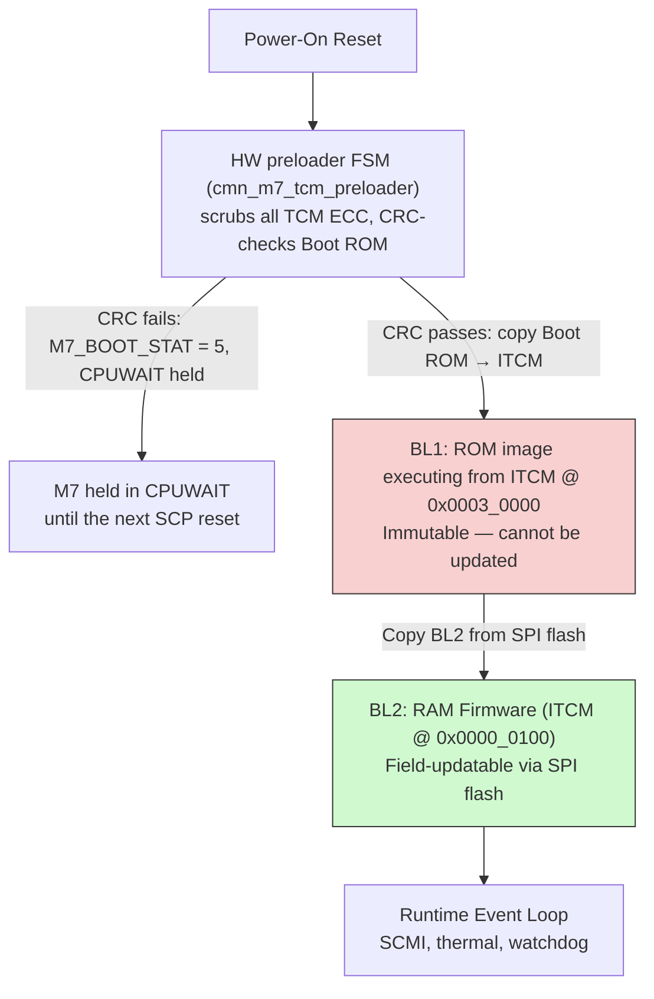

**Stage 1 (BL1):** stored in the 64 KB Boot ROM at `0x0008_0000` but **executed
from ITCM at `0x0003_0000`**. The M7 cannot instruction-fetch from the ROM bus
(a Code-region fetch routes over ITCM/AXIM only, never AHBP — Cortex-M7 TRM
DDI 0489F Table 2-1), so at reset a hardware preloader FSM (asimov
`cmn_m7_tcm_preloader.sv`) holds `CPUWAIT`, zero-initialises **all** ITCM and
DTCM (TRM §5.8.5 — TCM ECC requires written-before-read; combined with the
`INITRMWEN=2'b11` strap that read-modify-writes every sub-word TCM store),
checks the ROM image's CRC-32 in parallel with that scrub (see
[Boot ROM image and integrity check](#boot-rom-image-and-integrity-check)),
copies the ROM image into the ITCM tail at `0x0003_0000`, straps
`INITVTOR = 0x0003_0000 >> 7 = 25'h600`, then releases the core. BL1 copies
BL2 from SPI flash to ITCM (load size taken from the mandatory image-size
header at flash offset 0), then jumps to BL2. **Cannot be updated after
tapeout** — all code must be correct and minimal.

**Stage 2 (BL2):** RAM firmware loaded into ITCM at offset `0x0000_0100`
within the architectural ITCM window (Cortex-M7 ITCM itself is hardwired at
`0x0000_0000` per TRM DDI 0489F §5.6.1 and cannot be relocated; BL2's vector
table starts at offset `0x100` within ITCM). The 256-byte gap between
`0x0000_0000` and BL2's vectors keeps the upstream `mod_bootloader`'s
defensive `destination_base != 0` invariant satisfied so we use the ARM
SCP-firmware bootloader unmodified. The gap is zero-filled by the hardware
preloader's TCM scrub (Cortex-M7 TRM §5.8.5), so speculative fetches into it
remain ECC-clean. Contains all platform initialization and runtime services.
**Field-updatable** via SPI flash reprogramming.

Custom Positron code should be kept out of BL1 to the greatest extent possible. Since BL1 cannot be changed after
tapeout, it should use upstream ARM modules exclusively.

### 4.2 BL1 — Mask ROM Firmware

BL1 performs the minimum operations needed to load BL2:

1. Initialize UART for boot console output (`pl011`)
2. Bring up the Cadence xSPI controller and switch it to DIRECT (XIP)
   single-lane read, mapping the SPI flash into the XIP window at
   `0x48000000`.
3. Read the 12-byte image-size header at SPI flash offset 0 (magic `"ASCP"`,
   `image_size`, `check = magic ^ size ^ 0xA5A5A5A5`) through the XIP window.
   The header is **required**: every image producer writes it, so a
   missing/invalid header means the flash was not provisioned by our tooling
   and BL1 refuses to boot (ERR + park) rather than jump into unknown bytes.
4. Copy `image_size` bytes of BL2 from SPI flash offset `0x100` (XIP address
   `0x4800_0100`) to ITCM offset `0x0000_0100` (see §4.4 for the rationale on
   the offset). The header, pad, and image are all read through the XIP
   window. The XIP window must be accessed with **aligned 32-bit loads**:
   byte-sized loads return corrupted data (the controller fetches a wider
   beat and duplicates the even-byte lane), so BL1 issues word-aligned
   32-bit loads and unpacks bytes in software for unaligned offsets.
5. Jump to BL2 entry point

**BL1 does NOT:**
- Zero-initialize TCM ECC (the hardware preloader's ZERO phase scrubs all
  ITCM and DTCM before the core is released, and `INITRMWEN=2'b11` keeps
  sub-word stores ECC-safe — TCM init costs zero M7 instructions; the
  former `tcm_init.c` firmware scrub was removed as redundant)
- Initialize system identification (`sid`/`system_info`/`pcid` were dropped
  — Asimov has no SID/System-PIK RTL; BL2 carries a compile-time
  `asimov_sysinfo` shim that loudly WARNs the identity is spoofed)
- Initialize clocks, CMN, DRAM, or PCIe (those are BL2 responsibilities)
- Perform cryptographic verification of BL2 (see [Section 6.2](#62-scp-firmware-trust-chain))
- Implement any recovery logic (recovery is delegated to the BMC — see [Section 5.3](#53-recovery-architecture))

**Size budget:** BL1's code, read-only data and initialized-data load image must fit the 65,532-byte ROM payload;
the final ROM word is reserved for the image CRC (below). The BL1 link region ends at the payload size, so an
oversized BL1 fails to link. Current builds fit with headroom (newlib is the dominant consumer). Exact per-build sizes
are a build artifact, not a spec property.

#### Boot ROM image and integrity check

The boot ROM is 16,384 × 32-bit words (64 KiB). Its image is laid out as:

| ROM byte offset | Size | Contents |
|:---------------:|:----:|----------|
| `0x0000`–`0xFFFB` | 65,532 B | BL1 flat binary (vector table at offset 0), zero-padded to 65,532 bytes |
| `0xFFFC`–`0xFFFF` | 4 B | CRC-32/ISO-HDLC of bytes `0x0000`–`0xFFFB`, padding included, stored little-endian |

The CRC is the standard zlib/Ethernet CRC-32: polynomial `0x04C11DB7` (reflected `0xEDB88320`), initial value
`0xFFFFFFFF`, reflected input and output, final XOR `0xFFFFFFFF`. It covers the whole padded payload, not just the
linked sections, so every ROM deliverable (release and debug images, and the manufacturing ROM-programming image) must
be generated from the same padded bytes. The firmware build produces the complete 64 KiB image alongside the raw BL1
binary.

While it scrubs the TCMs, the preloader reads every ROM word in address order, CRC word included, and feeds each word
into the CRC low byte first, least-significant bit first. A valid image leaves the raw (uncomplemented) CRC register at
the residue `0xDEBB20E3` (equivalently, the zlib CRC-32 of the complete 64 KiB image is `0x2144DF1C`). Only then does
the preloader copy the ROM into ITCM. The copy includes the CRC word, which lands at ITCM `0x0003_FFFC` and has no
runtime role. On a mismatch the preloader:

- publishes `CRC_FAILED` (`0x5`) in `M7_BOOT_STAT` ([§10.4](#104-boot-status-register));
- never starts the copy, and holds `CPUWAIT` with the load-done indication low;
- stays in that state until the next SCP reset (POR or M7 warm reset), which re-runs the full check.

No firmware runs after a CRC failure, so firmware cannot report it; the failure is visible only through
`M7_BOOT_STAT` ([§5.4](#54-boot-failure-detection)). The ROM-bypass (JTAG side-load) boot path does not use the
physical ROM and skips the check, keeping its existing transfer format; entering it after a failed normal boot requires
a reset with bypass selected. The physical ROM can also be read back over the hemisphere's private JTAG TAP, including
after a CRC failure, and compared byte-for-byte with the golden image.

#### BL1 → BL2 handoff: INITVTOR, VTOR, and the reset vector

Three distinct things are easy to conflate. The handoff between BL1 and BL2 only makes sense once they're
separated:

| Term | What it is | Mutable at runtime? |
|---|---|---|
| **`INITVTOR`** | A 25-bit hardware *strap* (input port on the Cortex-M7). Sampled exactly once at reset. Its only job: set the initial value of the `VTOR` register. | No — strap, sampled once at reset and forgotten. |
| **`VTOR`** | A software-writable register inside the System Control Block at `0xE000_ED08`. Holds the current address of the vector table. The CPU dereferences `VTOR` for every exception fetch (reset, IRQ, fault, etc.). | Yes — software writes it any time. |
| **The "reset vector"** | Entry 1 of the vector table itself: 4 bytes at `[VTOR + 0x04]` containing the address of the reset handler. (Entry 0 is the initial stack pointer.) | Indirectly — by changing what `VTOR` points at. |

**Hardware reset sequence** (Cortex-M7 TRM DDI 0489F §3.4.18):

1. Hardware loads `VTOR = INITVTOR << 7`.
2. CPU reads SP from `[VTOR + 0x00]` (initial stack pointer).
3. CPU reads PC from `[VTOR + 0x04]` (the reset vector — address of the reset handler).
4. CPU starts executing at that PC.

After step 1 the strap has done its job. `INITVTOR` does not affect anything else for the rest of the
run; all subsequent exception fetches go through `VTOR`.

**Handoff mechanics.** BL1 cannot change `INITVTOR` (it's a strap), but `VTOR` is just a memory-mapped
register. Before BL1 branches into BL2, it rewrites `VTOR` to point at BL2's vector table — so when
interrupts, faults, etc. fire under BL2, the CPU fetches BL2's handlers, not the now-stale BL1 handlers
in the ITCM tail at `0x0003_0000`.

This is what the product's C trampoline (`mod_bootloader_boot`, replacing the upstream assembly)
does: it streams BL2 from flash into ITCM at the destination base via the xSPI driver, **writes
`VTOR` to the destination base** to relocate the table, then loads SP from `[base + 0x00]` and
branches to `[base + 0x04]`. After that, the CPU is running BL2 with `VTOR` pointing at BL2's
table.

**Asimov boot timeline:**

```
Power-on:
  Preloader FSM holds CPUWAIT: zero-scrubs ALL ITCM + DTCM (ECC init) while
  CRC-checking all 64 KB of Boot ROM (on failure: M7_BOOT_STAT = 5, core held),
  copies Boot ROM (0x00080000) → ITCM tail (0x00030000), releases the core
  INITVTOR strap = 0x00030000 >> 7 = 25'h600  (latched at reset deassertion)
  Hardware sets VTOR = 0x00030000
  CPU reads SP from [0x00030000], PC from [0x00030004]
  → starts running BL1 from ITCM

BL1 runs:
  Bring up Cadence xSPI in DIRECT/XIP read (flash mapped at 0x48000000):
  parse the 12-B image-size header at flash offset 0,
  copy image_size bytes of BL2 from flash 0x100 to ITCM at 0x00000100
  (no TCM scrubbing — the preloader already ECC-initialized everything)

BL1 hands off (inside mod_bootloader_boot trampoline):
  *(&SCB->VTOR) = 0x00000100         ← rewrite VTOR
  SP = *(uint32_t *)0x00000100
  PC = *(uint32_t *)0x00000104       ← BL2's reset handler address
  → branch — now running BL2

BL2 runs:
  All exception fetches now go via VTOR=0x00000100 → BL2's vector table
  INITVTOR is irrelevant from this point on — strap stays latched but unread
```

Silicon ships with `INITVTOR` strapped to `25'h600` (ITCM `0x0003_0000`, the preloader's copy
destination). Development/CI boot recipes live in the firmware repository, not this spec.

#### BL2 vector-table alignment

BL2's load offset of `0x100` is governed by two binding constraints:

1. **`INITVTOR` encoding granularity** (Cortex-M7 TRM §3.4.18). The strap is applied as
   `boot_vector_address = INITVTOR << 7`, so any non-zero target must be `0x80`-aligned. **Minimum
   non-zero alignment = 128 B.**
2. **Vector-table base alignment** (ARMv7-M ARM DDI 0403E.b §B3.2.5):
   *"The vector table base is aligned to a power-of-2 boundary, where the alignment value is greater
   than or equal to (number of exceptions supported × 4), and at least 32 words (128 bytes)."*

BL2's static vector table carries only the 16 architectural system exceptions (64 B); NVIC interrupt
vectors live in a runtime-allocated table sized from `SCnSCB->ICTR` by the framework's
`arch_interrupt_init`, which relocates `VTOR` after entry. The static table therefore requires only
the architectural 128 B minimum. Silicon implements `IRQNUM = 64` (the 32-lane `m7_irq` bundle
drives ten lines today — see [§3.6](#36-nvic-and-interrupt-configuration)); the runtime table's
alignment is satisfied at
allocation and does not constrain the load offset.

Combined: BL2 must land at an address that is `0x80`-encodable for `INITVTOR` and at least
128 B-aligned for the static table. `0x100` is that minimum rounded up one power of two for headroom;
the load offset does not change if the wired IRQ count grows.

### 4.3 BL2 — RAM Firmware

BL2 is the main SCP firmware. It initializes all platform hardware and then enters the runtime event loop:

**Clock/repair ordering:** step 3 may establish PLL lock while leaving the output on the reference.
The fast-clock transition must wait for required repairs, including any dependencies resolved in step 5;
the numbered table does not authorize an earlier switch. Low-speed reset release needed by configuration
receivers must not admit functional traffic. The final per-macro repair mechanism remains an open item.

| Step | Operation | Modules | Description |
|:----:|-----------|---------|-------------|
| 1 | MPU configuration | `armv7m_mpu` | Configure memory protection regions for TCM, peripherals, and AXI-mapped memory |
| 2 | eFuse read (planned) | custom (planned) | Read the per-corner eFuse arrays (four instances, one per die corner: NE/NW/SE/SW) and stage per-chip content for later steps: the TWS/SPM redundancy images (step 5, [§4.5](#45-redundancy-configuration-tws-and-spm)) and the per-chip PLL binning target (step 3). **Dependency:** the eFuse macro and read path are not yet in RTL — `corner_efuse.sv` is a combinational placeholder, `efuse_req` is tied 0 at every driver (`css_top_wrapper.sv:866`), and no SCP-visible read/status CSR exists. See the [§4.5](#45-redundancy-configuration-tws-and-spm) open items for the fuse front-end, the separate per-macro SRAM-repair distribution, and the repair-before-2 GHz ordering question. |
| 3 | PLL ownership and low-speed preparation; gated fast-clock transition | `asimov_pll` (custom) | Follow the source-election and takeover sequence in [§3.5](#35-planned-modules). Fixed starts the PLL but leaves `clk_core` at the 100 MHz reference; strap-elected mode requires firmware to configure the PLL. Both need an explicit M7/JTAG clock transition. Keep the reference selected until required repairs complete ([§4.5](#45-redundancy-configuration-tws-and-spm)); initial configuration/lock and the later fast-clock switch are separate milestones. If PLL reset is required, assert the affected subsystem holds before reprogramming and retain them until reinitialization is safe. Confirm live LOCK and selected mux/divider state before publishing the achieved rate to the boot-info struct. |
| 4 | CMN-S3 mesh init | `cmn_cyprus` | Discover mesh topology, program RNSAM (Request Node System Address Map) so AP cores and PCIe can reach DRAM and peripherals. The non-hashed I/O regions ([§7.1.1](#711-m7--cmn-access-topology)) include the `hra_cfg` aperture (`0xC0000000`, 1 GB → HRA HN-I NID 196), the prerequisite for every HRA-plane config access ([§7.1.4](#714-hra-configuration-plane)). The same pass programs the XMS mesh-egress aperture windows — `cmn_cfg_mgmt.XMA_ADDR_DRAM_RANGE`, which feeds the two XMS-mode SBSX egress bridges and must be written before any XMS DRAM traffic ([§7.1.1](#711-m7--cmn-access-topology)). |
| 5 | TWS + SPM redundancy configuration (planned) | custom (planned) | Drive the fuse-sourced redundancy images into the inference-datapath blocks through the M7-local driver blocks `cmn_m7_tws_cfg` (TWS 3-wire) and `cmn_m7_spm_rdt_cfg` (SPM 2-wire) — see [§4.5](#45-redundancy-configuration-tws-and-spm). The receivers sit inside the target blocks' reset domains, so this step must follow `RESET_CTRL` release ([§8.6](#86-reset-arbitration)) and complete (GO, then poll BUSY/DONE) before functional traffic in those blocks. |
| 6 | System-DRAM bring-up (SMS slice, SoC side) | `asimov-credo-dmc` (custom, planned) | Bring up the boot-critical SMS system-DRAM slice over Goldcrest pairs 16–17 to the off-chip LPDDR5X memory module; there is no on-die DRAM controller or PHY. The SCP programs the SoC-side SMS links; the BMC programs the module-side Goldcrest and LPDDR5X controller ([§5.4](#54-boot-failure-detection)). Firmware reaches each SMS pair through its HRA APB tunnel ([§7.1.4](#714-hra-configuration-plane)), discovers populated channels, downloads the MCU firmware on cold power-up, trains the link, and polls `gc_init_complete_sts`. Required before the host can load the AP OS image. XMS weight-memory and C2C Goldcrest links are not single-chip AP-boot prerequisites; their owner and lifecycle are tracked by the Goldcrest ownership investigation in §3.5. MCU-SRAM uncorrectable ECC requires reload; firmware retention across warm reset, block reset, link loss, and retraining remains to be specified. |
| 7 | PCIe endpoint init | custom `asimov-pcie` | Configure the Cadence SD2002 PHY and endpoint controller through the HRA PCIe taps ([§7.1.4](#714-hra-configuration-plane)): load top- and lane-level PHY microcontroller firmware before PHY reset release, configure straps/controller/BARs, write the zero-reset firmware-load-done and link-training-enable CSRs, and train the link. Both handshake writes are mandatory; without them the reset sequencer stalls and Phoenix cannot enumerate Asimov. This dedicated PCIe SerDes is independent of the 2 GHz system PLL and is not Goldcrest. |
| 8 | SDS handshake | `sds` | Write Shared Data Structures to shared memory — platform ID, DRAM size, feature flags — for TF-A to read during AP boot |
| 9 | AP core release | `asimov_system`, `power_domain`, `ppu_v1` | Power on the primary C1-Nano core through the power-domain → PPU cascade (SYSTOP → cluster → core). The prerequisites were already completed during `asimov_system` module init — before step 4, since CMN mesh init needs CMN out of reset: RVBAR is programmed for all five DSUs via the `cmn_cfg_mgmt` RVBAR slots, `CLUSTERIDAFF3` and `CFGM_PERIPHBASE` are strapped, then all 17 subsystem resets are released via `RESET_CTRL` ([§8.6](#86-reset-arbitration)) |
| 10 | Watchdog enable | `sp805` | Start the SP805 hardware watchdog. The NMI ISR services the watchdog automatically — no explicit kick in the event loop. See Section 8.3.1 for the interrupt-driven pet mechanism. |
| 11 | Runtime event loop | `scmi`, `mhu3`, `thermal_mgmt`, etc. | Enter the infinite event loop — handle SCMI messages and thermal monitoring (throttle/MPMM actuation at fixed frequency). Watchdog is serviced via NMI ISR (transparent to the event loop). |

Step 4 includes the mandatory [OCM cold-boot provisioning and readback gate](#715-ocm-cold-boot-policy).
Steps 6–9 must not admit SMS memory traffic, PCIe traffic, or AP requesters before that gate succeeds.

**BL2 footprint:** the current 22-module build fits ITCM with comfortable headroom; the estimated
production build (25+ modules) lands in the 160–200 KB range, which drives the TCM-sizing
discussion below.

The current RTL ships **256 KB ITCM + 256 KB DTCM with no instruction or data caches**
(`CFGITCMSZ`/`CFGDTCMSZ` = `4'b1001`; `ICACHE` = `DCACHE` = 0 in the delivered M7 integration). A
smaller tape-out sizing (e.g. 128 KB ITCM + 64 KB DTCM) remains under discussion to minimise die area;
shrinking ITCM below 256 KB would move the BL1 execution window (`0x0003_0000`) and the `INITVTOR`
strap and re-derive the BL2 size bound — the layout documented in §4.1/§4.4 assumes 256 KB ITCM.

### 4.4 Memory Layout

The M7's local address map is consolidated under `0x4400_xxxx` (CSS convention) for
peripherals. The boot ROM sits at `0x0008_0000` in the Armv7-M Code region (executable per
DDI 0403E.b §B3.1) — the hardware preloader's copy source; `INITVTOR` points at the ITCM copy
at `0x0003_0000`. ITCM and DTCM are at their
architectural addresses (`0x0000_0000` and `0x2000_0000`), hardwired per Cortex-M7 TRM
DDI 0489F §5.6.1 / §5.6.2 and not relocatable. Addresses not decoded M7-locally go out the
M7 AXI master through RN-I NID68 onto the mesh. CMN configuration straps and DSU control
registers are programmed via an APB sub-decode behind the M7 AHB peripheral bridge at
`0x4400_4xxx`, not via a PIK.

| Region | Base Address | Size | Contents |
|--------|:------------|:----:|----------|
| ITCM | `0x00000000` | — | Cortex-M7 ITCM. Architecturally fixed at `0x0` per TRM §5.6.1 — cannot be relocated. The lowest 256 B (`0x00000000`–`0x000000FF`) are unused; BL2 occupies the offset window starting at `0x00000100` (see next row). Total size set by Socrates — see [§4.3](#43-bl2--ram-firmware). |
| BL2 in ITCM | `0x00000100` | up to `0x0002FF00` | BL2 code + vector table (copied from SPI flash by BL1; load size from the flash image header). Bounded above by BL1's window so the SPI load can never reach BL1. The 256 B offset keeps `mod_bootloader.destination_base != 0` so we use upstream `scp-firmware` unmodified; the gap is zero-filled by the hardware preloader's TCM scrub. |
| BL1 in ITCM | `0x00030000` | 64 KB | BL1 execution window — the preloader FSM copies the whole Boot ROM image here (after its CRC check passes) and points `INITVTOR` at it (`25'h600`). BL1 executes from ITCM, never from the ROM. BL1 links into the first 65,532 B; the last word (`0x0003FFFC`) receives the image CRC. |
| Boot ROM | `0x00080000` | 64 KB | BL1 image **storage** (immutable): 65,532 B of zero-padded BL1 plus the CRC-32 word ([§4.2](#boot-rom-image-and-integrity-check)). The preloader FSM reads its own instance of the ROM macro directly, not over this bus; this AHBP-decoded window is a second instance of the same macro. The M7 cannot instruction-fetch from this bus (AHBP; TRM DDI 0489F Table 2-1); `INITVTOR` points at the ITCM copy at `0x0003_0000`, not here. |
| DTCM | `0x20000000` | — | BL2 data (stack, heap, BSS, static). Architecturally fixed per Cortex-M7 TRM §5.6.2. Size set by Socrates — see [§4.3](#43-bl2--ram-firmware) |
| SPI Flash | TBD | TBD | BL2 firmware image (read via Cadence xSPI controller — see [§4.2](#42-bl1--mask-rom-firmware)) |
| PL011 UART | `0x44000000` | 4 KB | SCP boot console |
| Cadence xSPI CSRs | `0x440B0000` | 64 KB | Boot-flash controller + PHY CSRs (IP6522 controller, IP6184 PHY) |
| xSPI XIP read window | `0x48000000` | 16 MB | DIRECT/XIP single-lane read aperture into the SPI flash; BL1's copy-source for the BL2 image |
| `cmn_cfg_mgmt` | `0x44004000` | 1 KB | CMN straps (`CFGM_PERIPHBASE`, `DMC_PERIPHBASE`, `DSU_PERIPHBASE`, `CLUSTERIDAFF3`), per-DSU `RVBAR_LO/HI`, thermal CSRs, `CMN_STATUS`, debug-auth `AUTH_CTRL`/`AUTH_LOCK` — see [§7.3.1](#731-cmn-configuration-and-dsu-management-registers) |
| `cmn_dsu_mgmt` | `0x44004400` | 1 KB | Per-DSU `WAKEREQ`, `DBGPWRUP_CTRL`, `DEFAULTP_CTRL`, `MPMM` enables/state, `PCSM_MODE_LO/HI`, `PP_CTRL` — see [§7.3.1](#731-cmn-configuration-and-dsu-management-registers) |
| (reserved) | `0x44004800` | 2 × 1 KB | Unmapped quadrants of the CMN APB sub-decode (read-as-zero, OKAY). The system counter lives in the AP peripheral fabric — see the note below the table |
| Reset Arbiter | `0x44005000` | 4 KB | M7 reset arbiter (`cmn_m7_reset_ctrl`): per-subsystem reset hold for all 17 subsystem resets, sticky `RESET_SYNDROME` capture, fault-input arbitration — see [§8.6](#86-reset-arbitration) |
| SCP CNTBase0 timer frame | `0x44005100` | — | Folded single-frame Armv8-A Generic Timer register set (`CNTPCT`, `CNTFRQ` = 1 GHz, `CNTP_CVAL/TVAL/CTL`); compare IRQ → NVIC `IRQ[3]` |
| SP805 Watchdog | `0x44006000` | 4 KB | SCP watchdog timer (CMSDK APB WDT, register-compatible with SP805) |
| M7 PLL config agent | `0x44080000` | 64 KB | `cmn_m7_pll_agent` — M7-side endpoint of the serial PLL configuration/status link to the CAR (see [§4.3](#43-bl2--ram-firmware) step 3) |
| M7 TWS config driver | `0x44090000` | 64 KB | `cmn_m7_tws_cfg` — TWS 3-wire configuration engine; firmware composes 2-bit wire-symbol streams, hardware plays them onto the TWS wires (see [§4.5](#45-redundancy-configuration-tws-and-spm)) |
| M7 SPM rdt-config driver | `0x440A0000` | 64 KB | `cmn_m7_spm_rdt_cfg` — SPM redundancy (spare-bank map) configuration engine (see [§4.5](#45-redundancy-configuration-tws-and-spm)) |
| MHU-320AE inst 1 (AP→SCP, MBX) | `0x44040000` | 128 KB | SCP-side receive endpoint; RX doorbell → NVIC `IRQ[4]` |
| MHU-320AE inst 2 (SCP→AP, PBX) | `0x44060000` | 128 KB | SCP-side send endpoint; TX-complete → NVIC `IRQ[5]` (RTL-wired, unused by firmware) |
| Shared SRAM (M7 alias) | `0x46000000` | 4 KB | M7-local alias of the low 4 KB of the 64 KB shared SRAM (AP-side base `0x2A000000`): SDS region (3520 B) + SCMI secure A2P/P2A payload areas (128 B each) |
| DSU utility windows | `0x70000000` | 5 × 4 MB | Per-DSU AXU windows (4 MB stride), reached over the mesh via HN-D. Hosts in-cluster PPU registers — see [§7.3.2](#732-ppu-power-management-architecture) |
| Mesh-routed addresses | — | — | Everything not decoded M7-locally goes out the M7 AXIM → RN-I NID68 onto the mesh, routed by RNSAM: HN-D CFGM at `0x80000000`, DRAM, GIC-600 (`0x2C000000` via HN-I NID 236), the AP peripheral fabric at `0x2A000000` (system counter at `+0x430000`, AP-side MHU windows — reachable only after the RNSAM I/O regions are programmed), DSU utility windows at `0x70000000`, PCIe APB |
| System DRAM | TBD | TBD | Host-loaded AP OS image, AP memory (SDS/SCMI secure payloads live in the shared SRAM above) |

> **Note:** Asimov has no PIK register block. The strap, RVBAR, and DSU-control role normally
> filled by Cluster/System PIKs in ARM CSS reference designs is filled here by `cmn_cfg_mgmt`
> and `cmn_dsu_mgmt`. System-clock control surface (INTCLK/GICCLK/DMCCLK) is not yet defined —
> see [§7.3.1](#731-cmn-configuration-and-dsu-management-registers) open items.
>
> **System counter:** the `css600_tsgen` lives in the AP peripheral fabric (NIC-400 behind
> HN-D), at CNTControlBase `0x2A430000` (Secure-only — non-secure accesses are dropped with
> PSLVERR) and CNTReadBase `0x2A800000`. The SCP programs it over the mesh after RNSAM setup
> (`CNTFID0` = 1 GHz, then `CNTCR.EN`); its broadcast count feeds every DSU `CNTVALUEB` and
> the M7's own folded CNTBase0 frame.

### 4.5 Redundancy Configuration (TWS and SPM)

Two M7-private driver blocks on the SCP peripheral map ([§4.4](#44-memory-layout)) carry redundancy
configuration into the inference-datapath blocks at boot:

- **`cmn_m7_tws_cfg`** (`0x44090000`) drives the **TWS 3-wire** serial configuration interface —
  systolic-array column/row bypass plus SRAM read-margin trim.
- **`cmn_m7_spm_rdt_cfg`** (`0x440A0000`) drives the **SPM 2-wire** redundancy interface — the
  spare-*bank* swap map for the SPM memories.

The plan of record is that this content is **fuse-sourced**: BL2 reads the per-corner eFuse arrays
([§4.3](#43-bl2--ram-firmware) step 2), composes the redundancy images in software, and drives them
through these two engines. Neither interface is per-macro SRAM column repair — that is a separate,
also-unbuilt fuse/repair-distribution path (see the open items below).

**Ordering constraint — release before shift.** The receivers for both interfaces sit inside the
target blocks' own reset domains: a block held in reset cannot capture the stream. Configuration
must therefore follow the block's `RESET_CTRL` release ([§8.6](#86-reset-arbitration)) and complete
before functional traffic in that block — [§4.3](#43-bl2--ram-firmware) step 5.

#### TWS 3-wire configuration engine (`cmn_m7_tws_cfg`)

The engine is a symbol-stream player; it imposes no protocol of its own. Firmware composes a stream
of 2-bit wire symbols — IDLE, CLEAR, VALID+DATA0, VALID+DATA1 — into the `CFG0..CFG7` image
registers (16 symbols per word, up to 128 symbols per drain), then writes `CTRL` with the stream
length (`LEN`, playing `LEN + 1` symbols) and the self-clearing `GO` bit (both may be written in one
access). A drain plays the **top** `LEN + 1` symbols in descending order — symbol 127 leads,
far-end-first — so firmware top-justifies shorter streams. One symbol is played per TWS wire clock;
the wires idle between drains. Firmware polls `STATUS` (`BUSY`/`DONE`) between drains. Clear pulses,
valid-data runs, and the segmentation of a full TWS column-configuration image across multiple
drains are all composed by firmware. The bit-level register layout is owned by the PeakRDL register
guide ([§1.4](#14-outstanding-dependencies)).

#### SPM redundancy-configuration engine (`cmn_m7_spm_rdt_cfg`)

Firmware writes a natural-order parallel image — 32 data-memory tile fields, 7 metadata-FIFO queue
fields, and 6 metadata-memory tile fields (1204 bits total) — then writes the single `CTRL.GO`
bit. Hardware serializes the whole image far-end-first over an internal 2-wire scan port into the
SPM's capture chain; the shift wires are not CSR-visible. Firmware polls `STATUS` (`BUSY`/`DONE`)
and must see DONE before releasing SPM traffic. The bit-level register layout is owned by the
PeakRDL register guide ([§1.4](#14-outstanding-dependencies)).

#### Open items

- [ ] **eFuse macro and read path.** The fuse front-end does not exist in RTL yet:
  `corner_efuse.sv` is a combinational placeholder (four instances, one per die corner),
  `efuse_req` is tied 0 at every driver (`css_top_wrapper.sv:866`), and there is no SCP-visible
  read/status CSR. The fuse-sourced flow above is blocked on this front-end (and its access
  protocol) landing.
- [ ] **Per-macro SRAM repair distribution.** Distinct from the TWS/SPM interfaces above: all SRAM
  macros currently tie their repair inputs inactive (`CRE = 0`, `FCA = 0` —
  `cmn_mem_ctrl_pkg.sv`), and no repair-broadcast hardware exists. The distribution mechanism
  (hardware autoload vs firmware-shifted) is undecided.
- [ ] **Repair-before-fast-clock sequencing.** SRAM repair must complete before the transition
  to the fast clock. Fixed mode leaves `clk_core` on the reference even after PLL lock, so both
  Fixed-start and strap-elected flows can preserve that interval until firmware deliberately
  switches the output. Define the repair-completion indication and the point where it gates the
  switch; Fixed mode requires the same repair-before-fast-clock ordering. The separate per-macro repair path
  above remains unresolved, and low-speed operation does not itself prove unrepaired SRAM safe.
  TWS/SPM configuration needs its receivers out of reset; arrange any required low-speed release
  after PLL lock, keep functional traffic excluded, and avoid a later PLL reset that would discard
  the programmed state. TWS/SPM redundancy completion is not proof of per-macro SRAM repair.

---

## 5. SCP Firmware Update and Recovery

### 5.1 Firmware Update Model

SCP firmware updates are managed by the **BMC on the Galaxia carrier card**. The BMC has
direct access to the SPI flash (behind a SPI mux) and can reprogram it independently of
the SCP or Phoenix host. This is the standard firmware update model for PCIe endpoint
devices — the management controller owns the flash and programs it on behalf of the host.

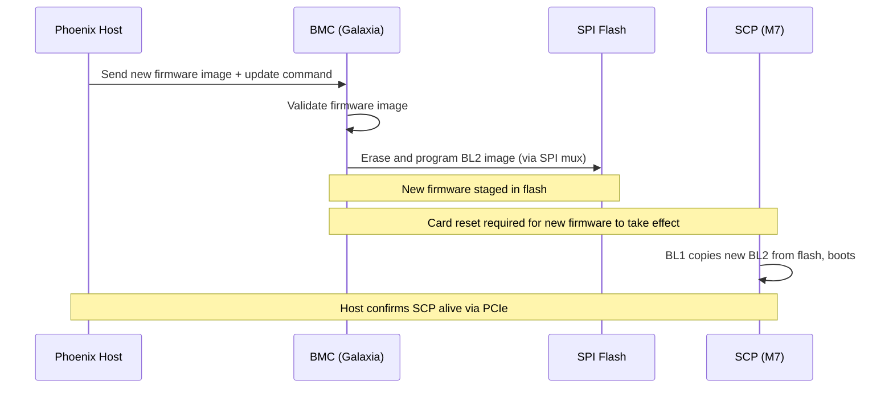

The newly programmed firmware takes effect after the next reset of the Galaxia card. Whether the
BMC triggers a card reset as part of the update flow, or the update simply takes effect on the
next power cycle, is TBD — this depends on the Galaxia card reset model, which is not yet defined.

- [ ] **Investigation: Galaxia card reset model** — How and when does the Galaxia card reset
  after a firmware update? Options include: BMC-triggered full card reset, host-initiated PCIe
  hot reset, or deferred activation on next power cycle. The reset architecture of the Galaxia
  card is TBD.
- [ ] **Investigation: BMC firmware update programming** — BMC software needs to:
  1. Receive firmware images from the Phoenix host
  2. Program SPI flash (behind the SPI mux)
  The host-to-BMC communication mechanism is TBD (I2C/SMBus sideband, BMC network
  interface, PCIe-to-BMC bridge, or shared mailbox).

- [ ] **Investigation: Host-to-BMC communication interface** — What physical/logical
  interface does the Phoenix host use to communicate with the Galaxia BMC? This is an
  open board design question.

### 5.2 SPI Flash Layout

Baseline layout (single BL2 image); physical flash capacity is TBD — the layout below assumes at
least 1 MB. Firmware bounds its reads by the 16 MB XIP window, not a device-capacity constant:

| Offset | Region | Size | Description |
|--------|--------|------|-------------|
| `0x000000` | Image header | 12 B | Magic `"ASCP"`, `image_size`, `check = magic ^ size ^ 0xA5A5A5A5`. **Required** — BL1 refuses to boot a flash image without a valid header. |
| `0x00000C` | (pad) | 244 B | Reserved header space up to the image |
| `0x000100` | BL2 Image | ≤ 191.75 KB (`0x2FF00`) | SCP RAM firmware; BL1 copies exactly `image_size` bytes |
| `0x040000` | Reserved | ~768KB | Config, logs, SMS Goldcrest MCU firmware image (slot TBD), future use |

**SMS Goldcrest MCU firmware image (working assumption).** The working boot plan reserves space
for the Credo-supplied Goldcrest MCU image (≤64 KB documented maximum) in this SPI flash alongside
the SCP images until an exact slot is assigned. Under the current flash model, the **BMC performs
SPI-flash programming** (initial provisioning and field update, [§5.1](#51-firmware-update-model))
and the SCP only reads. On cold boot, BL2 downloads the image to each populated SMS instance over
the HRA APB path ([§4.3](#43-bl2--ram-firmware) step 6) and retains a copy because an MCU-SRAM
uncorrectable ECC error requires re-download. This does not settle image custody, authentication,
version compatibility, or the download owner for XMS and C2C; those are part of the Goldcrest
ownership and recovery investigation in [§3.5](#35-planned-modules).

- [ ] **RSE-era handling of the SMS Goldcrest image (open).** Once the RSE (M55) owns boot-flash
  authentication, the working SMS image would become a signed firmware object in the secure-boot
  chain. Decide whether the RSE verifies and hands the image to the SCP for the HRA → Goldcrest APB
  download or whether responsibility moves. The BMC remains the flash-programming agent under the
  current update model; this SMS plan does not establish custody or ownership for XMS/C2C images.

### 5.3 Recovery Architecture

If the SCP fails to boot (corrupted firmware, bad update, hardware fault), the device will
not initialize PCIe and will be invisible to the Phoenix host. Recovery requires the BMC to
detect the failure and reprogram SPI flash with a known-good firmware image.

This is the standard recovery model across all ARM SCP platforms — no ARM CSS reference
design (RD-N2, RD-V1, RD-V3, Morello, N1SDP, Juno) implements on-device SCP firmware
self-recovery. Every BL1 in the upstream `scp-firmware` codebase performs a simple
copy-and-jump from a single fixed flash address. Recovery is always delegated to an
external agent (BMC, host JTAG, or RSS).

A boot ROM that fails the preloader's CRC check ([§4.2](#boot-rom-image-and-integrity-check)) is a different case:
the ROM is immutable, so reflashing SPI cannot fix it, and no SCP firmware runs at all. The part reports
`M7_BOOT_STAT = 0x5` and holds the M7 in `CPUWAIT`. The only boot path left is the ROM-bypass (JTAG side-load) path,
selected at reset, which skips the check. The ROM contents can be dumped over the private JTAG TAP and compared with
the golden image to confirm the failure.

### 5.4 Boot Failure Detection

For the BMC to act as the recovery agent, it must be able to detect that the SCP has
failed to boot. Possible mechanisms:

| Mechanism | Description | Dependency |
|-----------|-------------|------------|
| **Watchdog reset observation** | BMC monitors the SCP reset line or a reset count register. Repeated resets indicate a boot loop. | BMC-visible reset signal from ASIC |
| **PCIe enumeration timeout** | Phoenix host does not see Asimov on PCIe within a timeout and informs the BMC. | Host-to-BMC sideband communication |
| **Heartbeat register** | SCP writes a "boot OK" flag to a BMC-visible register after reaching the runtime event loop. BMC polls for this flag after reset. | Shared register or mailbox between SCP and BMC |
| **GPIO signal** | SCP asserts a GPIO pin after successful boot. BMC monitors the pin. | Dedicated GPIO between ASIC and BMC |
| **UART monitoring** | BMC monitors SCP UART output for a boot-complete message. | UART routed to BMC |
| **Boot-state pins** | The 4-bit `M7_BOOT_STAT[3:0]` pins ([§10.4](#104-boot-status-register)) carry the hardware preloader state (`0x0`–`0x5`: `0x4` once the M7 is released, `0x5` on a boot-ROM CRC failure — the only indication of a failure before any firmware runs), then firmware codes `0x6`–`0xF`. | Per-hemisphere `M7_BOOT_STAT[3:0]` pins routed to the BMC |

- [ ] **Investigation: Boot failure detection mechanism** — Depends on what interfaces
  exist between the BMC and the Asimov ASIC (I2C, GPIO, shared registers, sideband). This
  is an open board/ASIC design question that must be resolved with the hardware team.

**BMC role boundary in bring-up.** On-die, the BMC's role is board-scope only: rail/reset
sequencing, SPI-flash programming and recovery
([§5.1](#51-firmware-update-model)/[§5.3](#53-recovery-architecture)), and JTAG mediation
([§10.2](#102-jtag-and-coresight-debug)). Off-chip, the BMC **owns the memory-module far end**: the
module-side Goldcrest SerDes and the LPDDR5X memory controller are programmed by the BMC. The
SoC-side (Asimov) Goldcrest SerDes is the SCP's job ([§4.3](#43-bl2--ram-firmware) step 6), and
link training completes only once both sides are configured. No "BMC done with off-chip" handoff
signal exists today on either side, in RTL or in this specification. (The one already-wired
BMC-named influence on the boot path is the CAR `BMC_Use_W/E` strap pair — a board-level
clock-config source *selector* that elects an M7 as PLL owner, not a BMC data path — `car_top.sv`;
[§4.3](#43-bl2--ram-firmware) step 3.)

- [ ] **BMC far-end-ready handoff (required — mechanism open).** Because the BMC programs the
  memory-module far end, the SCP's SMS link bring-up has a real cross-agent dependency. Candidate
  mechanisms: a PLDM/MCTP-over-I2C sideband message (the sideband itself is an unbuilt proposal), a
  dedicated strap/GPIO, or no explicit signal — the SCP polls link status with a timeout (link-up
  is the implicit handoff). The polling option works mechanically but cannot distinguish a far end
  the BMC has not yet programmed from a dead module, which degrades boot-time error reporting and
  the DRAM-path RAS story — the decision must settle the timeout and error-classification policy,
  not just the signal.

**Proposed staging for the far-end-ready handoff** (strawman for review; the checkboxes below are
the decision points that close it):

- **Stage A — bring-up (no new hardware).** No explicit signal. BL2 brings up the SoC-side SMS
  pairs and polls link training (`gc_init_complete_sts`, then link-layer status over the pair's APB
  tunnel) against a timeout budget sized to the memory module's cold-boot + LPDDR-training time
  (currently uncharacterized — open vendor question). A training timeout is reported as a distinct
  *waiting-on-memory-module* boot status rather than a generic DRAM failure, so a stalled far end
  is at least distinguishable from an SCP hang at the console/BMC — accepting that Stage A
  fundamentally cannot tell "BMC has not programmed the far end yet" from "dead module".
- **Stage B — production.** The handoff rides the SCP↔BMC management sideband
  ([§8.5](#85-ras-and-error-handling) reporting direction; the sideband hardware is the proposed
  I2C target interface): the BMC sends a per-module *far-end ready* indication once it has
  programmed the module-side Goldcrest and LPDDR controller, and the SCP uses it to classify SMS
  training outcomes (and optionally to gate training start). The same message is the natural
  carrier for module provisioning the SCP cannot otherwise discover — populated-channel map and
  attached-DRAM topology/capacity — which the per-chip identity/discovery plan needs regardless.

- [ ] **Gate vs classify.** Does the SCP wait for the BMC ready indication before starting SMS
  training (serializes boot behind the BMC), or train opportunistically and use the indication
  only to classify a timeout as far-end-not-ready vs module fault (keeps boot parallel; requires
  the Stage-A timeout policy permanently)? Proposed default: classify, don't gate.
- [ ] **Message semantics and transport.** PLDM state sensor vs event vs vendor command; per-module
  vs per-card granularity; idempotence across SCP warm reset (does the BMC re-assert, or does the
  SCP query current state on boot?); Stage-B behavior when the sideband itself is down.
- [ ] **Timeout and error-classification policy** for Stage A (and as the Stage-B fallback):
  numeric budget blocked on far-end cold-boot/training time; classification feeds the boot-status
  reporting and the DRAM-path RAS story.
- [ ] **`ddr_rst_sel` strap interplay.** The memory module exposes a strap selecting ASIC- vs
  module-firmware-controlled DDR reset sequencing. If a board straps ASIC-controlled, part of the
  far-end reset ordering crosses back into SCP scope and must be sequenced against this handoff —
  the strap decision and the handoff mechanism have to be settled together.
- [ ] **Provisioning payload.** Whether *far-end ready* carries the module provisioning data
  (channel population / DRAM capacity) or that arrives via a separate discovery path (e-fuse
  personality data, stuffing-ID probing per [§4.3](#43-bl2--ram-firmware) step 6).

---

## 6. Firmware Security Model

### 6.1 Trust Model

The Asimov firmware security model follows ARM's standard approach where the **SCP is part of the platform Trusted
Computing Base (TCB)** and is trusted by assumption:

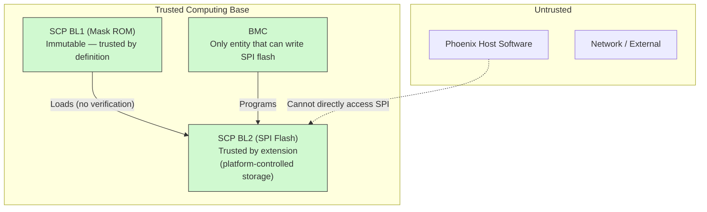

**Key security properties:**
- BL1 (mask ROM) is immutable and trusted by definition
- BL2 is stored in SPI flash, read directly by the SCP and programmable by the BMC (via SPI mux)
- The Phoenix host **cannot** directly write to SPI flash — firmware updates go through the BMC
- There is **no RSS (Runtime Security Subsystem)** in the Asimov design — the SCP BL1 is the root of trust
- SCP firmware does not cryptographically verify BL2 (consistent with all ARM SCP reference platforms)

### 6.2 SCP Firmware Trust Chain

ARM's TBB/TBBR security architecture assumes SCP firmware is trusted — the `scp-firmware` codebase contains **zero
cryptographic code** (no mbedTLS, no hash verification, no signature checking). Every ARM reference SCP platform
(RD-N2, RD-V1, Morello, Juno) performs a raw `memcpy` + jump from BL1 to BL2 with no verification.

For Asimov:
- **BL1 does not verify BL2** — consistent with ARM's model
- **SPI flash is protected by physical access control** — only the BMC can write it
- **The BMC is the trust boundary** for firmware updates

- [ ] **Investigation: Software-only verification in BL1** — If future requirements mandate
  BL1-to-BL2 verification, options include: - SHA-256 hash check (~1-2 KB code, integrity only) - ECDSA-P256
  signature verification (~9-13 KB code, full authentication) - Full TBBR certificate chain (~25-40 KB code,
  **does not fit 64KB ROM**)

  Any of these options would be novel — no ARM SCP has ever implemented self-verification.  The `scp-firmware`
  codebase contains no cryptographic library (no mbedTLS), no image header format, no signing tools, and no
  verification hooks. Implementing BL1 verification would require adding a standalone crypto implementation to
  the ROM firmware and defining an image signing workflow from scratch.

### 6.3 Threat Model and Attack Surface

| Threat | Mitigation | Risk |
|--------|-----------|------|
| Physical access to SPI flash | BMC controls SPI mux; datacenter physical security | Low (datacenter deployment) |
| Rogue BMC firmware | BMC firmware signing (separate concern) | Medium |
| Host compromise → SPI write | Host has no direct SPI access; BMC gates all writes | Low |
| Supply chain tampering | Manufacturing-time flash programming by trusted party | Low |
| BL1 bugs (mask ROM) | **Cannot be fixed post-tapeout.** Minimize custom code in BL1. | **High impact if triggered** |
| Firmware downgrade attack | No hardware monotonic counter — anti-rollback TBD | Medium |

### 6.4 AP Boot Security — TBBR Does Not Apply

ARM TBBR (Trusted Board Boot Requirements, DEN0006) defines a certificate-based chain of trust executed by
TF-A BL1 and BL2, designed for platforms with local AP storage (NOR flash, eMMC) containing a FIP with signed
images. **TBBR does not apply to Asimov's AP boot chain.** There are two independent reasons:

1. **Asimov has no AP BL1 or BL2.** The TF-A port uses `RESET_TO_BL31=1`, skipping the boot stages that
   execute TBBR verification. There is no AP ROM, no local storage, and no FIP. See [Section 11.2](#112-boot-path--bl31-direct-to-linux).

2. **There is no "firmware at rest" for the AP.** The Phoenix host loads BL31 and the Linux kernel into
   System DRAM over PCIe, and **retains full read/write access to that DRAM at runtime** through the PCIe BAR
   mapped to the ARM subsystem's memory. Device-side image verification is architecturally pointless when the
   entity that loaded the images can overwrite them at any time post-boot via the same PCIe I/O window.

This is a fundamental difference from standard ARM CSS platforms (RD-N2, Morello) where AP firmware lives in
on-board NOR flash — persistent, device-local storage that the host cannot write to at runtime. On those
platforms, TBBR protects against flash corruption and supply chain tampering. On Asimov, there is no persistent
AP firmware to protect: DRAM is volatile, host-loaded on every boot, and host-writable at all times.

**The Phoenix host is the root of trust for all AP images.** The security boundary for AP firmware integrity
is the host itself — host-side image signing, secure storage of firmware images on the host filesystem, and
host OS hardening. These are standard datacenter security practices, not on-device firmware verification
concerns.

The SCP does not verify the AP OS image before releasing the AP cores. There is no RSS/RSE in the Asimov
design, and adding one would not change the conclusion — the host's runtime DRAM access via PCIe makes any
device-side boot verification bypassable.

> **Note:** SCP firmware security (§6.1–§6.3) is unaffected by this analysis. SCP BL2 lives in SPI flash,
> which is not host-writable — the BMC is the trust boundary for SCP firmware. The arguments above apply
> only to AP images in host-accessible DRAM.

---

## 7. AP Initialization and OS Loading

### 7.1 SCP Platform Initialization

Before AP cores can boot, the SCP must complete the following platform initialization:

1. **CMN-S3 mesh initialization** — RN-SAM/HN-SAM programming and OCM0–4 cold-boot provisioning/readback
   ([§7.1.5](#715-ocm-cold-boot-policy)) before permitting AP, SMS, PCIe, DMA, or ACP memory traffic
2. **System-DRAM initialization** — bring up the SoC side of the SMS system-DRAM slice over the
   Goldcrest SerDes link; the LPDDR5X memory controller is off-chip at the far end of the link and
   is programmed, with the module-side SerDes, by the BMC ([§4.3](#43-bl2--ram-firmware) step 6,
   [§5.4](#54-boot-failure-detection))
3. **PCIe endpoint initialization** — Cadence SD2002 PHY configuration, link training, and BAR
   setup so the Phoenix host can communicate with Asimov
4. **GIC-600 reset release and mesh routing** — the SCP releases the GIC block from external reset
   (`RESET_CTRL[1]`) and programs the RNSAM I/O region that routes the GIC register window
   (GICD `0x2C000000`, GICR frames from `0x2C040000` — full layout in the section 7.1.1 RNSAM
   I/O-region table) to HN-I NID 236. Distributor and redistributor configuration
   is performed by TF-A BL31 on the AP ([§7.3](#73-ap-core-release-sequence))
5. **SDS structure** — Write platform information to shared memory for TF-A to read

**Reset timing:** the M7 SCP can execute from the reference clock before PLL lock. Each CMN reset
release requires the firmware hold to be cleared, synchronized PLL lock, and the controller's
minimum reset interval to complete ([§8.6](#86-reset-arbitration)). An all-clear CSR write or time
spent in other module init callbacks is not proof that CMN left reset.

CMN SAM programming runs during the `cmn_cyprus` `start()` phase: `clock_id = FWK_ID_NONE` means
setup is not deferred behind a clock-state notification. Therefore platform initialization must
establish the clock/reset/readiness prerequisites before that callback touches the mesh. The
release/readiness checks are described in [§8.6](#86-reset-arbitration); a missing clock notification
does not remove the PLL-lock interlock.

### 7.1.1 M7 ↔ CMN access topology

The CMN-S3 mesh is 6×6 (36 crosspoints), populated with 5 RN-F DSU ports, 12 RN-I, 5 HN-F, 6 HN-I,
2 HN-P, 1 HN-D, and 10 SBSX SN-F ports.

The SCP M7 reaches the CMN through two distinct paths, with different roles and timing. Firmware uses
both during boot, in a specific order.

**Path A — local APB sideband at `0x4400_4xxx`.** Decoded inside `cmn_m7_subsys.sv` from the M7's
peripheral bus; never reaches the mesh. Hosts the CMN integration straps (`cmn_cfg_mgmt`, `0x4400_4000`)
and per-DSU runtime registers (`cmn_dsu_mgmt`, `0x4400_4400`); the remaining two 1 KB quadrants are
reserved (read-as-zero). The system counter (`css600_tsgen`) is **not** on this sideband — it lives in
the AP peripheral fabric and is reached over the mesh (see [§4.4](#44-memory-layout)).
Available from cold boot — firmware uses Path A to program straps **before** releasing CMN/DSU reset
via `cmn_m7_reset_ctrl` `RESET_CTRL` ([§8.6](#86-reset-arbitration)).

**Path B — mesh data plane at `0x5000_0000`–`0xDFFF_FFFF`.** Routed through `cmn_m7_to_rni_axi_bridge.sv`
to the M7's RN-I (NID 68) and onto the CMN-S3 mesh. Used for everything mesh-routed: HN-D config space
at PERIPHBASE (`0x8000_0000`), HN-F home nodes (DRAM, SLC), HN-I bridges (off-mesh peripherals), SBSX
nodes (e.g. SPM scratchpad). (The current mesh has no CCG cross-chip gateways; they would be added
with a future CML configuration.) Available only after CMN exits reset and the RNSAM defaults latch
from the strap values.

**Boot order:**

1. BL1 then BL2 run from ITCM and DTCM (M7-internal — neither path involved).
2. BL2 writes `cmn_cfg_mgmt` straps via Path A (`0x44004000`+).
3. BL2 releases CMN reset via `cmn_m7_reset_ctrl` `RESET_CTRL` ([§8.6](#86-reset-arbitration)).
4. CMN samples `CFGM_PERIPHBASE` and other straps. RNSAM reset-default entries reference the same input,
   so RN-I NID 68's RNSAM auto-populates a `[PERIPHBASE, PERIPHBASE+256 MB) → HN-D` rule.
5. BL2 issues to `0x8000_0000` (Path B) → bridge → RN-I → RNSAM matches default route → HN-D CFGM.
   Firmware walks the mesh and consumes the release-pinned generated RN-SAM/HN-SAM map. The selected
   SMS topology is one five-HN-S HTG, with distinct directly homed OCM0–4 ranges; see
   [§7.1.5](#715-ocm-cold-boot-policy) for provisioning and admission requirements.

The non-hashed I/O regions programmed at boot:

| Region | Target | Contents |
|--------|--------|----------|
| `[0x00000000, +512 MB)` | HN-D (NID 64) | Base peripherals |
| `[0x20000000, +128 MB)` | HN-D (NID 64) | Peripheral space |
| `[0x28000000, +64 MB)` | HN-D (NID 64) | AP peripheral fabric (NIC-400): shared SRAM, AP UART, system counter, MHU windows |
| `[0x2C000000, +64 MB)` | HN-I (NID 236) | GIC-600 RNSAM route: GICD at `0x2C000000`; architected GICR frame 0 at `+0x40000` (`0x2C040000`), `0x20000` stride across 10 PEs; GICDA at `+0x180000`; the following 64 KB page is reserved. The remaining space is unused because 64 MB is the RNSAM minimum region size |
| `[0x70000000, +64 MB)` | HN-D (NID 64) | Per-DSU utility windows — AP-core release depends on this route: without it, PPU writes match no RNSAM region and fall through to the default target |
| `[0xC0000000, +1 GB)` | HN-I (NID 196) | `hra_cfg` aperture — the HRA configuration plane ([§7.1.4](#714-hra-configuration-plane)): PCIe, C2C, SMS/XMS Goldcrest APB, CPS, SPM, SSA, SAL, SVL config. Must be programmed before any HRA-plane access |

Alongside the RNSAM I/O regions, the same mesh-init pass programs the XMS mesh-egress aperture
windows: `cmn_cfg_mgmt.XMA_ADDR_DRAM_RANGE` (`cmn_cfg_mgmt.rdl`) holds per-XMA start/end bounds on
the top physical-address byte, fanned out to the two SBSX egress bridges instantiated in XMS
translate mode (`XLATE_MODE("XMS")` — `u_sbsx_xms_0/1`, `cmn.sv:6014`). The fields reset to zero and
are address-map setup, not Goldcrest/CSR configuration — they must be written before any XMS DRAM
traffic ([§4.3](#43-bl2--ram-firmware) step 4).

#### M7 as a CMN requestor only

The Cortex-M7 has an `AHBS` slave port (Cortex-M7 TRM DDI 0489F §5.7) that would let an external master
read its TCMs and selected internal regions, but in current Asimov RTL that port is connected only to
the boot-time TCM preloader (`cmn_m7_top.sv` — `u_tcm_preloader` drives `HSELS` to stage the boot ROM
into ITCM while `CPUWAIT` is held); it has no path from the mesh. Nothing on the CMN can target the M7's
internal address space. AP↔SCP communication uses the canonical CSS pattern: register-mapped MHUv3 +
shared SRAM, each accessible at addresses in both the AP and SCP frames; neither side reads the other's
TCMs directly.

#### 4 GB ceiling on M7 mesh access

The bridge wires `cmn_araddr / cmn_awaddr` upper bits to zero unconditionally — the M7's 32-bit AXI
address lands at `cmn_addr[31:0]` with `cmn_addr[47:32] = 16'b0`. The M7 can only reach mesh targets
whose system PA fits in the lowest 4 GB of the 48-bit CMN frame.

For single-chip Asimov this is sufficient: PERIPHBASE is in the device's internal frame (not host PA,
not affected by CXL HDM Decoder placement), and every on-die target the SCP touches — DRAM controller
config, GIC-600 distributor, MHU, shared SRAM, SPM (when its SBSX windows are placed below 4 GB by the
system address map) — fits below 4 GB.

The constraint becomes load-bearing only for multi-chip configurations where remote-chip CMN targets
live at `(4 TB × chip_id) + offset`. Asimov has no PIK `ADDR_TRANS` register and no ATU peripheral —
adding one would be a prerequisite for multi-chip CMN config from the SCP. Single-chip silicon does not
need it.

#### Forward note: AEK / CML A-Link compliance

When Asimov adopts the CML_SMP A-Link / AEK profile (CXL acceleration over multi-chip), §6.1 of the
CML_SMP A-Link Architecture Specification mandates two protections to prevent the host from
inadvertently issuing transactions into PERIPHBASE:

1. **Layer 1** — every RN-SAM (CCG, RN-I, etc.) on the host-to-device path must cover the full HPA
   range with non-default targets. No fallthrough to HN-D. A single uncovered range is a hole.
2. **Layer 2** — `cmn_apb_only` set, with all CFGM access constrained to a dedicated APB-to-HN-D path
   (the HN-D APB slave port). Asimov RTL ties this port off today; the SCP currently reaches HN-D over
   Path B (CHI/mesh).

Layer 1 alone closes the data-path hazard the spec is concerned about; Layer 2 is defense in depth and
required for full spec compliance. The Layer 1 invariant — "every RNSAM rule must have a non-HN-D
target, no programmed range may fall through" — should be machine-checkable from the system address
map once it's frozen.

- [ ] **Test invariant: RN-SAM no-fallthrough to HN-D.** Once the system address map is published,
      develop a coverage check that walks all RN-SAMs (CCG-RA, CCG-HA, RN-I), unions their programmed
      ranges, asserts the union covers the full HPA window, and asserts no entry has HN-D as its
      target. Lock the invariant in CI and silicon-bring-up.

### 7.1.2 CMN-S3 coherency setup

Beyond RNSAM (§7.1 step 1), the CMN-S3 mesh requires three additional programming steps before AP cores can
issue shareable transactions or broadcast cache-maintenance / TLB-invalidate operations under the
silicon-committed broadcast straps. The `asimov_system` SCP module performs steps 2 and 3 (and enforces
step 1) in a dedicated CMN DVM pass that independently walks the CMN configuration tree immediately
before releasing the primary AP core; step 1 is hardware-driven by the SCI wiring, with an SCP software
fallback.

**1. RN-F coherency-domain admission (SCI handshake).** Per CMN-S3 TRM §2.3.8, every RN-F starts in the
`DISABLED` coherency state at reset. The DSU's `SYSCOREQ` output asserts as part of the cluster's
coherency-entry state machine; the CMN responds with `SYSCOACK` and the RN-F transitions to `ENABLED`.
Until this handshake completes for a given RN-F, the CMN treats it as outside the coherency domain —
broadcast snoops fan out skipping that RN-F, and any transaction waiting on its response stalls indefinitely.
The handshake state is observable per port in `por_mxp_p<port>_syscoack_status` and is hardware-driven on
Asimov silicon (`SYSCOREQM0` → `SYSCOREQ_NIDxx` connections in the CMN integration). The SCP checks
`syscoack_status.d0 = 1` for every RN-F port post-discovery; for any port not already acknowledged it
falls back to the software coherency-entry interface (read-modify-write of
`por_mxp_p<port>_syscoreq_ctl`, the TRM §2.3.8.2 software sequence) rather than failing outright.

**2. DVM Node (DN) configuration.** The DN inside HN-D serializes DVM operations (TLBI, `IC IVAU`,
branch-predictor invalidate, DVMSync). Per CMN-S3 TRM §2.8.4, two DN registers must be programmed before any
AP core executes a TLBI:

- `por_dn_aux_ctl.disable_ddn = 1` — disables Distributed-DN peer snooping. Required for single-DN
  configurations (Asimov has exactly one HN-D and zero HN-T / HN-V).
- `por_dn_domain_rnf0` — bitmap of RN-F LDIDs in DVM domain 0; bit N indicates RN-F **LDID** N is a
  member. The DN consults this table to fan out DVM-snoops and will not complete a DVM operation until
  every member responds. All five C1-Nano RN-Fs are members once powered, so the fully-populated value is
  `0x1F`.

  **Membership MUST track cluster power, not be programmed statically at init.** A member whose cluster is
  unpowered never returns DVM-complete, so the DN stalls every subsequent broadcast indefinitely. The SCP
  therefore programs the bitmap empty at CMN-configuration time and admits each RN-F as its cluster powers
  on, from the same power-domain notification that drives the SCI coherency-entry handshake (step 1).
  Membership is removed symmetrically on cluster power-down. This is a silicon requirement, not an
  emulation artifact: broadcasting DVM to a powered-off member is incorrect on any implementation.

  **Bit position is the hardware LDID, which is *not* the cluster index** — see §7.1.3.

**3. Per-RN-SAM DVM routing.** Each RN-SAM has a `dn_nodeid` field (`rnsam_status[18:8]`, CMN-S3 TRM
§8.3.17.62) specifying the destination NID for DVM operations from that RN-F. The SCP programs this to the
HN-D's NID for every discovered RN-SAM. With reset value 0, DVM ops route to NID 0 (an SBSX in Asimov's
mesh) and never reach the DN, causing TLBI broadcasts to stall regardless of DN configuration.

#### Strap-driven broadcast routing

The C1-DSU broadcast strap policy committed for Asimov silicon directly determines which of the steps above
are mandatory pre-AP-release:

| Strap | Value | Effect |
|---|---|---|
| `BROADCASTCACHEMAINT` (BCM) | 0 | Outer-shareable CMOs are SF-mediated through HN-F (no wholesale broadcast) |
| `BROADCASTOUTER` (BCO) | 1 | DSU emits outer-shareable CMOs as broadcast transactions; HN-F bypasses its SF and snoops every RN-F in the outer-shareable domain |
| `BROADCASTTLBIINNER` | 1 | Inner-shareable TLBIs are routed through the DN (no inner-shareable bypass) |
| `BROADCASTTLBIOUTER` | 1 | Outer-shareable TLBIs are routed through the DN |

With `BROADCASTTLBI*=1`, steps 2 and 3 are mandatory: the first TLBI issued by BL31 (`tlbi alle3` in
`enable_mmu_el3`) hangs if either the DN or per-RN-SAM `dn_nodeid` is not programmed. With `BROADCASTOUTER=1`, the SCG
topology must route the System Cache region (RNSAM programming under §7.1 step 1) — broadcast CMOs have
nowhere to land if HN-F is not reachable.

Firmware must validate the selected five-HN-S SMS HTG and its per-HN-S routing from the generated map,
including the distinct OCM ranges and equal effective SLC capacities required by
[§7.1.5](#715-ocm-cold-boot-policy).

- [ ] **Silicon DN reset values.** TRM §2.8.4 specifies that the per-XP `dn_domain` field populates
  `por_dn_domain_rnf0` at hardware reset. SCP firmware writes the bitmap defensively. The ASIC team should
  confirm whether the defensive write is required on real silicon or whether the XP-default mechanism is
  sufficient and the firmware write can be made conditional.

#### SPM scratchpad routing

SPM traffic is system-cacheable, so it does not get a plain non-hashed I/O route. The RN-SAM carries the
SPM address range as a **secondary hashed range attached to SCG0** (a standalone SCG has no valid HN-F
target); the HN-F SAM `SYSCACHE_SUB` overrides then redirect matching addresses to the SBSX SN-F ports
backing the SPM (two of the ten ports used today, NIDs 168 / 296). The SPM base and size remain
provisional pending the published system address map.

### 7.1.3 Cluster index, RN-F node ID and hardware LDID

Three different identifiers name the same C1-DSU cluster, and they are **not interchangeable**. Firmware
that indexes a CMN structure by the wrong one is silently wrong for four of the five clusters, because
cluster 0 is the fixed point of the permutation.

| SCP cluster index | Utility-bus window | RN-F node ID (NID) | Hardware LDID |
|---|---|---|---|
| 0 | `0x7000_0000` | 80  | **0** |
| 1 | `0x7040_0000` | 152 | **3** |
| 2 | `0x7080_0000` | 208 | **1** |
| 3 | `0x70C0_0000` | 280 | **4** |
| 4 | `0x7100_0000` | 336 | **2** |

In C: `cluster_to_rnf_ldid[] = { 0, 3, 1, 4, 2 }`.

**Definitions.**

- **SCP cluster index** — the SCP's own power-domain / PPU element ordering (`CLUS0..CLUS4`). Selects the
  per-DSU utility-bus window at `SCP_UTILITY_BUS_BASE + n * 4 MiB`, decoded by HN-D from the
  `DSU_PERIPHBASE` strap to the per-DSU AXU master.
- **RN-F node ID** — the mesh node ID of the crosspoint device port that DSU's CHI interface attaches to.
  Used wherever a CMN structure names a *node* (RN-SAM targets, snoop-target tables).
- **Hardware LDID** — the RN-F's logical ID, **strapped per crosspoint**, not derived from the node ID and
  not assignable by software. Used wherever a CMN structure is *indexed by RN-F*, notably
  `por_dn_domain_rnf0` (§7.1.2 step 2) and the HN-S RN-F physical-ID tables.

**Derivation (RTL, not convention).**

1. *Cluster index → NID.* The CMN integration wires the per-DSU AXU masters and the RN-F CHI links from the
   same index space, in node-ID-ascending order: `RNF_PORT_NID_LIST = '{80, 152, 208, 280, 336}`, with the
   AXU master ports named for the node they serve (`AWADDRU_NID80` ← `dsu_axu_awaddr[0]`, `AWADDRU_NID152`
   ← `[1]`, and so on). So utility-bus slot *n* and RN-F `RNF_PORT_NID_LIST[n]` are the same DSU.
2. *NID → LDID.* Each RN-F crosspoint carries an `LDID_P0_D0_STRAP`; read in node-ID-ascending order the
   five straps are `0, 3, 1, 4, 2`. The aggregate is exported to the HN-S as `POR_RNF_NID_LIST_PARAM`,
   whose entries are indexed by LDID and read `{80, 208, 336, 152, 280}` — the inverse of the strap
   sequence, as expected.

Composing the two gives the table above.

**Consequences for firmware.**

- The `por_dn_domain_rnf0` bit for a cluster is `cluster_to_rnf_ldid[cluster]`, **not** the cluster index.
  Using the cluster index admits the wrong RN-F for clusters 1-4, so the DN waits on a member that never
  powered — reintroducing exactly the stall the power-tracking rule in §7.1.2 exists to prevent.
- The HN-S RN-F physical-ID tables are **preloaded by hardware** from the same strap data, with the valid
  bits set, on the single-chip path. Firmware must not program them: the upstream accessor ORs the node ID
  into the field rather than assigning it, so writing a differently-ordered table on top corrupts entries
  rather than replacing them. Software programming of these tables belongs only to the CML (multi-chip)
  path, for remote agents.
- Neither error is observable in a single-cluster boot. Cluster 0 maps to LDID 0 under both the correct and
  the naive identity mapping, and a single core generates no snoops for a snoop-target table to route.
  Validation of anything indexed by LDID therefore requires **at least two clusters powered**.

### 7.1.4 HRA configuration plane

The Host Register Access (HRA) plane is the configuration path for the Hemisphere design blocks:
the PCIe controller/PHY, C2C, the SMS and XMS Goldcrest APB tunnels, and the CPS/SPM/SSA/SAL/SVL
CSR banks. It egresses the mesh at a dedicated HN-I (NID 196), whose AXI4 master feeds an
AXI4-to-AXI4-Lite adapter (`cmn_hra_axi_axil_adapter` — `u_nid196_hra_adapter`, `cmn.sv:5249`;
48-to-30-bit address, 128-to-64-bit data, illegal accesses answered with DECERR locally) and then a
linear daisy-chain of `axil_hra_node` one-in/two-out range decoders
(`design/common/rtl/axil/axil_hra_node.sv`): 4 KB decode granularity, an address-match tap to the
local block, fall-through forwarding otherwise, and DECERR terminators on both chain tails. The
chain forks once, inside C2C (`cxh.sv` / `cxv.sv`):

```
HN-I NID196 → AXI4→AXI4-Lite adapter
  → PCIe0 tap [+0x00000000) → PCIe1 tap [+0x10000000)
  → C2C CSRs   [+0x20000000)
  → fork:
      WEST → SMS ×2 (+0x20010000 / +0x20011000) → XMS ×16 (+0x20020000 .. +0x2002F000)
             → CPS (+0x20030000) → DECERR
      EAST → SPM (+0x20031000) → SSA (+0x20034000) → SAL (+0x20400000, 4 MB)
             → SVL (+0x20800000, 4 MB) → DECERR
```

Offsets are relative to the plane's mesh aperture; the authoritative window map is generated into
`hra_addr_map_pkg` from `design/hemisphere/registers/hra.rdl` and rendered in the PeakRDL register
guide ([§1.4](#14-outstanding-dependencies)).

Firmware-relevant properties:

- **Reset.** The whole chain is held by `RESET_CTRL[13]` (HRA — `cmn.sv:5206`;
  [§8.6](#86-reset-arbitration)). Because the chain physically feeds through the C2C and XMS nodes,
  the C2C/XMS/HRA resets must release before any downstream HRA access. That reset release does not
  assign an initialization owner or require XMS/C2C bring-up on the single-chip AP-boot critical
  path — release is not initialization ([§8.6](#86-reset-arbitration)).
- **Reachability.** The plane is reached from the mesh through the RNSAM `hra_cfg` aperture
  ([§7.1.1](#711-m7--cmn-access-topology): `0xC0000000`, 1 GB → HN-I NID 196), which must be
  programmed before any HRA-plane access. Once the aperture is in the SAM, **any mesh requester**
  can master the chain — the M7 (RN-I NID 68), the C1 cores, or the host via PCIe inbound. Config
  mastership is therefore address-map and firmware policy, not hardwired.
- **Boot-critical minimum.** The SCP needs the plane for the SMS Goldcrest tunnels
  ([§4.3](#43-bl2--ram-firmware) step 6) and PCIe endpoint configuration (step 7); everything else
  on the plane can be configured later by whichever agent policy assigns.

- [ ] **Open: per-block HRA config mastership.** Which agent (M7 SCP, Phoenix host, or C1 AP
  software) owns configuration of each block on the plane is an unresolved policy decision, to be
  encoded in the SAM and security configuration once made.

### 7.1.5 OCM cold-boot policy

OCM (on-chip memory) reserves locked ways in each HN-S system-level cache (SLC). The selected SMS topology is
one HTG (hashed target group) containing HN-S NIDs `{88, 160, 216, 288, 344}`. OCM0–4 are distinct,
ordinary non-hashed RN-SAM ranges, each targeting exactly one of those HN-S nodes with `num_hns=1`.
They do not overlap SMS and do not use its hierarchical hash. In-capacity OCM accesses terminate in the
owning SLC; they need no OCM-specific HN-SAM subordinate or SMS/SBSX target entry.

#### Default and future boot-time configuration

The selected SAMv2 cold/full-CMN-reset firmware default is **256 KiB on each of OCM0–4**: four locked ways (W4)
per 1-MiB, 16-way SLC. This gives 1.25 MiB of aggregate OCM and leaves 768 KiB of ordinary SLC on each
HN-S (3.75 MiB aggregate). OCM0 is included, even when control-plane software does not allocate from it.
Every member of the SMS HTG must have the same locked-way count and effective ordinary-cache capacity.

This is a **firmware-provisioned reset/cold-boot default**, not a claim that hardware power-on-reset
register values already enable or back OCM. The M7 must program and verify the profile on each supported boot.

Future SPI-flash configuration data may select zero OCM ways on all five HN-S nodes, or additional
supported ways, before provisioning begins. The data format, location, versioning and reader are **TBD**;
SPI selection and the zero-way path are outside the supported boot interface.
The future selection must be common to all five HN-S nodes and validated against the generated hardware
and lock-base geometry. Unsupported or inconsistent selections must fail closed before requester admission.

| Common profile | OCM per HN-S | Ordinary SLC per HN-S | Policy |
|---|---:|---:|---|
| W0 | 0 | 1 MiB | Future boot selection: all five OCMs disabled, no OCM routes; restores full ordinary SLC |
| W4 | 256 KiB | 768 KiB | Selected SAMv2 firmware default on OCM0–4 |
| W8 | 512 KiB | 512 KiB | Alternative build-time profile |
| W12 | 768 KiB | 256 KiB | Maximum partial-OCM build-time profile |

For a supported nonzero profile, $OCM\_size = 1\,MiB \times W / 16 = W \times 64\,KiB$.
`ocm_allways_en` remains clear. Firmware accepts build-time W1, W2, W4, W8 and W12 selections;
W1 and W2 provide 64 KiB and 128 KiB per HN-S. Each selected profile must satisfy the geometry, programming
and transaction requirements below. There is no runtime or SPI configuration interface.
For a future W0 boot, firmware must leave lock bases invalid and `ocm_en` clear on all five HN-S nodes,
omit all five OCM routes, and verify the resulting full ordinary-SLC profile. W0 is not a runtime disable command.

The common profile, lock bases, `ocm_en` and OCM routes are immutable after requester admission until a
full CMN/platform reset. There is no live enable/disable/repartition API, retained-CMN reset replay,
whole-AP retained-SMS reboot, or suspend/kexec content-preservation contract with OCM active. An unsupported
reset path must fail closed or require full reset. Ordinary CPU/DSU power management must not reprovision OCM.

Here **full CMN reset** means resetting every applicable RN-SAM and every participating HN-S, including its
SAM/OCM state, with requester traffic stopped; an M7 restart or a reset-cause name alone is not proof of that
condition. Watchdog, LOCKUP, `SYSRESETREQ` and external `nSRST` re-arm all 17 managed subsystem holds,
including CMN ([§8.6](#86-reset-arbitration)). Firmware must establish that the full CMN reset completed
before replaying provisioning.
A full CMN reset does not imply a cold reset of CAR or restoration of its reference-clock selection; clock recovery
and subsystem readiness are separate prerequisites. No OCM-content preservation is promised across this reset.

#### Active backing versus PA reservation

The release-pinned generated map is the source for addresses and node ownership. Its selected allocation is:

| Aperture | Owning HN-S NID | PA slot base | PA reservation | W4 active RN-SAM interval (end exclusive) |
|---|---:|---|---:|---|
| OCM0 | 88 | `0xE0000000` | 1 MiB | `[0xE0000000, 0xE0040000)` |
| OCM1 | 160 | `0xE0100000` | 1 MiB | `[0xE0100000, 0xE0140000)` |
| OCM2 | 216 | `0xE0200000` | 1 MiB | `[0xE0200000, 0xE0240000)` |
| OCM3 | 288 | `0xE0300000` | 1 MiB | `[0xE0300000, 0xE0340000)` |
| OCM4 | 344 | `0xE0400000` | 1 MiB | `[0xE0400000, 0xE0440000)` |

Only `[base, base + W * 64 KiB)` is backed and routed as OCM; the rest of each 1-MiB slot is reserved
and must not match an OCM route. Firmware must discover and verify ordinary RN-SAM range comparison enabled
with LSB16 on every applicable RN-SAM. LSB16 means 64-KiB routing precision, not 64-KiB OCM capacity.
Other SAM tables have their own capabilities; do not infer their LSBs or table depths from the ordinary table.

Four physical `SLC_LOCK_BASE0..3` registers describe the selected coverage; do not interpret W as a count
of BASE registers. For the generated 1-MiB/16-way, `num_hns=1` geometry, W4 uses four 64-KiB comparisons,
W8 uses four 128-KiB comparisons, and W12 uses 128 + 128 + 256 + 256 KiB, in ascending address order.
The programmed valid/address fields and their union must exactly match the active extent. Firmware must
validate the selected geometry against discovered hardware capabilities before programming it.

#### Required one-shot provisioning and traffic gate

The implementation must perform the full CMN-S3 TRM §3.1.9 entry protocol during cold boot; it must not
assume that reset-empty caches permit an unvalidated shortcut. The required path is
FAM → SFONLY → ABF `MakeInvalid` → OCM configuration → FAM. Here FAM is normal full-associativity
cache operation, SFONLY is snoop-filter-only operation, and ABF is the address-based flush mechanism.
The normative boot requirements are:

1. After a full CMN reset, establish readiness and keep all OCM RN routes invalid. Validate topology,
   discovered target types and SN capabilities, subordinate attributes, equal slice sizes, the common W
   and lock-base coverage before activation.
   Reject retained mappings or pre-existing OCM state rather than treating them as a cold boot.
2. Keep all applicable RN-SAMs stalled and producers quiescent, with no outstanding conflicting accesses.
   No SMS-backed access, memory initialization/image loading, PCIe link bring-up, AP release, DMA, ACP,
   or other requester memory traffic may precede successful OCM provisioning. Configuration accesses needed
   to perform the sequence remain permitted. Explicitly establish producer quiescence; RN stalling or a
   profile-selection callback alone is insufficient. Releasing a subsystem reset is not authorization for traffic.
3. Program and read back the HN routing, request and poll the required HN-S power states, and execute the
   FAM/SFONLY and ABF sequence across the participating HN-S nodes. Bound all polls, reject ABF abort/error
   status even when completion is set, and do not change flush or power programming while ABF is active.
   `MakeInvalid` does not preserve dirty contents; this is cold provisioning, not a live-memory transition.
4. Program and read back equal locked ways, node-specific lock bases and partial OCM enable on all five
   HN-S nodes. Return to the required FAM state, verify it, then program/read back exact RN route payloads
   and validity. Never expose an OCM route with missing backing or `ocm_en=0`.
5. Publish a successful provisioning checkpoint to the boot orchestrator before SMS arming or memory use
   and before PCIe/AP/DMA/ACP admission. Module ordering alone is not that checkpoint. Any failed capability,
   completion or readback check must prevent admission; firmware must not continue with partial provisioning.

The future W0 implementation must have a separately validated cold-boot branch that leaves OCM disabled;
it must not execute the nonzero enable path with an invented zero-way encoding.

#### Three distinct safety concerns

- **Inactive-tail routing:** exact LSB16 comparison prevents addresses outside the active prefix from
  selecting that OCM entry. Such probes follow the intended default/error policy, which must complete
  without unintended SMS/SN transactions or side effects. A reserved slot is not permission to over-route it.
- **OCM oversubscription:** more distinct OCM-classified cache-line identities can compete for a set than
  its locked ways retain, through incorrect lock geometry, PA/set mapping or physical/security aliases.
  Arm support reports that a dirty victim can issue `WriteNoSnp` to memory and that a later OCM read can
  return zero instead of retrieving that memory copy. There is no safe spill/reload contract. An exact
  RN-SAM range does not by itself prove this cannot happen; concurrent users of the same PA/security identity
  are not themselves additional capacity.
- **Request attributes and producers:** admitted accesses must satisfy the required Normal Cacheable,
  allocating transaction behavior. Device or non-allocating requests are not assumed to fill OCM safely.
  A CPU mapping, DMA engine or ACP producer needs validated attributes, exact bounds and consistent
  ownership; an RN shared by cores and ACP cannot isolate the ACP producer merely by disabling its RN route.
  Keep unvalidated producers disabled. Do not advertise OCM as Linux general-purpose RAM or ordinary MMIO.

#### Validation requirements and open decisions

Validation must establish per-HN routing and shared SMS/OCM coherency, with valid allocating traffic terminating
locally. Probe both sides of every 64-KiB boundary, the last valid and first invalid lines, and reserved tails;
verify that these accesses cause no unintended SMS/SN transaction. Fill and dirty the complete selected capacity
without an OCM victim, and use an isolated negative control to demonstrate oversubscription detection.
Exercise boot-order violations, ABF aborts, capability/readback failures and unsupported reset/reconfiguration.
Directed firmware/DV tests can supply this evidence independently of a Linux allocator.

- [ ] **Arm confirmation of the shared SMS/OCM composition and profile-specific lock-base encoding.** Arm's
  support reply permits separate direct OCM and SMS ranges but identifies their shared-HN-S use as unexpected
  and requiring Positron validation.

The host image-ready handshake consumes successful SAM/OCM/SMS readiness before AP release
([§7.2](#72-host-loaded-os-via-pcie)). A future immutable firmware discovery descriptor and bounded Linux
mapping/allocator interface are separate from the provisioning protocol; no descriptor layout is defined here.

References: CMN-S3 TRM §3.1.8 (OCM geometry, Table 3-5), §3.1.9 (entry/exit protocol), §3.1.7 (ABF),
and the Arm support correspondence on shared SMS/OCM operation.
The `WriteNoSnp`/later-zero failure sequence is support-case guidance, not a verbatim quotation from the TRM.

### 7.2 Host-Loaded OS via PCIe

Asimov is a PCIe endpoint device. The OS image for the C1-Nano AP cores is **not stored on-device** — it is
loaded by the Phoenix host over PCIe after the SCP has initialized the platform:

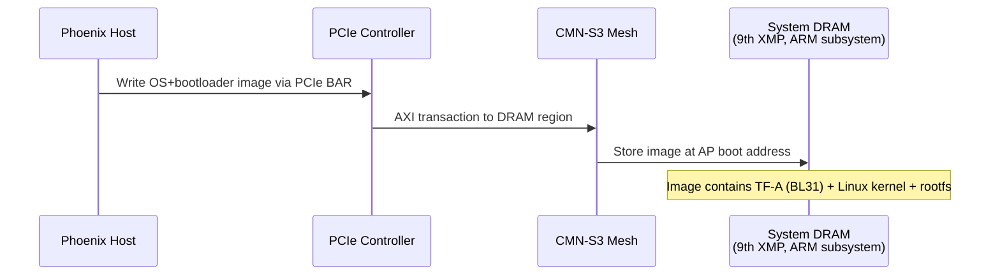

- [ ] **Investigation: PCIe BAR mapping for OS loading** — After the SCP initializes the
  PCIe endpoint, the Phoenix host needs to write the OS image into System DRAM. This requires: - A PCIe BAR (or
  portion of a BAR) that maps to the ARM subsystem's System DRAM - The SCP to configure the CMN RNSAM to route
  PCIe-originated transactions to DRAM - Agreement on the DRAM address where the OS image should be placed

  The "9th XMP" (memory port) provides shared ARM system DRAM. The exact BAR layout and DRAM addressing are TBD.

- [ ] **Investigation: OS image format** — What format does the image take? Options:
  - FIP (Firmware Image Package) containing TF-A + kernel + rootfs (no U-Boot — see
    [§11.2](#112-boot-path--bl31-direct-to-linux))
  - Flat binary with a header describing load addresses - Multiple separate images loaded to different addresses

- [ ] **Investigation: Host-side loading mechanism** — What Phoenix host software manages the OS loading?
  - Custom PCIe driver with `memcpy_toio()` to BAR - Standard Linux firmware loading framework - Integration with
  the Asimov device driver

#### "OS image written" signal — RTL constraint and option space

The SCP must not release the primary core until the host has finished writing the images
([§7.3.1](#731-cmn-configuration-and-dsu-management-registers) boot ordering constraints). The
current RTL constrains how the host can say so: **no host-writable inbound doorbell or scratch CSR
exists in the PCIe block** — the endpoint's signaling surface is outbound-only (device-to-host
MSI-X) plus the configuration-snoop DVSEC (`design/pcie/registers/pcie.rdl`). The mechanism is an
open decision with three candidate shapes:

1. **Inbound doorbell CSR** — add a host-writable doorbell/scratch register (with an M7 interrupt)
   to the PCIe wrapper. Preferred: matches the BlueField/OCTEON endpoint pattern and gives the SCP
   an event rather than a poll. Requires an RTL addition.
2. **Firmware-polls-DRAM convention** — the host writes a completion token at an agreed system-DRAM
   location; the SCP polls it. Needs no RTL change, but burns SCP poll cycles and needs a
   well-defined token/ordering contract.
3. **DVSEC rendezvous** — signal through the existing configuration-snoop DVSEC path.

- [ ] **Investigation: host-to-SCP "image written" mechanism.** Choose among the options above and,
  if option 1 is selected, specify the doorbell CSR and its M7 interrupt routing with the ASIC team.

### 7.3 AP Core Release Sequence

Following the standard ARM CSS boot model used by all reference platforms (RD-N2, Morello,
N1SDP, Total Compute), the SCP releases only the **primary core** at boot time. All
secondary cores remain powered off until Linux brings them up individually via PSCI.

The PPU (Power Policy Unit) is the only mechanism for releasing AP cores. Each C1-DSU
contains built-in PPUs: 1 cluster PPU, 1 per core, and 1 per CME (SME2 unit) — 20 in-cluster
PPUs across the 5 DSUs (5 cluster + 10 core + 5 CME0). Firmware currently drives the 15
cluster/core PPUs; SYSTOP is a firmware mock with no system-PPU hardware. When `nRESET`
deasserts on a DSU, the internal PPU state machines wake in OFF state and hold the core's
power-on reset asserted until the SCP writes `PPU_PWPR = ON`.

This hold is a configured property of the delivered RTL, not an assumption. The C1-DSU is built
with `PPU_RST_STATE = FALSE` (hardcoded in the cluster top —
`C1_DSU_DynamIQ_Cluster_1.sv:527`), so at `nRESET` deassertion every in-cluster PPU comes
up in **static** mode with power policy OFF and dynamic transitions disabled, holding its power
domain in power-on reset (C1-DSU TRM, ARM 107804, §5.2.2 and PPU_PWPR reset values in B.1.4.1). A
core cannot fetch from RVBAR until firmware performs the TRM §5.8.1 cold-boot power-up: cluster
`PPU_PWPR` = ON with the required operating-mode policy (see the `OP_POLICY` open item in
[§7.3.1](#731-cmn-configuration-and-dsu-management-registers)), then core `PPU_PWPR` = ON. There is
no CPUWAIT pin on the C1-DSU and none is needed — the PPU-OFF reset hold *is* the boot hold, which
is why the single all-clear `RESET_CTRL` write ([§8.6](#86-reset-arbitration)) is safe: releasing
the DSU resets does not start the cores. The standing all-awake reset value of
`cmn_dsu_mgmt.WAKEREQ` is inert against this hold, because `COREWAKEREQUEST` is a dynamic-mode wake
input that can initiate a power transition only when `PWR_DYN_EN` is set (TRM B.1.4.1, §5.7.3) —
see the corresponding sequencing constraint in
[§7.3.1](#731-cmn-configuration-and-dsu-management-registers).

The per-core power-on reset is internal to the cluster and sequenced by the PPU — there is no
externally routable per-core reset pin. See
[Section 7.3.1](#731-cmn-configuration-and-dsu-management-registers)
for the cmn_cfg_mgmt / PPU relationship and programming sequence.

**SCP boot-time actions:**

1. **Program RVBAR for all cores** — Write the Reset Vector Base Address Register for
   every C1-Nano core to point to the TF-A BL31 entry point in DRAM. This is done before
   any core is released, so secondaries have the correct reset vector when they are later
   powered on via PSCI. RVBAR is written via `cmn_cfg_mgmt` at `0x44004000` — see
   [Section 7.3.1](#731-cmn-configuration-and-dsu-management-registers) for the register
   layout and programming sequence.
2. **Normalize AP MPIDR Aff3** — Write `cmn_cfg_mgmt.CLUSTERIDAFF3 = 0x00` before reset
   release. This field feeds every DSU's `CLUSTERIDAFF3` input, i.e. `MPIDR_EL1.Aff3` for
   all 10 cores. Each hemisphere is an independent island running its own single-hemisphere
   TF-A image, and the TF-A port accepts only Aff3 = 0, so firmware forces the West-hemisphere
   value on both hemispheres.
3. **Power on primary cluster and primary core** — The `asimov_system` module calls the
   `power_domain` module's `set_state` API with a composite state (SYSTOP=ON, cluster=ON,
   core=ON). The `power_domain` module cascades through the hierarchy:
   - **SYSTOP** → `system_power` module → `mock_ppu` (reports transition immediately;
     Asimov has no real system PPU hardware)
   - **Cluster 0** → `ppu_v1` module → writes `PPU_PWPR` at utility bus offset `+0x030000`
   - **Core 0** → `ppu_v1` module → writes `PPU_PWPR` at utility bus offset `+0x080000`,
     enables dynamic power mode

   Upstream `ppu_v1` enables dynamic mode (autonomous OFF target) after powering on the core; the
   `mod_asimov_system` module then re-writes `PWPR` to static ON (dynamic mode disabled) on each
   core ON transition — see
   [Section 7.3.2](#732-ppu-power-management-architecture) for the full PPU lifecycle.

   All other 4 clusters and 9 cores remain in PPU OFF state.
4. **Signal readiness via SDS** — The SCP writes feature availability flags to the SDS
   structure (see [Section 7.4](#74-sds-handshake)), indicating the SCMI stack is ready.

**Primary core boot:**

5. The primary C1-Nano core fetches its first instruction from the RVBAR address (TF-A BL31).
6. TF-A BL31 initializes EL3, GIC-600, and the PSCI framework. All secondary CPUs are
   tracked as PSCI OFF state.
7. TF-A hands off to the Linux kernel (BL33) at NS-EL2 on the primary core (C1-Nano
   implements EL2, so the BL33 SPSR selects EL2).

**Secondary core bringup (Linux-driven):**

8. During SMP initialization, Linux calls `PSCI cpu_on()` for each secondary core.
9. Each call follows the chain: Linux SMC → TF-A BL31 PSCI handler → SCMI
   `POWER_STATE_SET(ON)` → MHU doorbell → SCP.
10. The SCP (`ppu_v1`, driven by the `power_domain` module) writes the target core's
    `PPU_PWPR = ON` and polls `PPU_PWSR`; the PPU sequences the core's power-on reset.
    (`COREWAKEREQUEST` is pinned asserted by the `cmn_dsu_mgmt.WAKEREQ` reset value and
    plays no software role — see [Section 7.3.2](#732-ppu-power-management-architecture).)
11. The secondary core exits reset, fetches from its pre-programmed RVBAR (TF-A BL31),
    enters the TF-A warm boot path, and is handed off to Linux at NS-EL2.

**Core power-down (Linux-driven):**

12. When Linux idles a core, it calls `PSCI cpu_off()`.
13. TF-A sets `IMP_CPUPWRCTLR_EL1.CORE_PWRDN_EN = 1` and executes WFI.
14. The SCP (via the same SCMI → `power_domain` → `ppu_v1` chain) writes the core's
    `PPU_PWPR` policy to OFF; the PPU waits for the core's quiescence (STANDBYWFI) and
    sequences it down.

#### 7.3.1 CMN Configuration and DSU Management Registers

Asimov has no PIK (Power Integration Kit) register block. The role of "tell cores WHERE to
boot, configure system clocks, and drive per-cluster control" — filled by Cluster PIK and
System PIK on ARM CSS reference designs — is filled here by two CMN-internal register banks
exposed to the M7 over an APB sub-decode at `0x4400_4xxx`:

| Block | Base | Size | Role |
|-------|:----:|:----:|------|
| `cmn_cfg_mgmt` | `0x44004000` | 1 KB | Per-DSU `RVBAR_LO/HI`, CMN strap fields (`CFGM_PERIPHBASE`, `DMC_PERIPHBASE`, `DSU_PERIPHBASE`, `CLUSTERIDAFF3`), per-DSU ASTART/AEND, DMA slot bases (SPM-DMA, DMA-350), thermal CSRs, `CMN_STATUS` readiness (see [§8.6](#86-reset-arbitration)), debug-auth `AUTH_CTRL`/`AUTH_LOCK` (see [§10.2](#102-jtag-and-coresight-debug)), XMA DRAM ranges, SRAM memory-control trims, per-core ACP OCM/DRAM bases |
| `cmn_dsu_mgmt` | `0x44004400` | 1 KB | Per-DSU `WAKEREQ`, `DBGPWRUP_CTRL`, `DEFAULTP_CTRL`, `MPMM` enables/state, `PCSM_MODE_LO/HI`, `PP_CTRL` |

Both banks are reached via the M7 AHB peripheral bridge → AHB-to-APB sync (1 GHz ↔ 2 GHz)
→ the CMN-internal APB sub-decoder (`paddr[11:10]`: `2'b00` = `cmn_cfg_mgmt`, `2'b01` =
`cmn_dsu_mgmt`; the two upper quadrants are unmapped and read as zero — the system counter is
not on this sideband, see [§4.4](#44-memory-layout)). The authoritative bit-level
reference is the RTL and the PeakRDL-generated register guide
([§1.4](#14-outstanding-dependencies)) — this section covers only what firmware needs to
know about the addresses, the boot-time sequence, and the upstream-module mapping.

**Where firmware programs each thing:**

| Function | Block | Notes |
|----------|-------|-------|
| Per-DSU RVBAR (10 PEs, 2 per DSU) | `cmn_cfg_mgmt` | One 8-byte LO/HI slot per DSU. Sampled by CMN at `nSRESET` deassertion |
| CMN strap fields | `cmn_cfg_mgmt` | Programmed once before clearing CMN reset |
| Per-DSU ASTART / AEND | `cmn_cfg_mgmt` | One slot per DSU |
| Per-DSU `WAKEREQ` (`COREWAKEREQUEST` driver) | `cmn_dsu_mgmt` | Resets with every core's wake bit asserted — matches the prior all-cores-awake tie-off behaviour |
| Per-DSU `DBGPWRUP_CTRL` | `cmn_dsu_mgmt` | DSU debug power-up |
| Per-DSU `DEFAULTP_CTRL` | `cmn_dsu_mgmt` | Initial DSU power-state at reset |
| Per-DSU `MPMM_EN` / `MPMM_STATE` | `cmn_dsu_mgmt` | DSU MPMM throttle |
| Per-DSU `CLUSTERPCSMMODE` | `cmn_dsu_mgmt` `PCSM_MODE_LO/HI` | DSU PCSM mode |
| Thermal CSRs | `cmn_cfg_mgmt` | TEMP_THRESHOLD, TEMP_HYSTERESIS, TEMP_CURRENT |

**System-clock control surface — open.** No equivalent of System PIK INTCLK / GICCLK /
DMCCLK registers exists in `cmn_cfg_mgmt` or `cmn_dsu_mgmt` today. Where firmware programs
the interconnect, GIC, and DRAM-controller clocks is not yet specified.

**`cmn_cfg_mgmt` vs PPU — two distinct mechanisms:**

| Mechanism | What it does | Address space | Access path |
|-----------|-------------|---------------|-------------|
| `cmn_cfg_mgmt` RVBAR | Tells cores WHERE to boot | M7 APB sub-decode (`0x44004xxx`) | AHB → AHB-to-APB → CMN APB |
| **PPU** | Tells cores WHEN to boot (reset release via power state) | Per-DSU utility bus (`0x70000000` + DSU stride) | M7 AXIM → RN-I NID68 → CMN → DSU AXU |

Both are required. RVBAR must be written **before** the PPU releases the core (DSU-120
C&I Manual: RVBAR may only be changed while the core is in reset).

> **PPU address space — DSU utility bus.**
>
> PPU registers reside inside each DSU and are accessed via the per-DSU utility window
> rooted at `DSU_PERIPHBASE = 0x70000000` with a 4 MB per-DSU stride. Per-DSU offsets follow
> the C1-DSU TRM (ARM 107804) Table 12-4:
>
> | PPU | Utility bus offset |
> |-----|:------------------:|
> | Cluster PPU | `+0x030000` |
> | Core 0 PPU | `+0x080000` |
> | Core 1 PPU | `+0x180000` |
> | CME0 PPU (SME2 complex) | `+0x280000` |
>
> See [§7.3.2](#732-ppu-power-management-architecture) for the per-DSU expansion.

##### RVBAR Programming Sequence

The SCP programs RVBAR for all 10 PEs before releasing the primary core. This ensures
secondaries have the correct reset vector when later brought online via PSCI.

1. **Write RVBAR for all five DSUs** — the BL31 entry address goes into each DSU's 8-byte
   `cmn_cfg_mgmt` LO/HI slot. The value is
   per-DSU: both PEs in a DSU share it, so the second PE — brought up later via PSCI — inherits
   the same reset vector.
2. **Power on cluster 0** via its PPU on the DSU utility bus (`+0x030000`): write `PPU_PWPR` =
   static ON and poll `PPU_PWSR` until the power-status field reads ON. (Known-open: the C1-DSU
   TRM prescribes `OP_POLICY` = ALL-SLICE / FULL-RAM operating-mode policy for this
   configuration — see Open Items.)
3. **Power on core 0.0** via its PPU (`+0x080000`): write `PPU_PWPR` = ON, poll `PPU_PWSR`.
   Core 0.0 then fetches its first instruction from the RVBAR address — TF-A BL31.

**Boot ordering constraints:**
- CMN strap fields (`CFGM_PERIPHBASE`, `DMC_PERIPHBASE`, `DSU_PERIPHBASE`, `CLUSTERIDAFF3`)
  and per-DSU RVBAR must be written before clearing CMN reset — they are
  sampled at `nSRESET` deassertion and read-only afterwards
- CMN RNSAM must be programmed before AP core release (otherwise AP instruction fetches
  fault on the mesh)
- DRAM must be initialized before the host writes TF-A / Linux images
- Host must signal "OS image written" before SCP releases AP. The mechanism is an open decision —
  no host-writable inbound doorbell/scratch CSR exists in the current RTL; see
  [§7.2](#72-host-loaded-os-via-pcie) for the option space (doorbell register preferred, matching
  the BlueField/OCTEON pattern)
- `cmn_dsu_mgmt.WAKEREQ` resets with every core's wake bit asserted, so enabling PPU dynamic mode
  (`PWR_DYN_EN`) on a core PPU is admission-equivalent to writing `PWPR` = ON — the standing wake
  request powers the core up immediately. Firmware must not enable dynamic mode on any core PPU
  before that core is meant to run (or must clear the core's `WAKEREQ` bit first); the static-mode
  `PWPR` = ON write is the sole cold-boot release mechanism
  ([§7.3.2](#732-ppu-power-management-architecture))

##### CFGM_PERIPHBASE encoding

`cmn_cfg_mgmt.CFGM_PERIPHBASE` is a coarse-granularity (256 MB) base strap that firmware programs to
place HN-D CFGM at PA `0x8000_0000` (matching the firmware-side `SCP_CMN_BASE`).

The CMN samples this input on `nSRESET` deassertion. RNSAM reset-default entries (Socrates-generated)
reference the same input port, so each RN's RN-SAM auto-populates a `[PERIPHBASE, PERIPHBASE + 256 MB) →
HN-D NID 64` rule when CMN exits reset. Firmware does not need to program any RN-SAM separately to
reach CFGM. This is the property that makes the strap-then-release boot order chicken-and-egg-free.

##### CLUSTERIDAFF3 and hemisphere identity

`cmn_cfg_mgmt.CLUSTERIDAFF3` drives the `CLUSTERIDAFF3` input of every DSU cluster,
i.e. `MPIDR_EL1.Aff3` for all 10 cores in the hemisphere. The field's documented reset is the
hemisphere's design-time identity (the `HEMI_ID` elaboration parameter cascaded from the top level:
West `0x00`, East `0x01`); in the current RTL the generated register block hard-resets the field to
`0x00` on both hemispheres. Because each hemisphere is an independent island running its own
single-hemisphere TF-A image — and the TF-A port accepts only Aff3 = 0 — SCP firmware writes
`CLUSTERIDAFF3 = 0x00` unconditionally before reset release ([§7.3](#73-ap-core-release-sequence)
step 2).

> **Invariant to preserve across Socrates regens.** The RN-SAM-default-routes-PERIPHBASE-to-HN-D
> behaviour is a Socrates-generation-time choice, not a runtime register. If the CMN config is
> regenerated and these defaults drop, BL2 hangs silently at the first CMN config access with no
> diagnostic. Capture this in any CMN regeneration checklist.

##### SCP Firmware Modules

The following modules implement the cmn_cfg_mgmt / cmn_dsu_mgmt / PPU control plane in the
SCP firmware:

| Module | Status | Role |
|--------|--------|------|
| `clock` (upstream) | **Empty config** — kept in build only so upstream modules that compile-time-reference `FWK_MODULE_IDX_CLOCK` (notably `mod_cmn_cyprus`) link. Declares no clock elements. Will gain elements (or be re-evaluated) if a future Asimov spin adds runtime-variable rates (DVFS). Not required today because, although the PLL target is **per-chip configurable for binning**, it is fixed *for that boot* after the selected clock transition completes — so DT/ACPI bindings populated by AP firmware from the boot-info struct give Linux drivers everything they need to interrogate the actual rate without SCMI involvement. | No-op clock HAL |
| `pik_clock` (upstream) | **Removed.** Programmed System-PIK clock registers borrowed from an ARM reference-platform layout (`0x50000820 / 0x50000824`) that have no counterpart in Asimov RTL. The stock SCP-firmware PIK framework is not applicable: Asimov has no PIK and the planned PLL programming path goes through the custom serial PLL agent, not PIK register groups. | (removed) |
| `asimov_pll` (custom) | Boot contract: both source-election paths, safe takeover, per-chip target programming, repair-gated fast-clock selection and achieved-rate handoff as defined in [§3.5](#35-planned-modules). Fixed mode also needs explicit programming to leave the reference clock. Use live lock together with source/mux/divider state; LOCK alone does not identify the operating rate. The ramp and repair policies must satisfy the open requirements below. | Boot-time PLL configuration, clock switch and selected-rate handoff |
| RVBAR programming | **Implemented** — `mod_asimov_system` writes per-DSU RVBAR slots directly into `cmn_cfg_mgmt` at `0x44004000 + dsu*8`. No separate driver module; one LO + one HI write per DSU. | Write per-DSU RVBAR at boot |
| `ppu_v1` (upstream) | **Implemented** — `config_ppu_v1.c` (15 PPUs: 5 cluster + 10 core; CME0 PPUs to be added) | PPU register driver for DSU-internal PPUs |
| `mock_ppu` (upstream) | **Implemented** — `config_mock_ppu.c` (1 system PPU) | Mock PPU for SYSTOP — enables `power_domain` cascade (see note below) |
| `power_domain` (upstream) | **Implemented** — `config_power_domain.c` | Hierarchical power state machine |
| `system_power` (upstream) | **Implemented** — `config_system_power.c` (1 mock PPU element) | SYSTOP power domain management |
| `asimov_system` (custom) | **Implemented** — boot orchestrator | Write RVBAR to `cmn_cfg_mgmt`, trigger composite `set_state(ON)` for primary core |

> **Why `mock_ppu` is required:** The `power_domain` module's composite state cascade (SYSTOP → cluster →
> core) requires each level's driver to call `report_power_state_transition` after completing its transition.
> The `system_power` module delegates this to its PPU elements. Asimov has no real system PPU hardware, so
> without at least one PPU element, `report_power_state_transition` is never called for SYSTOP and the
> cascade stalls — cluster and core PPU writes never happen. The `mock_ppu` module (an upstream ARM module)
> immediately reports transitions as complete, unblocking the cascade. Every ARM reference platform (RD-N2,
> Morello, TC2, TC4, Juno) has at least one system PPU element for this reason.

##### Open Items

- [ ] **PLL boot-time driver (`module/asimov_pll/`).** Implement the sequence in
  [§3.5](#35-planned-modules) for Fixed-start and strap-elected configurations, including safe
  takeover, retained CAR state on warm entry, explicit holds during PLL reset, bounded lock
  handling, repair completion and an explicit output-clock switch. The per-chip target remains
  configurable for binning through an e-fuse field or flash parameter block. Confirm the
  source-selection/board-strap policy, programming recipe and staged in-rush ramp with the ASIC
  team. Publish the selected output and derived timer/UART rates through the boot-info
  struct only after the transition; neither LOCK nor the CAR measurement counter alone proves
  those rates. AP firmware then supplies `CNTFRQ_EL0` and DT/ACPI frequency fields.
- [ ] **SCP-side UART and early timing rates.** The SCP PL011's `UARTCLK` and `PCLK` share
  peripheral `pclk`, divided by 20 from `clk_core`: 5 MHz on the cold 100 MHz reference path,
  100 MHz at a 2 GHz root. M7 `hclk` is divided by two. Early firmware must establish its current
  rates and reconfigure affected divisors/timeouts across the clock transition; a compile-time
  design-target rate or an AP boot-info struct populated later cannot supply BL1's initial rate.
  Warm entry must account for retained CAR settings. The reference-clock watchdog is independent
  of this root-clock change ([§8.3](#83-watchdog)).
- [ ] **CME0 PPU integration.** `config_ppu_v1.c` does not yet enumerate the per-DSU CME0
  PPU at utility-bus offset `+0x280000`. Required when SME2 power management is exercised.
- [ ] **Cluster PPU operating-mode policy (`OP_POLICY`) at cluster-ON.** Upstream `ppu_v1`
  cluster-ON writes only the power policy (static ON), leaving the operating mode at
  ONE-SLICE / snoop-filter-only — which is what the sequences in this section and §7.3.2
  currently document. The C1-DSU TRM (ARM 107804) §5.7.1 prescribes static ON +
  `OP_POLICY` = ALL-SLICE / FULL-L3-RAM for Asimov's DSU configuration
  (`DIRECT_CONNECT = 0`, L3 present), and RTL emulation shows the cluster does not complete
  the OFF→ON transition with the bare power-policy write. A firmware fix that stages
  `OP_POLICY` into the cluster PWPR before cluster-ON is in flight, pending C1/RTL SME
  confirmation of the final policy; update the pseudo-code above and the §7.3.2 cold-boot
  sequence when it lands.

#### 7.3.2 PPU Power Management Architecture

The C1-DSU's PPUs support two operating modes for power control: **static** and **dynamic**.
Understanding the distinction is critical for correct AP core boot and runtime power management.

##### Asimov-Specific PCSM Semantics

Asimov has a **single core power domain** with no on-die power switches and no retention rails (PTCR
§3.1.10, §5.8). The C1-DSU's PPU implements ARM's full PCSA five-state machine — the
FUNC_RET-capable PPU variant is the one Asimov instantiates for the regular cores — but on this
silicon only **two states are physically distinct**:

- **ON** — clocks running, core executing.
- **OFF** — clocks gated and core reset asserted; architectural state lost. Reached via PSCI
  `CPU_OFF`, which writes `PWPR.POLICY = OFF` and lets the PPU sequence to state 0.

MEM_RET, FULL_RET, and FUNC_RET cannot be physically distinguished from "clocks gated at full Vdd"
because there is no retention rail to demote voltages to and no power switch to open. The five-state
PCSA encoding still exists at the register level, but on Asimov it is dressed-up clock gating with
no leakage savings; the standard ARM PCSM literature numbers for those states do not apply.

PSCI `CPU_SUSPEND` is **intentionally not exposed** to Linux. The firmware power-domain
`allowed_state_mask_table` is `ON / OFF` only. Linux idle is plain WFI — core-internal clock gating
below the PSCI boundary, transparent to the OS. There is no per-core idle clock gating at the PPU
level today; see [Future work — state-preserving autonomous
idle](#future-work--state-preserving-autonomous-idle) below.

##### Why PPU dynamic mode is intentionally unused

Upstream `mod_ppu_v1` unconditionally calls `ppu_v1_dynamic_enable(min_dyn_state = OFF)` at the end
of every core `set_state(ON)` transition. That would leave the core PPU in dynamic mode with an
autonomous OFF target. On a `DEVPACTIVE` drop the PPU's FSM would transition
the core to **OFF (state 0)** — losing architectural state — *not* to FUNC_RET. That is
incompatible with Linux WFI semantics: an IRQ alone could not wake the core; a full
`CPU_ON` would be required.

This does not happen at runtime today because `cmn_dsu_mgmt`'s `WAKEREQ` register is unmanaged: it
stays at its reset value — every core's wake bit asserted — pinning `COREWAKEREQUEST` high. `DEVPACTIVE`
therefore never drops on WFI and the dynamic FSM never fires. But the configuration is a latent trap:
any future code that touches `WAKEREQ` for an unrelated reason (debug, MPMM bring-up, etc.) would
inadvertently activate the autonomous-to-OFF transition. The converse hazard exists at boot: with
`WAKEREQ` still at its all-awake reset value, setting `PWR_DYN_EN` on a core PPU is
admission-equivalent to writing `PWPR` = ON — the standing wake request powers the core up
immediately (see the boot ordering constraints in
[§7.3.1](#731-cmn-configuration-and-dsu-management-registers)).

To remove the trap and make the static-only intent explicit at the register level, the
`mod_asimov_system` SCP-firmware module subscribes to the power-domain
`POWER_STATE_TRANSITION` notification for every core PD element and writes
that core's PPU to static ON (dynamic mode disabled) after each
`MOD_PD_STATE_ON` transition. This fires for both the cold-boot primary core and every runtime PSCI
`CPU_ON`-driven secondary. The core PPU therefore sits at static ON at runtime,
with dynamic-mode autonomous transitions disabled.

##### CME (SME2 unit) PPU — the deliberate dynamic-mode exception

Each cluster carries one C1-SME2 unit (CME) with its own PPU at utility-bus offset `+0x280000` (see the
address map below). The CME PPU is managed the opposite way from the core PPUs — dynamic mode — and
deliberately so.

The delivered cluster configuration resets **all** PPUs in static mode (`PPU_RST_STATE: FALSE` in the
`C1_DSU_DynamIQ_Cluster_1.yaml` build config), which leaves the CME off with no autonomous wake path. The
C1-DSU TRM (ARM 107804, Power management chapter) requires the SME2-unit PPU to be programmed to **dynamic
mode before any core executes a streaming-SVE instruction**, and specifies that a core issuing SSVE against
a static/off CME PPU **stalls** until the PPU is reprogrammed to allow the ON transition. There is no CME
wake-request pin (`COREWAKEREQUEST` covers cores only), and the CME PPU interrupt and hardware-status
outputs (`CMEPPUIRQ`, `CME0PPUHWSTAT`) are left unconnected at the SoC top, so there is no after-the-fact
rescue path — the PPU must be armed ahead of use.

`mod_asimov_system` therefore extends the same core-ON notification handler that pins core PPUs to static
ON: on every core `MOD_PD_STATE_ON` transition it also writes the owning cluster's CME0
`PWPR = 0x100` (dynamic mode, autonomous minimum OFF). A core reaching ON guarantees the parent cluster is
ON — the access precondition for CME PPU registers — and the write is idempotent, so re-arming on every
core-ON stays correct across runtime cluster power cycles. In dynamic mode the CME powers itself on when a
core sends it SME work and back off only when all attached cores have `PSTATE.SM = PSTATE.ZA = 0` — at
which point there is no live streaming state to lose, which is why the static-only rationale above does
not apply to the CME. (On Asimov's switchless power topology the CME "off" state is, as with the cores,
clock-gating-class rather than a leakage saving.)

##### Complex and VPU power domains — no firmware surface

The two cores of each cluster form a single dual-core complex sharing a unified 128 KB L2 cache, the L2
TLB, and the Vector Processing Unit (VPU, 2×128-bit datapath). The complex (`PDCOMPLEX`) and VPU (`PDVPU`)
power domains have **no PPUs**: the complex bridge derives their states from the two core PPUs
automatically, "without involvement of the core PPU" (C1-DSU TRM §4.9.1), so there is no SCP programming
surface and no ordering obligation for them. The only software-visible control is AP-side: the VPU's
autonomous power-down hysteresis is set per core via `IMP_CPUPWRCTLR_EL1.VPU_PWR_CTRL` (C1-Nano TRM,
ARM 107753); the reset default applies and firmware does not touch it. All cluster isolation outputs
(`CLUSTERISOLATEn`, `COREISOLATEn`, `COMPLEXISOLATEn`, `VPUISOLATEn`, `CMEISOLATEn`) are intentionally
unconnected at the SoC top, consistent with the switchless power topology.

##### Future work — state-preserving autonomous idle

Adopting state-preserving autonomous idle (clocks gated on WFI, core resumes from IRQ without
losing architectural state) would require two firmware changes that are out of scope today:

1. **Manage `WAKEREQ`** (in `cmn_dsu_mgmt`) to deassert `COREWAKEREQUEST` for a core on idle
   and re-assert it on wake. Without this, `DEVPACTIVE` never drops and the autonomous FSM never
   fires.
2. **Override the dynamic-mode autonomous target.** Replace the static-ON pin write
   described above with dynamic mode targeting FUNC_RET (state-preserving),
   not OFF (state-destroying).

Realistic savings are bounded to the clock-distribution-network and core-pipeline dynamic-power
delta during transient WFI windows — no leakage savings, since there is no retention rail. This is
why the work is treated as a future optimisation rather than a near-term deliverable.

##### Static vs Dynamic Power Policy

| Mode | PWPR policy | Behavior | Use case |
|------|-----------|----------|----------|
| **Static** | `POLICY = ON`, dynamic disabled | PPU transitions to the exact mode specified. Core stays ON until software writes a different policy. | Cold boot, debug, **and steady-state on Asimov** (per the static-ON pin described above). |
| **Dynamic** | dynamic mode, autonomous OFF target | PPU autonomously transitions between OFF (minimum) and ON based on hardware DEVPACTIVE inputs. No further register writes needed. | Reference DSU-family runtime model; **intentionally not used on Asimov** — see [Why PPU dynamic mode is intentionally unused](#why-ppu-dynamic-mode-is-intentionally-unused) above. |

ARM recommends dynamic mode for normal operation (DSU-120 TRM Section 6.6):

> "Because static power management can require considerable activity from the System Control Processor,
> Arm strongly recommends that you use dynamic power management for normal operation of the cluster."

In dynamic mode, the PPU determines the target power mode as `max(PWR_POLICY, dynamically_hinted_mode)`,
where the dynamically hinted mode comes from the `DEVPACTIVE` hardware inputs (DSU-120 TRM Section 6.11).

##### COREWAKEREQUEST — The Core Power-On Trigger

`COREWAKEREQUEST[N]` is a **level-sensitive hardware input** to the DSU, one per core. It is the
primary mechanism for requesting core power-on in dynamic mode (DSU-120 TRM Section 6.6.3):

> "To power up core \<y\>, assert the COREWAKEREQUEST[\<y\>] signal."

When `COREWAKEREQUEST` is asserted, the PPU's DEVPACTIVE input requests the ON power mode. In dynamic
mode, this causes the PPU to transition from OFF to ON, deassert the core's
power-on reset, and release the core.

When `COREWAKEREQUEST` is deasserted and the core enters WFI (with `CORE_PWRDN_EN=1`), the PPU's
DEVPACTIVE drops and the PPU autonomously transitions back to OFF.

On Asimov, each core's `COREWAKEREQUEST[N]` input is the **hardware OR** of the GIC-600 per-core
`wake_request` output and the corresponding bit of the SCP-programmable `cmn_dsu_mgmt` `WAKEREQ`
register (resets with every core's wake bit asserted). There is no SCP software step in the
wake path: a pending interrupt for an offline core asserts `COREWAKEREQUEST` directly in hardware.
(The earlier routing of per-core wake requests into the M7 NVIC was removed — see
[§3.6](#36-nvic-and-interrupt-configuration).)

##### Cold Boot Power-On Sequence

The SCP firmware's `asimov_system` module triggers the cold boot by calling the `power_domain`
module's `set_state` API with a composite state (SYSTOP=ON, cluster=ON, core=ON). The framework
cascades the request through the power domain hierarchy:

```
asimov_system: set_state(CLUS0CORE0, composite ON|ON|ON)
  │
  ├─ power_domain posts SET_STATE event
  │
  └─ Event loop processes:
       │
       ├─ SYSTOP (level 2):
       │    system_power → mock_ppu.set_state(ON)
       │    mock_ppu: immediately returns FWK_SUCCESS
       │    system_power: report_power_state_transition(SYSTOP, ON)
       │    → pd->current_state = ON, unblocks cluster level
       │
       ├─ Cluster 0 (level 1):
       │    ppu_v1: cluster_on()
       │      → writes PPU_PWPR = static ON at utility bus +0x030000
       │      → polls PPU_PWSR until ON confirmed
       │      → report_power_state_transition(CLUS0, ON)
       │    → pd->current_state = ON, unblocks core level
       │
       └─ Core 0.0 (level 0):
            ppu_v1: ppu_v1_core_pd_set_state(ON)
              → writes PPU_PWPR = ON at utility bus +0x080000
              → enables dynamic mode (autonomous OFF target)
              → core starts executing (STANDBYWFI deasserted → DEVPACTIVE ON)
              → report_power_state_transition(CORE0, ON)
```

> **Current implementation status.** Inside `ppu_v1_core_pd_set_state(MOD_PD_STATE_ON)`, upstream
> first writes `PWPR` = static ON and then calls `ppu_v1_dynamic_enable()`, which switches it to
> dynamic mode with an autonomous OFF target. The `mod_asimov_system` SCP module
> then receives the `POWER_STATE_TRANSITION` notification and re-writes `PWPR` = static ON for each
> core, returning the PPU to static ON with dynamic mode disabled. The rationale is captured in
> [Why PPU dynamic mode is intentionally unused](#why-ppu-dynamic-mode-is-intentionally-unused)
> above.

After the static-ON re-write, the core PPU sits at static ON and stays ON. Subsequent power
management (PSCI CPU_ON / CPU_OFF) is PWPR-driven through the same `power_domain` → `ppu_v1` chain;
the in-cluster PPU does not autonomously change state on WFI/IRQ.

##### ARM reference dynamic-mode model (not used on Asimov)

```
Power down (PSCI CPU_OFF):
  Core software: set IMP_CPUPWRCTLR_EL1.CORE_PWRDN_EN = 1, execute WFI
  → Core signals quiescence (STANDBYWFI)
  → PPU DEVPACTIVE drops
  → PPU autonomously transitions ON → OFF
  SCP deasserts COREWAKEREQUEST[y]

Power on (PSCI CPU_ON):
  SCP asserts COREWAKEREQUEST[y] via PIK register
  → PPU sees DEVPACTIVE requesting ON
  → PPU transitions OFF → ON (dynamic mode, no register writes needed)
  → core power-on reset deasserts
  → Core fetches from RVBAR
```

The flow above is the ARM reference model for dynamic mode (per the DSU-family TRM power-management
chapter). On Asimov every runtime transition is PWPR-driven instead: PSCI `CPU_ON` leads to a
`PPU_PWPR = ON` write (then the static-ON re-pin), and PSCI `CPU_OFF` leads to a `PPU_PWPR`
policy = OFF write; `COREWAKEREQUEST` stays pinned asserted and is never toggled by software.

##### PPU Utility Bus Address Map

The SCP accesses PPU registers via each DSU's utility bus, reached over the M7 AXI master
through RN-I NID68 → HN-D → the per-DSU AXU on each DSU device port. The RN-SAM routes purely
by address, so BL2's RNSAM programming must include the non-hashed `0x70000000 → HN-D` I/O
region ([§7.1.1](#711-m7--cmn-access-topology)) as a prerequisite for any PPU access. The DSU
utility window is rooted at `DSU_PERIPHBASE = 0x70000000` (programmed via `cmn_cfg_mgmt`) with
a 4 MB per-DSU stride. Per-DSU PPU offsets follow the C1-DSU TRM (ARM 107804) Table 12-4:

| Cluster | Base | Cluster PPU | Core 0 PPU | Core 1 PPU | CME0 PPU |
|:-------:|:----:|:-----------:|:----------:|:----------:|:--------:|
| 0 | `0x70000000` | `+0x030000` | `+0x080000` | `+0x180000` | `+0x280000` |
| 1 | `0x70400000` | `+0x030000` | `+0x080000` | `+0x180000` | `+0x280000` |
| 2 | `0x70800000` | `+0x030000` | `+0x080000` | `+0x180000` | `+0x280000` |
| 3 | `0x70C00000` | `+0x030000` | `+0x080000` | `+0x180000` | `+0x280000` |
| 4 | `0x71000000` | `+0x030000` | `+0x080000` | `+0x180000` | `+0x280000` |

The CME0 PPU is the SME2 compute-matrix-engine power domain. The other three PPUs
(Cluster, Core 0, Core 1) cover the conventional DSU power domains. These four are the complete
per-cluster PPU inventory: the complex and VPU domains have no PPUs (see
[Complex and VPU power domains](#complex-and-vpu-power-domains--no-firmware-surface) above).

Within each PPU, firmware uses `PPU_PWPR` (Power Policy Write Register — sets static/dynamic mode
and the target/minimum) and `PPU_PWSR` (Power Status Register — polled after a `PWPR` write to
confirm the mode); the register layout follows the PPU Architecture Spec (DEN0051E, Section 5).

##### ARM Reference Documents

- **C1-DSU TRM** (ARM 107804) Table 12-4: utility bus base addresses (including the CME PPU); §4.9.1:
  complex-bridge power arbitration (why the complex/VPU domains have no PPUs); Power management chapter:
  SME2-unit PPU dynamic-mode requirement and static-mode SSVE stall behavior
- **DSU-120 TRM** (ARM 102547) Section 6.6: power management programming sequences; Section 6.11:
  dynamic mode minimum policy semantics (analogous DSU-family reference; its Table 13-3 utility-bus
  map has no CME/SME2 PPU entry)
- **DSU-120 C&I Manual** (ARM 102548) §10.1: power-related system design (PPU control methods,
  static/dynamic PPU power control); §10.4: reset control; Chapter 11: implementing power management
  (PPU mode transition behavior)
- **PPU Architecture Spec** (DEN0051E): PPU register definitions, mode transitions, DEVPACTIVE
- **PCSA** (DEN0050D) §7.3: power domain reset hierarchy

#### 7.3.3 SVE2 and SME2 Enablement Chain

The C1-Nano cores implement SVE and SVE2 natively (128-bit vector length), and each cluster's C1-SME2 unit
(CME) provides SME and SME2 with a 512-bit streaming vector length. The features reach Linux userspace only
if every boot stage does its part; each omission has a distinct failure mode:

| Stage | Requirement | Failure mode if missing |
|-------|-------------|-------------------------|
| SCP firmware | Arm the CME0 PPU in dynamic mode after each cluster powers on (see [§7.3.2](#732-ppu-power-management-architecture)). | The first streaming-SVE instruction stalls the issuing core indefinitely (static/off CME PPU, no wake path). |
| BL31 (TF-A) | Build with `ENABLE_SME_FOR_NS=2` and `ENABLE_SME2_FOR_NS=2` (runtime-detected). `ENABLE_SVE_FOR_NS` already defaults to 2, so SVE needs no flag. | Linux writes `SMCR_EL2` during EL2 init whenever `ID_AA64PFR1_EL1.SME != 0` — this is runtime-ID-gated, not kernel-config-gated — and with `CPTR_EL3.ESM = 0` the access traps to EL3 as an unhandled exception class (EC 0x1D): the boot dies silently immediately after the BL31 banner. |
| Kernel | `CONFIG_ARM64_SVE=y` and `CONFIG_ARM64_SME=y`. | The kernel masks the ID-register fields and publishes no hwcaps; the features are hidden from userspace even though the hardware advertises them. |

Because the core ID registers advertise SME2 unconditionally (there is no CME-less configuration of this
silicon), the BL31 requirement applies from the very first silicon boot — an SME-unaware BL31 cannot boot
Linux on Asimov at all.

With all three stages in place, `/proc/cpuinfo` reports `sve sve2 svebitperm svei8mm svebf16` and
`sme smei8i32 smef16f32 smeb16f32 smef32f32 sme2 smei16i32 smebi32i32`. The Cryptographic Extension is
fused off in the delivered configuration (`CRYPTODISABLE` / `SMCRYPTODISABLE` tied high), so the
`aes` / `pmull` / `sha*` / `sm4` and `sveaes`-class hwcaps are correctly absent.

### 7.4 SDS Handshake

The Shared Data Structure (SDS) is the boot-time communication mechanism between the SCP and the AP.
The SCP's `mod_sds` publishes four structures into the secure SDS region (3520 B at the base of the
4 KB AP↔SCP shared-SRAM window; SCP-local alias `0x4600_0000`, AP view `0x2A00_0000`):

- ROM firmware version
- RAM firmware version
- Platform ID
- Feature Availability word (currently 0)

These are written during SCP BL2 startup (the `mod_sds` start phase), before the primary AP core is
released. The current TF-A port does not consume them on the boot path — DRAM size and counter
frequency are build-time constants in the port ([§11.5](#115-tf-a-platform-port)). Planned additions
(DRAM size discovered at DRAM-controller init, achieved PLL rate, system-counter frequency) are
tracked in [§11.5](#115-tf-a-platform-port).

Both `scp-firmware` (`mod_sds`) and TF-A (`drivers/arm/css/sds/sds.c`) implement the same SDS format.

---

## 8. SCP Runtime Services

After boot, the SCP enters an infinite event loop and provides runtime management services to the AP cores and
the broader platform.

### 8.1 SCMI Communication

The System Control and Management Interface (SCMI) is the standard ARM protocol for AP ↔ SCP communication. Messages
travel via shared memory + MHU (Message Handling Unit) doorbell interrupts.

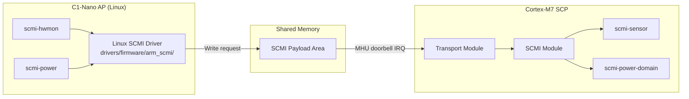

**SCMI protocols for Asimov:**

| Protocol | Purpose | Linux Driver |
|----------|---------|-------------|
| Base | Platform discovery | `arm_scmi` (built-in) |
| Power Domain | Core/cluster power on/off (CPU_ON/CPU_OFF only — no CPU_SUSPEND) | `scmi-power` |
| System Power | System suspend/shutdown/reset | — |
| Sensor | Temperature, voltage, current — **planned, not yet implemented** (thermal stack, [§3.5](#35-planned-modules) / [§8.2](#82-thermal-management)) | `scmi-hwmon` |
| AP Core (0x90, Arm vendor extension) | BL31 publishes the AP entry point via RESET_ADDRESS_SET (see [§3.4](#34-module-inventory)) | — (TF-A only) |

The **Performance** and **Clock** SCMI protocols are intentionally not implemented. Asimov runs at a
single Operating Point with no runtime DVFS (PTCR §3.1.9 / §5.8); the core clock is fixed for each
boot (design target 2.0 GHz, per-chip binning target set at boot — see [§4.3](#43-bl2--ram-firmware)
step 3), so neither protocol has a consumer — see [§8.4](#84-power-management-strategy).

Linux has upstream kernel drivers for the protocols Asimov implements or plans; no custom Linux code
is required.

#### MHUv3 Configuration

Asimov uses a single secure MHUv3 doorbell channel for PSCI/SCMI communication between the SCP and AP.
MHUv3 is unidirectional — two MHU-320AE r0p1 instances provide bidirectional communication:

- **AP→SCP (MHU-320AE inst 1):** AP postbox (PBX) sends the doorbell, SCP mailbox (MBX) receives
- **SCP→AP (MHU-320AE inst 2):** SCP postbox sends the doorbell, AP mailbox receives

SCMI uses **out-of-band transport** (SMT — Shared Memory Transport): the MHU carries only a doorbell
interrupt, the actual SCMI message payload lives in a shared SRAM region accessible to both the SCP
and AP.

**SCP firmware modules:** `mhu3` (hardware driver) → `transport` (SCMI transport HAL) → `scmi`
(protocol dispatcher) → `sds` (Shared Data Structures for TF-A).

**Address map (SCP side per `scp_mmap.h` / RTL `cmn_m7_subsys`; AP side per the TF-A port /
`cmn_periph_nic`):**

| Address | Component | Purpose |
|---------|-----------|---------|
| `0x44040000` | MHU-320AE inst 1 MBX (128 KB, SCP side) | SCP receives AP→SCP doorbell |
| `0x44060000` | MHU-320AE inst 2 PBX (128 KB, SCP side) | SCP posts SCP→AP doorbell |
| `0x2A920000` | MHU-320AE inst 1 PBX (128 KB, AP side) | AP posts AP→SCP doorbell |
| `0x2A940000` | MHU-320AE inst 2 MBX (128 KB, AP side) | AP receives SCP→AP doorbell |
| `0x46000000` | Shared-SRAM alias (4 KB, SCP side) | M7-local window onto the low 4 KB of the 64 KB shared SRAM (AP-side base `0x2A000000`); holds SDS (3520 B) + SCMI A2P payload (128 B) + SCMI P2A payload (128 B) |

**IRQ assignment:**

| IRQ | Source | Destination |
|-----|--------|-------------|
| M7 NVIC IRQ 4 | AP→SCP MHU inst 1 MBX doorbell | SCP receives SCMI request from TF-A/Linux |
| GIC SPI 113 (INTID 145) | SCP→AP MHU inst 2 MBX doorbell | AP receives SCMI response from SCP |

(M7 NVIC IRQ 5 — inst 2 PBX TX-complete — is wired in RTL but unused: `mod_mhu3` completes its
postbox writes synchronously over the M7 AHB, so a TX-complete interrupt adds no information.)

**Shared SRAM layout:**

| Offset | Size | Content |
|--------|------|---------|
| `0x0000` | 3520B | SDS (Shared Data Structures — platform ID, DRAM size, features) |
| `0x0DC0` | 128B | SCMI Secure A2P payload (AP writes, SCP reads) |
| `0x0E40` | 128B | SCMI Secure P2A payload (SCP writes, AP reads) |

### 8.2 Thermal Management

The SCP autonomously monitors on-die temperature sensors and takes corrective action. This runs independently of
the AP — even if Linux is unresponsive, the SCP protects the silicon.

**Thermal management loop:**

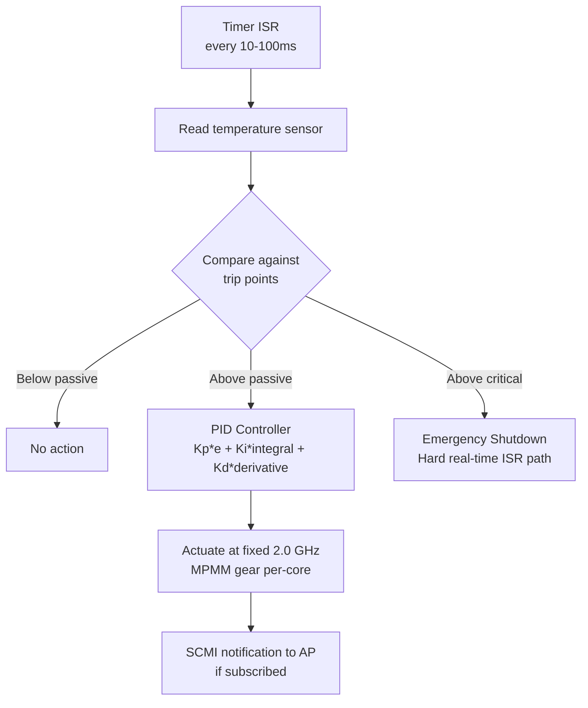

The actuator is intentionally **not** DVFS — Asimov has a single Operating Point. MPMM is the sole
fixed-frequency throttle actuator: the M7 enables it per-core and per-DSU via `cmn_dsu_mgmt`
`MPMM_EN` (per-core enables plus per-DSU CME and cluster enables) and monitors gear state
via `MPMM_STATE` (per-core) and `MPMM_CME_STATE` (per-DSU CME). (An earlier
Asimov-custom per-DSU `THROTTLE_CTRL` CSR was removed from the RTL as redundant with MPMM.)

Above the critical threshold the emergency path bypasses the PID and asserts board-level reset.

**Asimov-specific thermal considerations:**
- The SVL/SAL/TWS inference engines generate significant heat during workloads
- The SCP may need clock control over Hemisphere IP to throttle inference engines
- Emergency thermal shutdown must work even if AP cores are unresponsive

- [ ] **Investigation: Thermal sensor IP** — What temperature sensors are available on-die?
  The SCP needs register-mapped sensor access. A custom `asimov-sensor` module will be needed.
  Note: `cmn_cfg_mgmt` already exposes a register-mapped thermal interface on the M7 APB sub-decode
  (see [§7.3.1](#731-cmn-configuration-and-dsu-management-registers)): `TEMP_THRESHOLD`,
  `TEMP_HYSTERESIS`, and `TEMP_CURRENT` (read-only, hardware-sampled). The
  sensor input feeding `TEMP_CURRENT` is currently tied to zero in RTL pending sensor-IP integration.
- [ ] **Investigation: Hemisphere clock control from SCP** — Can the SCP throttle inference
  engine clocks, or only ARM core clocks?

### 8.3 Watchdog

The watchdog architecture follows the standard ARM CSS pattern of independent, self-monitoring hardware watchdogs.
Each processor kicks its own watchdog; the SCP does not actively poll AP liveness (see note below).

#### 8.3.1 SCP Self-Monitoring (SP805 / CMSDK Watchdog)

The SCP watchdog uses a watchdog timer at `SCP_PERIPHERAL_BASE + 0x6000` (standard ARM CSS offset used by every
reference platform: RD-N2, Morello, N1SDP, Juno, SGM775/776, SGI575). The upstream `module/sp805` driver
(`scp-firmware/module/sp805/`) handles all initialization and runtime servicing.

> **Asimov hardware note:** the watchdog IP is the **CMSDK APB Watchdog** (ARM IP package BP210,
> DDI0479) — register-compatible with SP805 (identical offsets, lock mechanism, two-stage timeout;
> only the PID part number differs), so the upstream `module/sp805` driver works unmodified.

**SP805 two-stage timeout mechanism:**

The SP805 is a 32-bit free-running down counter with a two-stage timeout. This two-stage design gives the processor
one full timeout period to respond before a hard reset occurs:

1. Counter loads value from `WDOGLOAD` and counts down on each `WDOGCLK` rising edge
2. **First timeout (counter reaches 0):** interrupt is asserted. Counter reloads from `WDOGLOAD` and continues
   counting down. On Asimov, this interrupt is routed to the M7 NMI (Non-Maskable Interrupt), matching the
   RD-N2/Morello convention — firmware bugs cannot accidentally mask it.
3. **If the NMI ISR clears the interrupt** (writes to `WDOGINTCLR`): counter reloads, normal operation resumes
4. **Second timeout (counter reaches 0 again without interrupt being cleared):** the SP805 asserts its
   `WDOGRESET` output signal, which routes to the SoC reset controller, triggering a full system reset

**How the SCP "pets" the watchdog (interrupt-driven, not polling):**

The SP805 module does **not** require an explicit "kick" call in the SCP event loop. Instead, the pet mechanism is
entirely interrupt-driven:

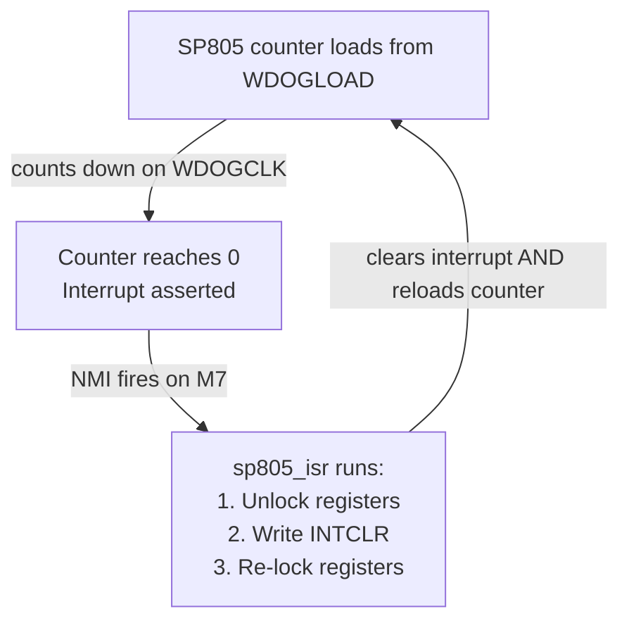

The proof that the SCP is healthy is that it can **service the NMI**. If the SCP is stuck in an infinite loop, hard
fault, deadlock, or stack corruption, it cannot take the NMI exception. The interrupt stays pending, the counter
reaches zero a second time, and `WDOGRESET` fires — resetting the entire system.

The watchdog is armed with no clock dependency, immediately at module start; it sits after the SCMI
communication stack but before the power-domain / boot-orchestration modules in the BL2 module list,
so it is counting before AP-core power-on, and from that point the NMI-driven pet keeps it serviced
through the remainder of boot and runtime. The register base (`0x44006000`) and the bark-to-NMI
routing are both confirmed by the RTL.

**Timeout calculation:** `timeout_per_stage = WDOGLOAD / WDOGCLK_frequency`. On Asimov, `WDOGCLK`
is `clk_ref` at 100 MHz (free-running, PLL-independent); the current placeholder load value gives
~2.7 seconds per stage and must be tuned to the desired timeout for the deployed clock.

**RTL status:** The CMSDK APB Watchdog (BP210, register-compatible with SP805) is integrated in
`cmn_m7_subsys.sv` at `0x44006000`. Key integration points:
- Bark interrupt routes to the M7 NMI line.
- `WDOGRESET` feeds the reset arbiter (`cmn_m7_reset_ctrl`); on bite, the arbiter asserts a
  full-scope warm reset across all 17 subsystem resets and latches `WDOGRESET_SYS` in
  `RESET_SYNDROME`. See [Section 8.6](#86-reset-arbitration).
- `WDOGCLK` is `clk_ref` (100 MHz, free-running, PLL-independent). An always-on 32 KHz domain
  would be ideal but is not required.

#### 8.3.2 AP Self-Monitoring (SBSA Generic Watchdog)

- Linux kicks the SBSA Generic Watchdog directly via MMIO register writes (upstream `sbsa_gwdt` driver)
- WS0 timeout fires an interrupt (Linux can attempt panic/kdump); WS1 timeout triggers hardware reset
- WS1 signal routes to the SCP or reset controller — the SCP's involvement is **passive** (receives signal, triggers
  reset)
- Discovered by Linux via ACPI GTDT table or device tree (`compatible = "arm,sbsa-gwdt"`)

> **Note:** There is no upstream SCMI watchdog/heartbeat protocol, and no SCP firmware module that actively polls AP
> liveness via shared memory. An SCP-side software heartbeat would be a custom vendor extension, warranted only if
> application-level liveness detection (beyond kernel-level SBSA watchdog) is required.

#### 8.3.3 Trusted Boot Guard (SP805, Secure Instance)

- TF-A BL1 enables a secure SP805 with 256-second timeout (per TBBR spec) during image load/authentication
- Disabled after boot completes; provides recovery if trusted boot hangs

#### 8.3.4 RTL Status

The CMSDK APB Watchdog (the SCP self-monitor described in [Section 8.3.1](#831-scp-self-monitoring-sp805--cmsdk-watchdog))
is integrated in the Asimov ASIC RTL, alongside the M7 reset arbiter that handles its bite path
(see [Section 8.6](#86-reset-arbitration)). The SBSA Generic Watchdog
([Section 8.3.2](#832-ap-self-monitoring-sbsa-generic-watchdog)) is a deliberate non-goal — the
host's PCIe-driver timeout backstops AP-hang detection. The Trusted SP805
([Section 8.3.3](#833-trusted-boot-guard-sp805-secure-instance)) is not applicable because TBBR
does not apply to Asimov's AP boot chain (see [Section 6.4](#64-ap-boot-security--tbbr-does-not-apply)).

### 8.4 Power Management Strategy

Asimov targets a **single runtime Operating Point** with **no runtime DVFS** (PTCR §3.1.9 / §5.8):
nominally 0.75 V VDD_CORE, 2.0 GHz core clock, 1.0 GHz AXI and 100 MHz APB. Cold boot begins on
the reference path; firmware must explicitly establish the selected runtime rate ([§3.5](#35-planned-modules)).
There is one core power domain with no on-die
power switches, no retention rails, and no level shifters between domains. All runtime power management
is therefore some form of clock gating or activity throttling at fixed frequency. The SCP firmware
exposes the following levers:

| Lever | Mechanism | Driver |
|-------|-----------|--------|
| Core ON / OFF | PSCI `CPU_ON` / `CPU_OFF` → SCMI Power Domain → `power_domain` → `ppu_v1` writes PWPR | Linux CPU hotplug, scheduler |
| Per-core idle clock gating | Core-internal WFI gating only; PPU autonomous-idle path intentionally unused (firmware pins each core PPU at static ON — see [§7.3.2](#732-ppu-power-management-architecture)) | Hardware (transparent to OS) |
| Per-core / per-DSU MPMM gear | ARM Max-Power-Mitigation via `cmn_dsu_mgmt`: `MPMM_EN` (per-core + per-DSU CME/cluster enables); gear state via `MPMM_STATE` (per-core) and `MPMM_CME_STATE` (per-DSU CME) — see [§8.2](#82-thermal-management) | SCP thermal loop |
| CME (SME2 unit) ON / OFF | CME0 PPU in dynamic mode (armed by `asimov_system` at core-ON — see [§7.3.2](#732-ppu-power-management-architecture)): hardware powers the CME on streaming-SVE use, off when all cores leave streaming state | Hardware (transparent to OS) |
| Complex / VPU domains | No PPUs — the complex bridge derives `PDCOMPLEX`/`PDVPU` from the core PPUs; VPU power-down hysteresis tunable per core via `IMP_CPUPWRCTLR_EL1.VPU_PWR_CTRL` (reset default in use) | Hardware (optional AP-side tuning) |
| Cluster / SoC clock-distribution gating | Multi-level ICG (coarse subsystem / medium block / fine register) | RTL (always-on); no firmware involvement |

The SCMI Performance and Clock protocols are not implemented. Linux's `cpufreq` and `scmi_clock`
subsystems have no consumer on Asimov.

PSCI `CPU_SUSPEND` is not exposed: there are no Linux-visible idle states beyond plain WFI, and the
firmware power-domain `allowed_state_mask_table` is ON/OFF only. Linux idle traps to WFI; the only
clock gating that occurs is at the core boundary (core-internal). The cluster clock keeps running.
Enabling PPU autonomous-idle (state-preserving FUNC_RET landing) is treated as future work — see
[Future work — state-preserving autonomous
idle](#future-work--state-preserving-autonomous-idle) under §7.3.2.

### 8.5 RAS and Error Handling

> **The RAS architecture — error-source inventory, signalling and routing, the fabric/DRAM-path
> error-capture design (error classes E1–E7, CMN error-record servicing, the Goldcrest link error
> surface), OS posture, and the watchdog-initiated diagnostic capture — is specified in the
> [Asimov RAS Architecture](./asimov_ras_architecture.md). This section is a summary of what is
> implemented today.**

The SCP can aggregate hardware error interrupts from across the SoC:
- CMN mesh errors (protocol violations, ECC errors)
- DRAM controller errors
- PCIe link errors
- Interconnect timeouts

**Implemented today:** the GIC-600 `fault_int` / `err_int` / `pmu_int` aggregator outputs route to M7
NVIC IRQ[16]–IRQ[18] (firmware-first RAS — see [§3.6](#36-nvic-and-interrupt-configuration) for the
wiring). SCP BL2 installs handlers for all three lines at start-of-day; each ISR counts the event and
latches the most-recent IRQ identity in a fault-syndrome buffer, logging at ERR level. Forwarding RAS
events to the AP is planned but not implemented — today the path is log-and-latch only. CMN
error-record servicing and Goldcrest link supervision are designed but not implemented (RAS
architecture §4.6.3/§4.6.4).

**AP-side error routing:** each DSU has a dedicated 17-signal GIC SPI slot carrying its RAS
error/fault (cluster, core, complex, CME), MPAM, PMU, communication, and CTI interrupts
([§11.6](#116-ap-interrupt-sources--gic-spi-map)). The HN-D RAS error and fault lines (Secure and
Non-secure) land on GIC SPI 10–13 and are additionally OR-ed onto a PCIe MSI-X critical-error
signal, so the host sees them as well.

### 8.6 Reset Arbitration

The reset arbiter (`cmn_m7_reset_ctrl`) at `0x44005000` is the single owner of warm-reset
sequencing in the M7 / CMN domain. It accepts processor/watchdog faults and debugger reset, drives synchronised
reset outputs to all 17 downstream subsystems (CMN, GIC, the 5 DSUs,
XMS/CPS/TWS/SLS/SPM/C2C/HRA/SMS, and PCIe0/1), exposes per-subsystem release control to firmware,
and accumulates reset-source flags in a sticky syndrome register that firmware reads on every boot.
Flags remain set until cleared; the register is not an exclusive most-recent-cause encoding.

#### Fault Inputs and Arbiter FSM

| Fault input | Trigger | Scope |
|-------------|---------|-------|
| Watchdog bite | CMSDK WDT second-stage timeout (the NMI ISR did not pet) | Full scope: all 17 subsystem resets (CMN, GIC, DSU0–4, XMS, CPS, TWS, SLS, SPM, C2C, HRA, SMS, PCIe0/1) plus the M7 |
| M7 LOCKUP | Cortex-M7 `LOCKUP` signal (unrecoverable fault loop) | Full scope |
| M7 SYSRESETREQ | Cortex-M7 `NVIC_SystemReset()` software request | Full scope |
| Debugger nSRST | External system-reset request, including its minimum-duration extension | Full scope; no separate syndrome field |

The reset controller forces all 17 `RESET_CTRL` holds high for every processor restart above, resets
SCP functional transport/peripherals along with the M7, and reruns the boot preloader. Debug and
reset-controller storage remain in the POR domain. The arbiter does not wait for outstanding bus
transactions to drain. Its configured reset pulse defaults to 16 live `hclk` cycles (minimum six);
watchdog reset remains asserted until the synchronized bite clears, and nSRST can extend the hold.
Firmware must reinitialize and deliberately release downstream subsystems after restart.

Watchdog, LOCKUP and SYSRESETREQ have independent sticky syndrome flags; simultaneous sources
can set multiple flags. CAR configuration survives an SCP warm reset, so restart is not equivalent
to cold clock entry. The local M7 PLL transport resets while CAR-side configuration remains.

#### Register Layout

The bit-level layout — offsets, field ranges, widths, access types, and reset values — is owned by
the PeakRDL-generated register guide ([§1.4](#14-outstanding-dependencies)). The firmware-visible
registers and their roles:

| Register | Role |
|----------|------|
| `RESET_CTRL` | Active-high holds at `[16:0]`: CMN `[0]`, GIC `[1]`, DSU0–4 `[6:2]`, XMS datapath `[7]`, CPS/TWS/SLS/SPM/C2C/HRA `[13:8]`, SMS management slices `[14]`, and independent PCIe0/1 controllers `[16:15]`. Reset `0x1FFFF` (all 17 held). |
| `RESET_STATUS` | Synchronised readback of those 17 hold states at matching bit positions, plus `pll_locked` at bit `[31]`. |
| `BOOT_STATUS` | Firmware-defined boot-progress markers. |
| `SCRATCH` | General-purpose scratch. |
| `RESET_SYNDROME` | Sticky reset-source flags: `POR` (until the next cold POR), watchdog bite (`WDOGRESET_SYS`), `SYSRESETREQ`, and M7 `LOCKUP`. Warm sources all have full managed-subsystem scope; flags accumulate until cleared. |
| `RESET_SYNDROME_CLR` | Write-1-clear for the warm-cause bits; the `POR` bit stays sticky until cold POR. |

**Live PLL-lock interlock.** CAR LOCK is connected through to both the reset controller and
`RESET_STATUS.pll_locked` (bit 31).
Each of the 17 subsystem outputs requires synchronized lock, a firmware release request,
controller self-ready and its minimum reset interval. Loss of lock reasserts those outputs and
restarts their minimum-pulse counters. This is synchronized logic requiring live clocks, not an
asynchronous clock-failure recovery mechanism. M7's own reset is separate and is not gated by LOCK.

PLL lock loss does **not** set the stored `RESET_CTRL` holds: with an all-clear mask, outputs can
release again automatically after lock returns and minimum intervals complete. Before intentional
PLL reset, firmware must explicitly hold affected subsystems and preserve control of their later
reinitialization/release. For Fixed-to-M7 takeover that preserves lock, use the running recipe
before asserting VLD ([§3.5](#35-planned-modules)). Lock readback does not certify fast-clock
selection: Fixed can report lock with `clk_core` still at 100 MHz.

The reset-arbiter block also folds in the SCP `CNTBase0` timer frame (base `0x44005100`,
[§4.4](#44-memory-layout)) — a standard single-frame Armv8-A generic-timer register set,
`CNTFRQ` = 1 GHz, compare IRQ → NVIC `IRQ[3]`.

#### Firmware Use

BL2 reads `RESET_SYNDROME` early in module init (in `asimov_system`) and logs the decoded reset
cause. The decoder checks warm-reset bits first and falls through to POR — POR is sticky and
would otherwise mask warm causes. The log line is emitted at `FWK_LOG_CRIT` priority so it
survives release builds.

Syndrome-driven recovery paths are not implemented; the boot-time read informs
diagnostics only.

#### Subsystem Reset Release at Boot

At POR every downstream subsystem (CMN, GIC, the 5 DSUs,
XMS/CPS/TWS/SLS/SPM/C2C/HRA/SMS, and PCIe0/1 — all 17 blocks) is held in external reset.
The SCP firmware must write its explicit `RESET_CTRL_BOOT_HOLD_MASK` policy before any
module touches those subsystems; without this write, `cmn_cyprus_start` would attempt mesh discovery
against a held-in-reset CMN and fail.

**Release is not initialization.** Clearing a hold bit only requests reset deassertion (the arbiter
still requires PLL lock and its per-block minimum assertion time before the block leaves reset), and
every block then needs its own configuration pass before carrying functional traffic: mesh SAM for
the CMN ([§7.1.1](#711-m7--cmn-access-topology)), redundancy images for TWS/SPM
([§4.5](#45-redundancy-configuration-tws-and-spm)), Goldcrest link bring-up for SMS/XMS/C2C
([§4.3](#43-bl2--ram-firmware) step 6), endpoint configuration for PCIe. The DSU bits are the
designed-in example: releasing them does not start the C1 cores
([§7.3](#73-ap-core-release-sequence)). Release order among blocks is firmware policy — the arbiter
imposes no cross-block interlock.

BL2 performs the release in `asimov_system_mod_init`, after the syndrome read and log:

1. Read `RESET_SYNDROME` and emit the boot-cause log line.
2. Program the reset-sampled `cmn_cfg_mgmt` straps — the per-DSU RVBAR slots, `CLUSTERIDAFF3`, and
   `CFGM_PERIPHBASE` ([§7.3.1](#731-cmn-configuration-and-dsu-management-registers)) — which the CMN
   samples at reset deassertion and which are read-only afterwards.
3. Write `RESET_CTRL_BOOT_HOLD_MASK = 0x00000` to request release of all 17 managed subsystems,
   including SMS and both PCIe controllers. PCIe PERST# remains an independent external
   link-reset input.
4. Confirm PLL lock and poll `RESET_STATUS[16:0]` until it matches the policy mask, with a bounded
   wait. Account for CDC and minimum-pulse latency; a single read immediately after the write
   does not establish completed release.
5. Poll `cmn_cfg_mgmt.CMN_STATUS.ready` with a **100,000-iteration bound** before the first mesh
   access — see [CMN logic-domain readiness poll](#cmn-logic-domain-readiness-poll).
6. Confirm that both reset release and CMN readiness succeeded before publishing the
   `MODINIT_DONE` boot marker or allowing mesh initialization. On failure, report the cause and
   prevent dependent accesses; apply the failure policy below.

- [ ] **Clock/reset admission failure policy.** Define bounded recovery or a boot stop when
  PLL lock, subsystem reset release or CMN readiness fails. The policy must use a valid early
  timebase and prevent dependent accesses while their prerequisites are unsatisfied.

##### Why `mod_init` and not `start`

The SCP firmware framework runs `init()` for **all** modules first, then `bind()`, then `start()`.
Requesting release in `asimov_system_mod_init()` places it before other modules' `start()`
callbacks. Successful completion still requires the hardware conditions above and a checked
release/readiness result. `cmn_cyprus_start` is the critical consumer: it programs the mesh.

##### Single-write release

A single policy write covers all 17 holds. The arbiter synchronises the 17-bit release request
through a single 2-flop CDC into its root-clock reset-sequencing domain and drives all 17 reset outputs,
registered in that domain, from there; any further crossing into a subsystem's own clock domain is
handled by that block's downstream reset synchroniser. A single write can request all releases,
but completion also waits for synchronized PLL lock and minimum-pulse counters. Their clock is
100 MHz on the reference path and nominally 2 GHz after the fast-clock switch; signal names alone
do not establish elapsed time. Firmware must check completion before dependent accesses.

The five DSU bits (`RESET_CTRL[2:6]`) need no staging either: releasing a DSU's `nRESET`
(`cmn.sv:3302`) does not start its cores. The C1-DSU is delivered with `PPU_RST_STATE = FALSE`
(hardcoded in the cluster top — `C1_DSU_DynamIQ_Cluster_1.sv:527`), so `nRESET` deassertion leaves
every in-cluster PPU in static mode, power policy OFF, holding its power domain in power-on reset;
the per-core `nCPUPORESET` is generated inside the DSU by the PPUs, not from SoC wiring (C1-DSU
TRM, ARM 107804, §5.2.2). No core can fetch from RVBAR until firmware runs the PPU cold-boot
power-up sequence ([§7.3](#73-ap-core-release-sequence)), so the C1 admission gate is the PPU
write — issued only after RVBAR, mesh SAM, and the OS image are in place — not the reset release.
Staging `RESET_CTRL[2:6]` until image-ready remains available as optional defense in depth, but is
not required for correctness.

Early DSU release is also safe with respect to downstream blocks that are not yet initialized
(Goldcrest links untrained, PCIe controller unconfigured). A released-but-PPU-OFF DSU keeps its
entire `PDCLUSTER` domain — including the CHI/mesh interface, SCU, and L3 — unpowered and held in
reset (C1-DSU TRM, ARM 107804, §4.3.2), comes out of reset in the CMN-S3 **DISABLED** system
coherency state with `SYSCOREQ` deasserted, and a DISABLED RN-F receives no snoop or DVM traffic
from the mesh (CMN-S3 TRM, ARM 107858, §2.3.8.1). Its CHI links stay in the STOP state with no
flits issued, mesh discovery requires no participation from it, and the reset arbiter has no
hardware coupling between the DSU bits and the XMS/C2C/HRA/PCIe bits (`cmn_m7_reset_ctrl.sv`). No
DSU-originated transaction can therefore reach an untrained XMS SBSX egress or an unconfigured
PCIe port before admission. This argument rests on three firmware/platform invariants during the
pre-admission window:

1. No PPU register is written before deliberate admission — in particular `PWR_DYN_EN` stays 0,
   since enabling dynamic transitions is admission-equivalent while `COREWAKEREQUEST` idles
   asserted ([§7.3.1](#731-cmn-configuration-and-dsu-management-registers)).
2. Debug power-up requests stay inactive: `cmn_dsu_mgmt.DBGPWRUP_CTRL` stays 0 and no external
   debugger asserts a DebugBlock granular power request during boot.
3. The CMN hardware `SYSCOREQ`/`SYSCOACK` handshake is left in charge of coherency admission: the
   first write to an RN-F port's `syscoreq_ctl` register permanently switches that port to
   software coherency control until the next mesh reset (CMN-S3 TRM, ARM 107858, §2.3.8.2), so
   firmware must not write `syscoreq_ctl` before cluster power-up.

- [ ] **Directed quiescence test.** The hold direction is architecturally specified and
  empirically corroborated on emulation, but no run has monitored the DSU CHI flit-valid,
  link-active, `SYSCOREQ`, XMS-egress, and PCIe ports through a released-but-PPU-OFF window with
  all 17 holds cleared at once. A directed test (simulation assertion bind plus an emulation
  confirmation) should convert the analysis into a measured guarantee.

##### Independent XMS and SMS hard-reset domains

`RESET_CTRL[7]` holds the XMS datapath and `RESET_CTRL[14]` independently holds the SMS
management slices. This removes the former hard-reset coupling, but firmware still must not
assert SMS reset while the AP executes from SMS-backed DRAM. Runtime XMS/C2C recovery should use
their block- or per-lane controls where possible and follow the Goldcrest retention/reload contract
once defined by the investigation in §3.5.

- [ ] **Validate Goldcrest recovery boundaries end to end.** Confirm which soft and hard resets
  preserve MCU SRAM and recover a live lane without collateral damage; map each failure class to
  retraining, MCU restart, or firmware reload.

##### CMN logic-domain readiness poll

Releasing CMN reset (above) only deasserts the reset; the CMN *logic domain* then completes its
P-channel ON handshake before the mesh is usable. The adjacent `cmn_cfg_mgmt` block exposes this
as a read-only `CMN_STATUS` register that reports
a ready flag plus the raw P-channel handshake state (`preq` / `paccept` / `pactive` / `pdeny` and
the P-channel `pstate`). After releasing the subsystem resets, BL2 polls the `CMN_STATUS` ready flag
over the local M7 APB sideband for up to **100,000 loop iterations** before the first HN-D access,
which `cmn_cyprus_start` issues later. This is not a 100 µs deadline: the system counter is still
halted during `mod_init` and is enabled in the platform `start()` callback. Poll duration depends
on the executing clock and bus latency, including reference-clock operation.

Firmware must observe readiness before issuing an HN-D access.
`cmn_m7_to_rni_axi_bridge` does not gate M7→HN-D `AR`/`AW` valids on `cmn_logic_ready`, so the
bridge provides no hardware barrier against an early access. A timeout must report the failure
and prevent mesh initialization. Recovery versus boot-stop behavior is defined by the clock/reset
admission failure policy above.

---

## 9. Release Management

### 9.1 Repository Architecture

The SCP firmware ships from a **wrapper repository** (`positron-ai/asimov-scp-firmware`) that treats
ARM's SCP-firmware as a versioned dependency: the upstream framework is a git submodule pinned to a
clean upstream commit (via a Positron mirror), and everything Asimov-specific — the BL1/BL2 firmware
definitions and the custom modules ([§3.4](#34-module-inventory)) — lives out-of-tree in the wrapper,
located through ARM's native `PRODUCT_PATH` / `SCP_MODULE_PATHS` mechanisms. No symlinks or forked
upstream history are required. Local fixes to ARM's source are carried as an explicit patch series
applied on top of the pinned submodule at build time until they land upstream, so the pin itself
always points at unmodified upstream code. Cross-repo dependencies are likewise pinned as
submodules, and a thin Makefile fronts the build.

The TF-A port follows the same pattern: `positron-ai/asimov-tfa` carries the platform port
out-of-tree, with upstream Trusted Firmware-A as an unpatched submodule pinned to a Positron mirror,
and its own pinned dependency submodules. Positron-side mirrors track the upstream projects; each
pin currently references a specific upstream commit (an ARM release tag once upstream releases carry
the fixes we depend on).

### 9.2 Versioning

SCP firmware releases are tagged `scp-vX.Y.Z`; TF-A releases are tagged `tfa-vX.Y.Z`. Both follow
semantic versioning:

- **Major:** Breaking changes to SCMI interface, flash layout, or hardware compatibility
- **Minor:** New features, new modules, new SCMI protocol support
- **Patch:** Bug fixes, performance improvements

Both wrapper repositories implement the same **version-provenance mechanism**: a build-time
generator derives the firmware version from git (bare semver on a release tag, a dev-annotated
revision otherwise) together with the pinned revisions of the design collateral the build targets —
including the silicon RTL commit — and emits it in two forms:

- a **version header** compiled into the firmware, printed as the boot banner at every boot
  (SCP BL1/BL2 — [§10.3](#103-boot-logging); BL31 — [§11.5](#115-tf-a-platform-port)), with a
  `(debug)` suffix on debug builds, so every boot log is self-identifying; and
- a machine-readable **`build-info.json`** with the same provenance, embedded in every release
  package alongside the binaries.

Release CI gates on this provenance: artifacts are not published if the embedded versions do not
resolve to release-tagged collateral or the build tree was dirty.

---

## 10. Debugging and Visibility

### 10.1 UART

The SCP uses a PL011 UART for boot console output and runtime logging. The SCP firmware framework provides
`FWK_LOG_*` macros that output via the `pl011` module. The SCP PL011 sits at `0x4400_0000` — a 4 KB APB
slot behind the AHB-to-APB bridge on the M7 peripheral bus (see the memory map in
[§4.4](#44-memory-layout)) — with its combined interrupt on NVIC `IRQ[0]`
([§3.6](#36-nvic-and-interrupt-configuration)).

The AP cores have their own PL011 console UART at `0x2A40_0000`, reached over the CMN HN-D peripheral
fabric (NIC-400) with its interrupt on GIC SPI 112 and UARTCLK = 100 MHz; TF-A BL31 and Linux use it as
their console (see [§11.4](#114-ap-debug-console)). The two UARTs are independent: SCP firmware owns
`0x4400_0000`, AP software owns `0x2A40_0000`.

- [ ] **Investigation: SCP UART physical routing** — How is the SCP UART exposed externally? Options:
  - Direct pin on the Galaxia card header - Routed through the BMC (BMC acts as UART bridge) - Accessible via JTAG
  debug probe

### 10.2 JTAG and CoreSight Debug

JTAG debug access is required for Asimov silicon bringup, firmware debugging, and post-mortem
analysis of deployed cards. The current proposal — pending sign-off from the ASIC team and the
Galaxia carrier-card team — is a two-mode debug architecture mediated by the Galaxia BMC, consistent
with the BMC-as-trust-boundary model in [Section 6.1](#61-trust-model).

#### Proposed Access Architecture

**Operational mode (default in deployed cards).** The Galaxia BMC owns the JTAG interface to
Asimov. Developers connect to the BMC via USB; the BMC presents a CMSIS-DAP (or equivalent)
software-proxy interface to the host. The BMC enforces access policy in concert with the SCP: the
on-die gate-mask for `DBGEN` / `SPIDEN` / `NIDEN` / `SPNIDEN` (see the
[debug-authentication block](#debug-authentication-block)) is programmable only from the M7, so the
BMC forwards a validated unlock request and SCP firmware applies the mask. No external
debug-probe header is exposed for operational use.

**Factory mode.** Asimov's TAP is part of a board-level JTAG chain alongside the BMC, SPI flash,
and other JTAG-capable devices on the Galaxia card. A manufacturing test fixture drives the chain
for boundary-scan verification and initial provisioning (BMC firmware, SPI flash content). After
end-of-line test, factory-mode access is permanently locked via an eFuse; the card boots in
operational mode thereafter and there is no software path back to the factory chain.

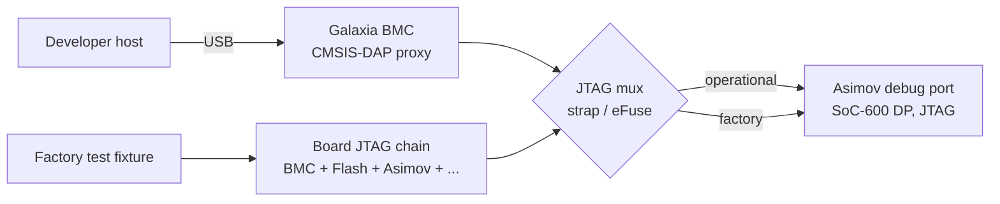

Asimov exposes a single CoreSight (SoC-600) debug port from which AXI-AP / AHB-AP / APB-AP fan-out
reaches all processors (the M7 SCP via the AHB-AP; all 10 C1-Nano cores via the APB-AP and the
per-cluster DSU debug blocks) and the CoreSight components in the CMN debug top (the system CTI/CTM
cross-trigger fabric; the trace sources — per-cluster DSU ATB, the CMN DTC, and the M7's ETM
instruction trace plus ITM; the ATB funnel; and the ETF/ETR/CATU trace sinks). The debug port is
JTAG-only — SWD support was removed during ARM design review — and the single TAP keeps host-side
tools (OpenOCD, pyOCD, Arm DS) straightforward.

#### Debug-Authentication Block

Debug authentication is CSR-driven — dedicated chip-level `DBGEN` / `NIDEN` / `SPIDEN` / `SPNIDEN`
authentication pads were removed during ARM design review. The `AUTH_CTRL` register (in
`cmn_cfg_mgmt`, reached over the M7-local APB sideband at `0x4400_4000` — see
[§7.3.1](#731-cmn-configuration-and-dsu-management-registers)) holds a gate mask with one bit per
authentication signal (`DBGEN`, `NIDEN`, `SPIDEN`, `SPNIDEN`), driving the DSU debug ports and the
CMN mesh authentication inputs.

`AUTH_CTRL` resets fully-enabled (auth on — the bringup posture). At silicon tape-out the
reset value is expected to be overridable by lifecycle-state (LCS) fuses, so production parts boot
with debug authentication locked down; that fuse path is not yet implemented (see open items).
There are no authentication pads — the register is the only gate.

This is the firmware-visible mechanism behind the operational-mode gating: `AUTH_CTRL` is reachable
only from the M7, over the same sideband used for the boot-time CMN straps, so SCP firmware sets the
debug-enable bits after validating an unlock token — for example one forwarded by the BMC — clears
them on session end, and can set the write-once `AUTH_LOCK` bit to freeze the mask until
the next reset.

The block does not implement the Armv9 RME equivalents `RLPIDEN` / `RLNIDEN`; if RME debug control
is in scope for production, an additional gating mechanism is needed.

#### Trace Strategy

Live high-bandwidth trace (per-core ETM) is not feasible across a BMC-bridged JTAG
path — JTAG TCK driven by a microcontroller-class debug proxy caps out far below the per-core ETM
stream rate. The realistic approach:

- The on-die system **TMC ETF** (32 KB buffer) for short capture windows, with the **TMC ETR +
  CATU** path to DRAM for larger captures.
- **Post-mortem dump** of the buffer via JTAG (BMC-mediated).
- **No TPIU off-chip pins.**

There are no TPIU pins, so continuous off-chip pin trace is not possible. The CoreSight-to-DRAM
path (ETR → CATU → mesh) exists in silicon; host-side egress of the captured buffer (e.g. over
PCIe) and any continuous-profiling use of it are out of scope here.

#### Cross-Trigger Fabric (ECT) and the M7's Role

The M7 SCP is one node on the SoC-600 system cross-trigger matrix (CTM). It carries a built-in CTI
(`CTI=1`), exposing 4-channel `CTICHIN` / `CTICHOUT` event I/O plus `CTIIRQ[1:0]` interrupt outputs.
The RTL wires:

- **M7 CTI ECT channels** — the M7's `m7_cti_event_out` / `m7_cti_event_in` trigger channels connect
  bidirectionally to the CMN debug top (`cmn_m7_top` ↔ `cmn_dbg_top`), placing the M7 on the system
  CTM for cross-halt and trace-trigger coordination.
- **tsgen halt/restart from the System CTI** — the system timestamp generator's `halt_req` /
  `restart_req` inputs are driven from System-CTI `event_out[5]` / `[6]` (`cmn_periph_nic`), so a
  debugger can freeze the system counter in lock-step with a cross-halt.
- **Trace egress to memory** — the ETR's CATU-translated output enters the mesh at a dedicated RN-I
  (NID 328; subordinate port S0 carries the CATU-translated ETR trace, S1 the AXI-AP debugger
  master), providing the silicon hardware for a CoreSight-to-DRAM trace path (host-side egress is
  out of scope here).
- **PCIe debug ingress** — a dedicated HN-I (NID 332) gives an external debugger a path onto the
  mesh from the PCIe side.
- **M7 `CTIIRQ[1:0]` into the NVIC** — routed to `m7_irq[29]` / `m7_irq[30]` (level-held until the
  CTI interrupt acknowledge), so the hardware path exists for the SCP to take an interrupt on an
  ETR `ACQCOMP` / ETF `FULL` event. However, the M7 has no register path to the CTI/ETF/ETR — those
  sit on the debug APB inside `cmn_dbg_top`, whose M7-facing ports are trace/auth-only — so firmware
  cannot acknowledge the level-held lines (CTI INTACK) or drain the buffers; it can at most observe
  a trigger once and mask the NVIC line. Firmware-driven trace-buffer drain (CoreSight Use Case 3)
  therefore remains blocked on an M7→debug-APB access path.
  The cluster-CTI `CTIIRQACK` round-trip, by contrast, is fully hardware (GIC `spi_r`) and needs no
  firmware involvement.

#### Open Items

- [ ] **Firmware trace-drain service.** The M7 CTI's `CTIIRQ[1:0]` reach the NVIC at `m7_irq[29]` /
  `m7_irq[30]`, but a drain service needs an M7→debug-APB access path (the lines are level-held
  until CTI INTACK, which the M7 cannot reach) — until that exists, firmware can at most
  observe-and-mask. Resolving the access path is an ASIC-facing question; the drain service itself
  is then firmware work.
- [ ] **RME debug-control signal gating.** If Armv9 RME (Realm Management Extension) debug control
  is in scope, an additional gate path for `RLPIDEN` / `RLNIDEN` is required — the
  [authentication block](#debug-authentication-block) only covers `DBGEN` / `SPIDEN` / `NIDEN` /
  `SPNIDEN`.
- [ ] **LCS-fuse override path for the `AUTH_CTRL` reset value.** Production parts should boot with
  debug locked down via an LCS-fuse-driven reset of the gate mask; the fuse-to-register path is not
  yet wired (engineering / bringup parts get the all-ones reset).
- [ ] **Mux mechanism — physical vs. logical.** A physical analog mux on TCK / TMS / TDI / TDO
  cleanly separates operational and factory paths but makes the mux-select line security-relevant.
  A logical-bypass scheme (BMC stays in the chain and asserts BYPASS on its own TAP when idle) is
  simpler but leaves a compromised BMC able to disturb the chain.
- [ ] **Mode selection — strap or fuse.** Operational vs. factory mode should be selected by a
  hardware strap or eFuse, not a runtime register. End-of-line test should burn the fuse to lock
  factory access. Post-production failure-analysis access (if needed) requires a separate
  signed-token mechanism, not a software-toggleable bit.
- [ ] **Trace buffer capacity review.** The system TMC ETF is 32 KB (`MEM_SIZE` = `0x2000` 32-bit
  words) and there are no per-cluster buffers — all cluster ATB funnels into the single
  system-level ETF. RTL review has flagged the FIFO as possibly undersized; confirm this capture
  window is adequate for post-mortem needs, or plan on the ETR-to-DRAM path for longer captures.
- [ ] **Asimov TAP placement in the factory chain.** If Asimov sits behind other TAPs in the
  board-level chain, the BYPASS-bit overhead for fixture programming is bounded but worth
  confirming.
- [ ] **JTAG pin-sharing on Asimov.** Confirm whether the debug-port (JTAG) pins are dedicated or shared with
  GPIO / boot-strap functions. Pin sharing complicates always-on debug.

### 10.3 Boot Logging

The SCP firmware logs boot progress via UART. Key boot milestones to capture:

1. BL1 entry — ROM firmware started
2. BL2 copy start/complete — Flash read timing
3. BL2 entry — RAM firmware started
4. Reset syndrome — decoded reset cause ([§8.6](#86-reset-arbitration))
5. Module init sequence — Each module's init success/failure
6. Identity warning — BL2's `asimov_sysinfo` shim logs the fixed (spoofed) product/chip identity
   (`chip_id=0`) until a real identity source exists
7. CMN discovery — Mesh topology detected
8. DRAM init — Controller configuration, training, size detected
9. PCIe init — Endpoint configured, link training status
10. AP release — RVBAR set, core released

#### Boot banner

Each stage (BL1 and BL2) prints a compact version banner with its first log output, via the
framework's custom-banner hook: the firmware version string (bare semver when built from a release
tag, a dev-annotated revision otherwise), the silicon RTL commit the firmware was built against, and
a pinned development-environment provenance record — all generated into a version header at build
time. Because release builds log at WARN and the happy boot path otherwise logs below that, each
stage forces a CRIT-priority entry message at start so the banner also appears in release builds.
The version string carries a `(debug)` suffix on debug builds. The same generated provenance also
feeds the machine-readable release manifest — see [§9.2](#92-versioning).

#### Log buffering

Release builds buffer log output in the framework's 4 KiB ring and drain it to the UART from the
idle loop; if the ring fills faster than the UART drains, new messages are dropped and a truncation
marker ("... and N more messages ...") is emitted once the ring empties. Debug builds log
unbuffered. BL1's boot-failure path flushes the ring before parking so the failure diagnostics are
never lost.

### 10.4 Boot-Status Register

The boot console ([§10.1](#101-uart)) is unavailable for the earliest part of SCP boot and may be
unavailable entirely in a deployed system. Two separate 4-bit boot-status registers give boot-progress visibility
that does not depend on the UART, for two different audiences:

| Register | Address | Visible to | Purpose |
|----------|---------|------------|---------|
| `BOOT_STATUS` | `0x4400_5008` | Debug only (JTAG / debug probe) | Internal breadcrumb: firmware boot-stage marker, drives no pins |
| `M7_BOOT_STAT` | `0x4400_4114` | BMC, via the `M7_BOOT_STAT[3:0]` pins | Board-visible boot state: hardware preloader codes, then firmware codes |

The SCP firmware publishes a boot-stage marker — a "POST code" — to `BOOT_STATUS` at every boot milestone.

The marker lives in `BOOT_STATUS`, a 4-bit software-writable / hardware-readable field in the
M7 reset-control block (`cmn_m7_reset_ctrl`) at `0x44005008`:

| Offset | Register | Width | Access | Description |
|:------:|----------|:-----:|:------:|-------------|
| `0x008` | `BOOT_STATUS` | 4 | RW (sw), RO (hw) | Firmware boot-stage marker — the boot-progress code table below. |
| `0x00C` | `SCRATCH` | 32 | RW (sw), RO (hw) | General-purpose scratch register, reserved for debug use (see below). |

This register is on the M7's local control-register sideband, which is reachable from the moment
the M7 leaves reset and has no dependency on the interconnect, the system address map, or any
subsystem coming out of reset. A write to `BOOT_STATUS` therefore always completes and can never
stall, independent of how far the rest of the system has progressed. This is what lets it report
progress before any higher-level transport (console, mailbox) is available, and lets it be read
back over a debug probe after a hang to localize where boot stopped. `BOOT_STATUS` is an internal breadcrumb only:
it drives no pins and is not a BMC interface; it is read over JTAG debug access.

The codes are monotonic across the boot sequence, so the value found in `BOOT_STATUS` after a
hang is the furthest milestone the firmware reached before stalling.

#### Boot-progress codes

| Code | Name | Milestone reached |
|:----:|------|-------------------|
| `0x0` | (reset value) | No marker written yet — firmware has not reached the first milestone. |
| `0x1` | `MODINIT_ENTRY` | System-support module initialization entered. |
| `0x2` | `MODINIT_DONE` | Reset-vector, configuration-aperture, and subsystem-reset programming complete; interconnect readiness checked. |
| `0x3` | `START_ENTRY` | Module start phase entered (all modules initialized). |
| `0x4` | `SYSCNT_DONE` | System counter enabled (system-wide timebase running). |
| `0x5` | `AP_EVENT_POSTED` | AP-boot work item queued. |
| `0x6` | `AP_EVENT_RUN` | AP-boot work item handler entered. |
| `0x7` | `DVM_DONE` | Interconnect distributed-virtual-memory domain configured. |
| `0x8` | `SETSTATE_DONE` | Primary AP core power-on requested. |
| `0x9` | `PRIMARY_CORE_ON` | Primary AP core power domain reached ON. |
| `0xA`–`0xF` | reserved | Reserved for debug instrumentation; not written by production firmware. |

Codes `0x1` through `0x9` are the production boot-progress contract: a healthy cold boot ends with
`BOOT_STATUS = 0x9`, and any lower value identifies the stage at which a stalled boot stopped
advancing. Codes `0xA`–`0xF` are reserved for ad-hoc debug instrumentation and are never written
by production firmware, so a value in that range unambiguously indicates a debug build.

The adjacent `SCRATCH` register (`0x00C`) is likewise reserved for debug use — production firmware
does not write it, leaving it free as a wider (32-bit) scratch word for debug instrumentation that
needs to stamp more than the 4-bit stage code.

#### BMC-visible boot state (`M7_BOOT_STAT`)

`M7_BOOT_STAT` is the boot state the BMC sees. It lives in `cmn_cfg_mgmt` at offset `0x114` (M7 address
`0x4400_4114`) and drives the `M7_BOOT_STAT[3:0]` package pins, one set per hemisphere, which are routed to the BMC.
It first reports the hardware boot stages that run before any firmware: the TCM preloader owns it while it holds
`CPUWAIT` (hardware writes take precedence over software during that window). Codes `0x0`–`0x5` are reserved for
these hardware stages; codes `0x6`–`0xF` are available to firmware.

| Code | Name | Owner | Stage |
|:----:|------|:-----:|-------|
| `0x0` | `RESET` | Hardware | In reset. |
| `0x1` | `INIT_TCM` | Hardware | Scrubbing ITCM and DTCM; the boot-ROM CRC check runs in parallel. |
| `0x2` | `LOAD_BL1` | Hardware | Copying the boot ROM into ITCM and draining the copy. |
| `0x3` | `WAIT_EFUSE` | Hardware | Waiting for eFuse policy and debug readiness. |
| `0x4` | `DONE` | Hardware | Done; `CPUWAIT` released and BL1 starts. |
| `0x5` | `CRC_FAILED` | Hardware | Boot-ROM CRC check failed ([§4.2](#boot-rom-image-and-integrity-check)); `CPUWAIT` held until the next SCP reset. |
| `0x6`–`0xF` | — | Firmware | Firmware-defined boot milestones and failure indications (not yet assigned). |

`DONE` reaches the output before `CPUWAIT` is released. From then until the next SCP reset, which restarts the
hardware sequence at `0x0`, the RTL lets firmware write any value. Firmware writes only codes `0x6`–`0xF`, so a
value of `0x0`–`0x5` on the pins always carries its hardware meaning. Current firmware does not write
`M7_BOOT_STAT` yet, so after a successful hand-off the pins read `0x4`.

The two registers are easy to confuse, and their codes overlap: `0x5` means `CRC_FAILED` in `M7_BOOT_STAT` but
`AP_EVENT_POSTED` in `BOOT_STATUS`. They also reset differently. `M7_BOOT_STAT` restarts on every SCP reset, while
`BOOT_STATUS` survives a warm reset so that the last boot's progress stays readable. After a warm reset that fails
the CRC check, `BOOT_STATUS` therefore still holds the previous boot's final stage. A debugger should read
`M7_BOOT_STAT` first: `BOOT_STATUS` can describe the current boot only once `M7_BOOT_STAT` reads `DONE` or a firmware
code, and only after firmware has written its first marker for this boot. The BMC sees only `M7_BOOT_STAT`.

- [ ] **Firmware `M7_BOOT_STAT` codes.** Assign the firmware codes `0x6`–`0xF` (which boot milestones and failure
  indications the BMC sees on the pins), together with the BMC boot-status contract.

---

## 11. C1-Nano AP Bootloader and Linux Host

> **Note:** The AP OS architecture details are TBD and will be workshopped after the SCP > firmware is further
along. This section covers the boot path and rationale; the runtime > software on the APs is covered in the >
[CSS Software Spec](../css_software/css_software_spec.md).

- [ ] **Investigation: C1-Nano OS decision (AD-001)** — bare metal vs RTOS vs minimal
  Linux. This is a CRITICAL decision that unblocks all C1-Nano firmware development. The architecture below
  assumes Linux.

### 11.1 Why TF-A Is Required

Armv9-A application cores such as the C1-Nano reset into the highest implemented Exception Level
(EL3). Linux enters at NS-EL2 (the C1-Nano implements EL2; BL31 sets the BL33 SPSR for the highest
implemented non-secure EL) and then configures EL2 for itself (VHE/KVM hyp stub) or drops itself to
EL1. An EL3 firmware must:

1. **Initialize EL3 state** — Exception vectors, security configuration registers
2. **Configure the GIC-600** — Some distributor/redistributor registers are EL3-only
3. **Drop to the non-secure world (NS-EL2)** and hand off to the Linux kernel
4. **Stay resident at EL3** to field SMC (Secure Monitor Call) traps from Linux at runtime

That last point is critical — TF-A BL31 is not a bootloader that runs and exits. It remains resident in secure
memory for the lifetime of the system, providing **PSCI** (Power State Coordination Interface) services to Linux:

| Linux Operation | PSCI Call | What Happens |
|----------------|-----------|-------------|
| Boot secondary cores | `cpu_on()` | SMC → BL31 → SCMI to SCP → PPU powers on core |
| CPU hotplug off | `cpu_off()` | SMC → BL31 → SCMI to SCP → PPU powers off core |
| System reboot | `system_reset()` | SMC → BL31 → SCMI to SCP → system reset |
| System shutdown | `system_off()` | SMC → BL31 → SCMI to SCP → power off |

**Without PSCI, Linux can only run on a single core and cannot reboot or shut down cleanly.** For 10 C1-Nano
cores across 5 DSU clusters, this is not viable. PSCI is the standard mechanism — the alternative (`spin-table`)
is a legacy method that lacks CPU hotplug, power management, and clean reboot support.

TF-A is the standard, battle-tested implementation of the EL3 Secure Monitor and PSCI for ARM platforms. It has
upstream support for GIC-600, C1-Nano (Nevis), SCMI, and SDS-based CSS platforms — all directly applicable to
Asimov. (CMN-S3 needs no TF-A driver: interconnect configuration is the SCP's responsibility.)

### 11.2 Boot Path — BL31 Direct to Linux

The full TF-A boot chain (BL1 → BL2 → BL31 → BL33) is designed for platforms where AP firmware needs to be
loaded from local storage and verified through a TBBR certificate chain. Asimov does not need this — the SCP
has already initialized the hardware, and the Phoenix host loads all AP images into DRAM via PCIe. TF-A supports
skipping directly to BL31 with `RESET_TO_BL31=1`.

Similarly, general-purpose bootloaders like U-Boot or GRUB are unnecessary. Their primary functions — hardware
discovery, DRAM initialization, loading kernels from storage, boot menus — are already handled by the SCP and Phoenix
host respectively. There is no local storage to boot from and no need for a boot menu on a PCIe endpoint accelerator.

The minimal boot path is:

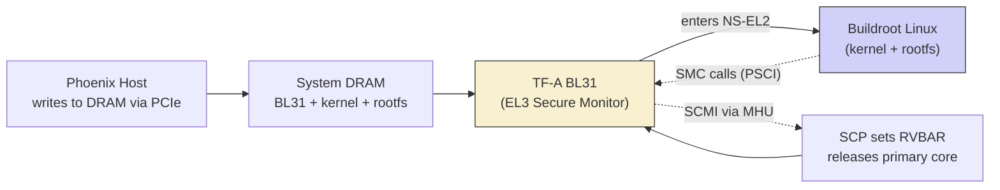

**Boot sequence:**

1. Phoenix host writes BL31 image + Linux kernel + rootfs into System DRAM via PCIe BAR
   (see [Section 7.2](#72-host-loaded-os-via-pcie))
2. SCP sets RVBAR to the BL31 entry point in DRAM
3. SCP releases the primary C1-Nano core from reset (PPU power-on)
4. Primary core begins executing BL31 at EL3
5. BL31 initializes EL3 exception vectors, security state, and GIC-600
6. BL31 sets up the SCMI transport to the SCP (shared-SRAM payload area, MHUv3 doorbell at
   `0x2A920000`). The SCP publishes SDS structures (firmware versions, platform ID, feature
   availability) in shared SRAM at `0x2A000000`; the current port does not consume them during
   boot — DRAM size and counter frequency are build-time constants (see
   [Section 7.4](#74-sds-handshake))
7. BL31 drops to NS-EL2 and jumps to the Linux kernel entry point, passing the DTB pointer in `x0`
8. Linux boots, brings up secondary cores via PSCI `cpu_on()` (each call goes through BL31 → SCMI → SCP → PPU)
9. BL31 remains resident at EL3, handling PSCI and secure SCMI traffic for the lifetime of the system

### 11.3 Security Architecture — TrustZone, RME, and PAS

The C1-Nano core is Armv9.3-A and does not implement RME (`FEAT_RME` is not implemented). Armv9 RME
defines four Physical Address Spaces (PAS), summarized here as background for the
security-architecture decision:

| PAS | Who uses it | Purpose |
|-----|------------|---------|
| Root | EL3 firmware (BL31) | Most privileged — manages all other worlds |
| Secure | Secure-EL1 (OP-TEE, trusted apps) | Traditional TrustZone secure world |
| Realm | Realm-EL1 (CCA confidential VMs) | ARM CCA confidential compute |
| Non-Secure | Linux, normal applications | Standard OS execution |

On a transaction from an AP core, the **core assigns the PAS tag** based on the current exception
level and security state. The **CMN GPC** (Granule Protection Check) is the enforcement point in
the interconnect — it checks whether the transaction's PAS is allowed to access the target physical
address. The **DRAM controller** sees flat physical addresses with no PAS awareness.

#### Asimov Does Not Require PAS Enforcement

As a PCIe endpoint accelerator running inference workloads, Asimov does not have the use cases that
motivate PAS enforcement:

- **No OP-TEE / secure world workloads** — there are no trusted applications, DRM, or secure
  storage on an inference accelerator. Secure-EL1 is unused.
- **No ARM CCA / Realm workloads** — confidential compute VMs are not applicable. Realm PAS is
  unused.
- **No multi-tenant isolation** — Asimov runs a single-tenant inference control plane. Hardware
  memory partitioning between tenants is not needed.
- **DRAM is flat physical memory** — the Credo/Weaver LPDDR5X controller presents a flat address
  space with no PAS splitting at the DRAM endpoint.

**Recommended architecture:** Flat DRAM, no GPC enforcement, no TZC-400. BL31 reserves a region
at the base of DRAM (2 MB at `0x80000000`), protected by a device tree `reserved-memory` node
that tells Linux not to map it. This is software-only protection — acceptable for a single-tenant
inference accelerator.

**TF-A build implications:**

| Flag | Value | Rationale |
|------|-------|-----------|
| `ENABLE_RME` | `0` (default) | No Realm Management Extension (`FEAT_RME` not implemented on C1-Nano) |
| `CTX_INCLUDE_EL2_REGS` | `0` | No Secure-EL2 payload (no SPM) — EL3 does not need to context-switch EL2 system registers; NS-EL2 is owned exclusively by Linux |

**Linux implications:** None. Linux functions identically with or without TrustZone hardware.
The kernel's PSCI support, SCMI drivers, and device tree handling are unaffected. No kernel
configuration changes are needed.

TODO(asimov): ASIC team must confirm that no PAS enforcement is needed. If GPC or TZC is required
for any reason (e.g., host isolation), the firmware will need updates.

#### SCP CMN Access Requires Root PAS

The Cortex-M7 SCP is ARMv7-M and natively generates only Secure PAS transactions. Several
CMN-S3 config registers — including RNSAM non-hashed regions and HN-F SAM — are Root-class
and silently RAZ/WI under non-Root PAS. Without a path that drives Root PAS on SCP config
writes, RNSAM programming is silently skipped and subsequent AP DRAM accesses SLVERR.

The ASIC must provide a mechanism that makes these Root-class CMN config registers writable by the
SCP. The SCP reaches CMN config space over its AXI master through the RN-I port (M7 AXIM → RN-I →
CHI → HN-D PERIPHBASE); the M7-to-RN-I bridge currently ties `AxNSE = 0`, so SCP transactions arrive
at the mesh as Secure PAS. The mechanism must either stamp Root PAS (`[NSE,NS] = 10`) on SCP
transactions destined for CMN config space at the bridge, or relax the affected registers'
PAS class. This is independent of the AP-side PAS enforcement decision above (no GPC, no
TZC-400) — that decision concerns AP transactions, not the SCP's config writes.

### 11.4 AP Debug Console

Asimov has two independent PL011 UART instances:

- The **SCP M7** owns the UART at `0x44000000` (boot + runtime SCP log, M7 NVIC `IRQ[0]` — see
  [Section 10.1](#101-uart)).
- The **AP cores** own the AP UART at `0x2A400000`, instantiated in the NIC-400 peripheral fabric
  (`cmn_periph_nic`) fed by the CMN HN-D AXI master. Its consolidated interrupt is GIC SPI 112 and
  UARTCLK = 100 MHz. BL31 uses it as the boot, runtime, and crash console, and Linux uses it as its
  serial console (DT `serial@2a400000` with a fixed 100 MHz `uartclk`).

The two instances have separate bus decodes (M7-local peripheral bus vs. mesh-routed HN-D → NIC-400
fabric) and separate interrupt paths (M7 NVIC `IRQ[0]` vs. GIC SPI 112). Console ownership splits
cleanly at the AP handoff: SCP firmware never touches the AP UART, and AP software never touches the
SCP UART. BL31 takes the AP UART once the SCP has released the AP cores — the AP UART is reachable
only after the SCP's RNSAM setup routes the AP peripheral fabric
([§7.1.1](#711-m7--cmn-access-topology)).

### 11.5 TF-A Platform Port

The Asimov TF-A platform port lives in [`positron-ai/asimov-tfa`](https://github.com/positron-ai/asimov-tfa)
under `platform/plat/asimov/`. It is a BL31-only port — TF-A's BL1/BL2 stages are not built (the SCP
performs the equivalent platform initialization), and BL31 is the only image that runs on the AP cores.
BL31 stays resident at EL3 to service PSCI for the lifetime of the system.

#### Build Configuration

Key flags from `platform.mk`:

| Flag | Value | Rationale |
|------|:-----:|-----------|
| `RESET_TO_BL31` | `1` | SCP performs all platform init; AP starts directly at BL31 |
| `PROGRAMMABLE_RESET_ADDRESS` | `1` | SCP writes RVBAR before releasing each core (see [Section 7.3.1](#731-cmn-configuration-and-dsu-management-registers)) |
| `COLD_BOOT_SINGLE_CPU` | `1` | SCP releases the primary only; secondaries come up via PSCI |
| `ARM_ARCH_MAJOR` / `ARM_ARCH_MINOR` | `9` / `2` | Build baseline. The core itself is Armv9.3-A; features above the baseline are enabled as runtime-checked (`=2`) `ENABLE_FEAT_*` flags (below) |
| `ARM_PLAT_MT` | `0` | Single-threaded cores. MPIDR uses the MT-style affinity layout — Aff2 = cluster (0–4), Aff1 = core (0–1), Aff0 = 0 — without relying on `MPIDR.MT`; platform-local topology code maps MPIDR to core position in place of the generic CSS mapper |
| `HW_ASSISTED_COHERENCY` | `1` | C1-DSU hardware-managed coherency |
| `USE_COHERENT_MEM` | `0` | Pairs with HW-assisted coherency |
| `ENABLE_PIE` | `1` | Position-independent BL31 |
| `PLAT_MHU_VERSION` | `3` | MHUv3 (matches SCP firmware — see [Section 8.1](#81-scmi-communication)) |
| `USE_GIC_DRIVER` | `3` | GIC v3 driver |
| `GICV3_SUPPORT_GIC600` | `1` | GIC-600 specific support |
| `GIC_ENABLE_V4_EXTN` | `0` | GICv4 (direct virtual-LPI injection) not supported — the GIC-600 instance has no ITS |
| `CSS_USE_SCMI_SDS_DRIVER` | `1` | Selects the SCMI + SDS CSS driver stack (vs legacy SCPI) for PSCI power control; the current port does not read SDS on the boot path |
| `CSS_LOAD_SCP_IMAGES` | `0` | TF-A does not ship SCP firmware images |
Architecture-feature configuration beyond the baseline (AMU, TCR2/SCTLR2/CLRBHB/Debugv8.9/CSV2,
AArch32 exclusion, and the mandatory C1-Nano SME/CME power-down erratum workaround) is enabled as
runtime-checked `ENABLE_FEAT_*` / errata flags in `platform.mk` — the build file is the
authoritative list. (`ENABLE_RME` is not set — `0` is the upstream default; see the
[Section 11.3](#113-security-architecture--trustzone-rme-and-pas) build-implications table.)

`PLAT_MAX_PWR_LVL = ARM_PWR_LVL1` (from `platform_def.h`, not `platform.mk`): PSCI exposes only core
and cluster power domains. There is no system-level PSCI power domain because Asimov has no system
PPU; the SCP-side SYSTOP domain is a firmware bookkeeping construct backed by `mock_ppu`
([§7.3.1](#731-cmn-configuration-and-dsu-management-registers)).

#### AP-Side Memory Map

BL31 maps two device regions in addition to the ARM common ranges. These addresses are provisional —
final values come from the system address map.

| Region | Base | Size | Contents |
|--------|:-----|:----:|----------|
| NIC-400 peripheral fabric + shared SRAM | `0x2A000000` | 9.375 MB (`0x960000`) | Shared SRAM (SDS + SCMI payload) at base; AP UART (PL011) `+0x400000`; system-counter CNTControl `+0x430000` / CNTRead `+0x800000`; MHU-320AE inst 1 PBX (AP→SCP doorbell) `+0x920000` (128 KB); MHU-320AE inst 2 MBX (SCP→AP doorbell) `+0x940000` (128 KB). Fed by the CMN HN-D AXI master |
| GIC-600 | `0x2C000000` | 1.5 MB (`0x180000`) | TF-A-mapped GICD/GICR span: GICD at base; architected GICR frame 0 at `+0x40000` (`0x2C040000`), `0x20000` stride across 10 PEs. Routed through the 64 MB RNSAM region to HN-I NID 236 |

Both regions are mapped `MT_DEVICE | MT_RW | EL3_PAS`. There is no TZC-400 configuration (`plat_arm_security_setup`
is a no-op, consistent with [Section 11.3](#113-security-architecture--trustzone-rme-and-pas)).

BL31 also maps its own image with split attributes — code read-only and executable (`MT_CODE`),
`.rodata` read-only and execute-never (`MT_RO_DATA`), and the rest of the image read-write — all in
the EL3 PAS, so a runtime write to const data faults instead of silently corrupting. The MMU is
enabled with the D-cache on.

**AP-side GIC SPI map** (SPI N = GIC INTID 32+N), sourced from the silicon `gic_spi_in[127:0]`
bundle:

| SPI | Source |
|-----|--------|
| `[3:0]` | SPM DMA[3:0] |
| `[6:4]` | tied 0 (GICD fault/err/pmu RAS is routed to the M7 NVIC `IRQ[18:16]` instead — [§3.6](#36-nvic-and-interrupt-configuration)) |
| `[8:7]` | reserved (HN-I) |
| `[9]` | ACP metadata-FIFO overflow |
| `[13:10]` | HN-D RAS — `[13]` fault(S), `[12]` fault(NS), `[11]` err(S), `[10]` err(NS); all four also OR-ed onto the PCIe MSI-X critical-error signal |
| `[14]` | HN-D PMU |
| `[16:15]` | reserved |
| `[24:17]` | DMA-350 inst 0/1 (per instance: channel, combined-NS, combined-S, security violation) |
| `[109:25]` | Per-DSU 17-lane slots (base 25, stride 17): cluster/core/complex/CME RAS, MPAM, PMU, COMM, and the SME2 complex CTI (`CTIIRQ[2]`) |
| `[111:110]` | Trace sinks: ETR buffer interrupt, CATU address error |
| `[112]` | AP UART |
| `[113]` | MHU inst 2 MBX (AP RX doorbell) |
| `[114]` | MHU inst 1 PBX (AP TX-complete) |
| `[119:115]` | Per-DSU cluster CTI `CTIIRQ[3]` (DSU0–4) |
| `[127:120]` | Design-block IRQs: SPM summary; C2C crit (also on PCIe MSI-X) / norm; CPS crit / norm; SLS norm / crit; XMS channel |

The device tree currently consumes only the AP UART (SPI 112); the per-DSU slots are defined by the
SPI collator in the CMN wrapper and will be consumed as the RAS/MPAM stack lands.

#### Platform Sources and Reused Drivers

The port itself is small: BL31 entry hooks and console init, PSCI topology and MPIDR-to-core-position
helpers for the Aff2 = cluster / Aff1 = core layout, the memory map and system-counter frequency
override, the platform definition header, and the device tree handed to Linux (PSCI 1.0 via SMC,
10 PEs across 5 clusters, non-monolithic GIC-600, the AP UART console node, DRAM at `0x80000000`).
Everything else is stock upstream TF-A: the GIC-600, MHUv3, SCMI, and SDS drivers, the PSCI
framework, the C1-Nano CPU support library, and the common CSS platform code — no upstream code is
forked or patched.

#### System Counter Frequency

BL31 needs the system counter rate for `CNTFRQ_EL0` programming. The system counter is a
`css600_tsgen` in the NIC-400 peripheral fabric, with CNTControl at `0x2A430000` (Secure-only —
non-secure accesses are dropped with PSLVERR) and CNTRead at `0x2A800000`. The SCP programs it over
the mesh after RNSAM setup — `CNTFID0` = 1 GHz, then `CNTCR.EN` — and its broadcast count feeds
every DSU `CNTVALUEB` and the M7's own counter frame. BL31 does not touch the control frame.

The current platform port returns a compile-time constant from `plat_get_syscnt_freq2`.

- [ ] **Publish the programmed counter rate via SDS.** The SCP should publish the rate it programmed
  into `CNTFID0`, with BL31 reading it during platform setup — keeping the AP's `CNTFRQ_EL0`
  consistent with whatever the SCP actually programmed instead of a build-time constant.

#### Boot-Fixed Clock Rate Handoff to Linux

The system counter is one of several rates whose actual value is not known at firmware build time. The
end-goal PLL target is **per-chip configurable via e-fuse** for silicon binning (see
[Section 4.3](#43-bl2--ram-firmware) step 3), so any clock derived from the PLL — including the AP
PL011 baud-generator clock and several peripheral clocks — has a per-chip-specific rate that must reach
Linux drivers without a compile-time constant. The same constraint will apply to any future peripheral
that takes a PLL-derived clock as input.

Asimov uses the standard ARM-SoC pattern: **firmware-side runtime fixup of DT (or ACPI tables) before
kernel handoff**. SCMI Clock Protocol is intentionally not advertised because the rate is fixed for the
lifetime of the boot — there is no DVFS to support — so Linux gets the per-chip-correct value through
DT/ACPI bindings that already exist for fixed-rate platforms and never needs to query the SCP at
runtime.

The data flow:

1. **SCP boot** — identify the current CAR source and retained clock
   state, then follow [§3.5](#35-planned-modules). Fixed requires explicit programming to leave
   the reference clock; strap-elected operation also requires PLL configuration. Complete
   required repair and the output-clock transition before deriving the achieved rate from the
   selected source/mux/dividers. LOCK confirms PLL status, not the selected core frequency;
   CAR's monitor observes `clk_div_fnl`, not necessarily the selected core-clock branch. Write
   the actual root and derived rates, plus other provisioning data, into the SDS
   boot-info structure for downstream firmware.

2. **BL31 platform setup** — `bl31_plat_arch_setup` reads the SDS region:
   - Returns the achieved arch-timer rate from `plat_get_syscnt_freq2`; ARM common BL31 code writes
     `CNTFRQ_EL0` from this value on every PE. See [System Counter Frequency](#system-counter-frequency)
     above.
   - Patches DT `clock-frequency` properties on the rate-bearing nodes before kernel entry. The
     pre-fixup DT in `asimov-tfa/platform/plat/asimov/fdts/` holds design-target defaults; BL31
     overwrites the values that depend on the achieved PLL rate (PL011 `clock-frequency`, any
     `fixed-clock` provider whose rate is PLL-derived).
   - When an ACPI-booted OS is in scope, equivalent fields in GTDT (counter frequency), SPCR
     (baud-rate base), and any clock-bearing `_DSD` properties get populated before EDK2 publishes the
     tables to the kernel.

3. **Linux boot** — drivers read DT or ACPI as if the values were known at build time. `clk_get_rate()`
   on a `fixed-clock` provider returns the per-chip-correct value; `clk_set_rate()` either no-ops or
   returns `-EINVAL`. No SCMI Clock involvement on any code path.

This pattern is what Tegra (U-Boot patches DT from OCOTP speedo), i.MX (U-Boot patches from OCOTP
fuses), and the ARM reference platforms (TF-A patches DT for `clock-frequency` properties on a few
specific nodes) all do for binnable boot-time clocks. The Linux driver code path is identical to a
truly-fixed-clock platform.

Open items in this area:

- [ ] **SDS boot-info struct layout for achieved PLL rate.** Format, offset, and version field within
  the SDS region. Coupled to the PLL architectural spec (which clock(s) become PLL-derived dictates how
  many rate fields land in the struct) and to the chip-personality discovery mechanism (binned target,
  chip serial, attached DRAM topology, disabled-block straps).
- [ ] **DT fixup implementation in BL31.** A `plat_arm_fdt_fixup` (or equivalent) hook in
  `asimov_bl31_setup.c` that reads the SDS region and walks the DT before kernel handoff, patching the
  rate-bearing nodes. Currently absent; BL31 only programs `CNTFRQ_EL0` via `plat_get_syscnt_freq2`.
- [ ] **ACPI table fixup path.** If/when the host loads an ACPI-based OS through EDK2, equivalent
  patching of GTDT counter frequency, SPCR baud-rate base, and any clock-bearing `_DSD` properties
  before EDK2 publishes the tables. Tracked separately from the DT path.
- [ ] **Pre-fixup DT defaults track the RTL peripheral fabric.** The DT carries the silicon-target
  AP UART node (PL011 at `0x2A400000`, GIC SPI 112, fixed 100 MHz `uartclk`); re-verify the
  rate-bearing nodes when the PLL lands.

#### BL31 Memory Placement

BL31 reserves a region near the base of DRAM (currently 2 MB at `0x80000000`, per [Section 11.3](#113-security-architecture--trustzone-rme-and-pas)).
The DTS marks the region `reserved-memory` so Linux does not map it. Final address and size will be
revisited when the system address map is finalized.

The Linux kernel image loads at `0x80200000`, immediately above the BL31 reservation, and the host
stages the device tree at `0x82000000`. BL31 enters the kernel with `x0` pointing at the preloaded
DTB, per the arm64 boot protocol.

#### BL31 Boot Banner

BL31 prints a provenance banner at NOTICE level ahead of the stock TF-A version lines: the firmware
version string (suffixed when built as a debug build) and the pinned revisions of the design
collateral it was built against — including the silicon RTL commit — taken from a
build-time-generated version header. NOTICE is at the release log level, so the banner prints in
release builds too. The banner format and generation mechanism mirror the SCP firmware's
([§10.3](#103-boot-logging)), and the same provenance is embedded machine-readably in release
packages ([§9.2](#92-versioning)).

### 11.6 AP Interrupt Sources — GIC SPI Map

Companion to the M7 NVIC map in [§3.6](#36-nvic-and-interrupt-configuration): this section enumerates every
interrupt delivered to the AP cores (the DSU/C1-Nano side) through the GIC-600 distributor. Authoritative source:
the `gic_spi_in[127:0]` concatenation in `asimov/design/css/cmn/rtl/cmn.sv` (`NUM_SPIS = 128`), snapshot at RTL
`d4302d895`. SPI index `n` corresponds to GIC INTID `n + 32`; Linux device-tree cells use the SPI index
(`GIC_SPI <n>`). Active-LOW sources are inverted at the GIC via `SPI_INV` configuration; all others are
active-HIGH level unless noted. Per-PE PPIs (INTID 16–31: generic timers, core PMU, etc.) are architectural
C1-Nano/DSU signals and are not repeated here.

#### Fixed lanes

| SPI | INTID | Source | Description |
|:---:|:-----:|--------|-------------|
| 0–3 | 32–35 | SPM DMA[0–3] | SPM DMA channel IRQs |
| 4–6 | 36–38 | *tied 0* | GICD `fault_int`/`err_int`/`pmu_int` are re-routed to the M7 NVIC (IRQ[16]–[18], [§3.6](#36-nvic-and-interrupt-configuration)); the AP-side route is disabled by the `GICT_ERRIRQCR<n>=0` reset default (GIC-600 TRM §3.16.5) |
| 7–8 | 39–40 | *reserved* | Kept for HN-I use |
| 9 | 41 | ACP metadata-FIFO overflow | From `cmn_cfg_mgmt` |
| 10 | 42 | HN-D NID64 RAS `err` (NS) | The four HN-D RAS lines (SPI 10–13) also OR-feed `cmn_msix_crit_irq` → PCIe MSI-X, so the host sees HN-D RAS as well |
| 11 | 43 | HN-D NID64 RAS `err` (S) | |
| 12 | 44 | HN-D NID64 RAS `fault` (NS) | |
| 13 | 45 | HN-D NID64 RAS `fault` (S) | |
| 14 | 46 | HN-D NID64 PMU overflow | |
| 15–16 | 47–48 | *reserved* | |
| 17 | 49 | DMA-350 inst 0 channel combined | |
| 18 | 50 | DMA-350 inst 0 `comb_ns` | Non-secure combined |
| 19 | 51 | DMA-350 inst 0 `comb_s` | Secure combined |
| 20 | 52 | DMA-350 inst 0 `sec_viol` | Security violation |
| 21–24 | 53–56 | DMA-350 inst 1 | Same four lanes, same order (channel / `comb_ns` / `comb_s` / `sec_viol`) |
| 25–41 | 57–73 | DSU0 slot | 17-lane per-DSU slot — layout below |
| 42–58 | 74–90 | DSU1 slot | |
| 59–75 | 91–107 | DSU2 slot | |
| 76–92 | 108–124 | DSU3 slot | |
| 93–109 | 125–141 | DSU4 slot | |
| 110 | 142 | *reserved* — ETR `bufintr` | Trace buffer (CoreSight), not yet driven |
| 111 | 143 | *reserved* — CATU `addrerr` | Not yet driven |
| 112 | 144 | AP UART (PL011) | Consolidated `UARTINTR` ([§10.1](#101-uart)) |
| 113 | 145 | MHU-320AE inst 2 `MBX` | AP RX doorbell — SCP→AP SCMI response ([§8.1](#81-scmi-communication)) |
| 114 | 146 | MHU-320AE inst 1 `PBX` | AP TX-complete — AP→SCP transmit acknowledged |
| 115–119 | 147–151 | DSU0–4 `CTIIRQ[3]` | Per-DSU cluster CTI trigger-out (debug/trace cross-trigger) |
| 120 | 152 | SPM block interrupt summary | |
| 121 | 153 | C2C critical-priority | Also routed to PCIe MSI-X PF1 vector 0 (host visibility) |
| 122 | 154 | C2C normal-priority | |
| 123 | 155 | CPS critical-priority | |
| 124 | 156 | CPS normal-priority | |
| 125 | 157 | SLS normal-priority | |
| 126 | 158 | SLS critical-priority | |
| 127 | 159 | XMS channel IRQ | Single consolidated line for the external-memory subsystem, including the aggregated Goldcrest sideband `INT` events (see the [RAS architecture](./asimov_ras_architecture.md) §4.6.4 for the source inventory and servicing design) |

#### Per-DSU slot layout

Each DSU occupies a contiguous 17-lane slot (`dsu_spi_slot()` in `cmn.sv`). SPI index = slot base + offset, with
bases 25 / 42 / 59 / 76 / 93 for DSU0–4. `n*` -prefixed signals are active-LOW at the DSU boundary and inverted
via `SPI_INV`; the CTI lane is active-HIGH.

| Offset | Signal | Description |
|:------:|--------|-------------|
| +0 | `nCLUSTERCRITIRQ` | Cluster critical RAS error |
| +1 | `nCLUSTERERRIRQ` | Cluster RAS error |
| +2 | `nCLUSTERFAULTIRQ` | Cluster RAS fault |
| +3 / +4 | `nCOREERRIRQ[0/1]` | Per-core RAS error (core 0 / core 1) |
| +5 / +6 | `nCOREFAULTIRQ[0/1]` | Per-core RAS fault |
| +7 | `nCMEERRIRQ` | CME (C1-SME2) RAS error |
| +8 | `nCMEFAULTIRQ` | CME RAS fault |
| +9 | `nCOMPLEXERRIRQ` | Core-complex RAS error |
| +10 | `nCOMPLEXFAULTIRQ` | Core-complex RAS fault |
| +11 | `nMPAMNSIRQ` | MPAM error (Non-secure) |
| +12 | `nMPAMSIRQ` | MPAM error (Secure) |
| +13 | `nCLUSTERPMUIRQ` | Cluster (DSU) PMU overflow |
| +14 / +15 | `nCOMMIRQ[0/1]` | Per-core debug communications channel |
| +16 | CME (C1-SME2) complex CTI `CTIIRQ[2]` (active-HIGH) | CME CTI trigger-out, acknowledged via `spi_r`. The RTL signal name (`dsu_cluster_cti_irq`) is misleading — per the C1-DSU pin description, `CTIIRQ[2]` is the SME2 complex CTI; the true DSU **cluster** CTI (`CTIIRQ[3]`) is on SPI 115–119 ([§10.2](#102-jtag-and-coresight-debug)) |

- [ ] **Investigation: DT/TF-A alignment check.** Cross-check the Linux device tree and any TF-A interrupt
  properties against this table once the DT lands; SPI 4–6 being dead (M7-routed RAS) and the `SPI_INV`
  programming for the active-LOW DSU lanes are the two easiest things to get wrong.

### 11.7 Buildroot Linux

The C1-Nano cores will run a minimal Buildroot Linux serving as the inference control plane.  Buildroot produces
a single image containing the kernel and rootfs.

- [ ] **Investigation: Buildroot configuration** — Define the minimal kernel configuration
  and rootfs contents. Key questions: - Which SCMI drivers are needed? (likely: `scmi-hwmon`,
  `scmi-power`) - What userspace application manages inference workloads?  - How does the AP Linux communicate
  with the Phoenix host?  - What is the kernel configuration for 10 C1-Nano cores across 5 DSU clusters?
